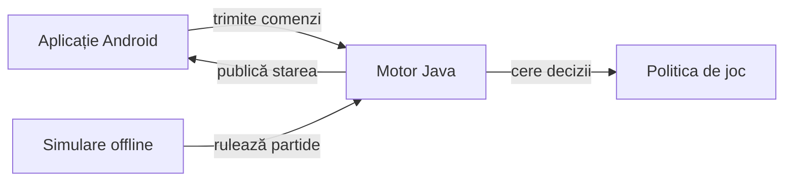

# Whist Lab

## Pe scurt

Whist Lab este un joc local de levate pentru trei până la șase locuri, cu adversari Normal sau Greu. Profilul principal este Whist românesc 1–8–1 la patru jucători. Interfața și instrucțiunile sunt disponibile în română și engleză.

## Jocul

- **[Whist Lab 0.21.2 pe GitHub](https://github.com/crististefanita/atf_j4/releases/tag/v0.21.2)** — ediție Android pentru utilizatorii autentificați.
- **[Descarcă APK 0.21.2](https://github.com/crististefanita/atf_j4/releases/download/v0.21.2/WhistLab-0.21.2.apk)** — pachet Android semnat, cu testele și documentația candidatei sincronizate.

## Cum se joacă

La fiecare mână licitezi câte levate vei lua. Urmezi culoarea cerută și joci atu dacă îți lipsește culoarea și ai atu. Scorul ține cont de precizia contractului, de serii și, în variantele românești, de opțiunea Joc la 0. [Regulile și variantele](docs/game/README.md)

## Arhitectura



<details>
<summary>Legendă și limite</summary>

Aplicația construiește interfața și salvează partida. Motorul deține legalitatea, tranzițiile și scorul. Politica decide pe baza mâinii proprii și a informației publice. Laboratorul folosește motorul pentru a compara politici pe aceleași distribuiri.

</details>

[Aplicația Android](whist-lab-app/README.md) · [Motorul comun](whist-lab-app/game-core/README.md) · [Livrarea iOS separată](docs/platform/ATF_iOSDelivery.md)

## Început rapid offline

Pentru o verificare scurtă a regulilor și a contextelor publice, rulează din rădăcină cu Java 21, PowerShell 7 și Node.js.

```powershell
.\scripts\run-whist-collection.ps1 -Collection quick
```

Lansatorul pregătește sursele într-un director temporar. Colecțiile offline lucrează fără emulator. [Colecții, precondiții și comenzi](docs/testing/ATF_Collections.md)

## Documentație

| Ce cauți | Unde începi |
|---|---|
| Reguli, scor și progres | [Regulile jocului](docs/game/README.md) · [Istoric](docs/game/ATF_ScoreHistory.md) · [Realizări](docs/game/ATF_Achievements.md) |
| Testare și guvernanță | [Strategia de testare](docs/testing/README.md) · [Guvernanța calității](docs/governance/README.md) |
| Instalare, versiuni și calificare | [Catalogul livrărilor](release/README.md) · [Livrarea Android](docs/platform/ATF_AndroidDelivery.md) · [Procesul RAG](docs/testing/ATF_ReleaseQualification.md) |
| Comportamentul adversarilor | [Arhitectura AI](docs/ai/README.md) · [Învățare și simulări](docs/learning/README.md) |
| Alte ghiduri | [Indexul documentației](docs/README.md) · [Feedback activ](docs/feedback/README.md) |

## Biblioteci comune

Infrastructura de testare consumă biblioteci binare versionate. Contractele folosite local se verifică prin adaptoare și teste de integrare. [Biblioteci, responsabilitate și sincronizare](docs/platform/README.md)
