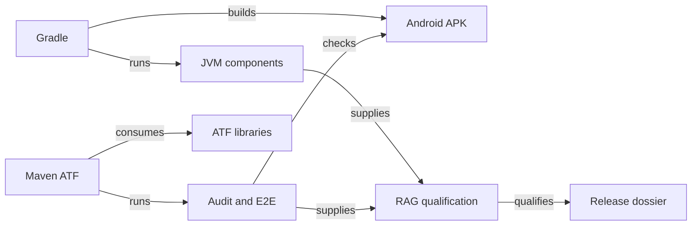
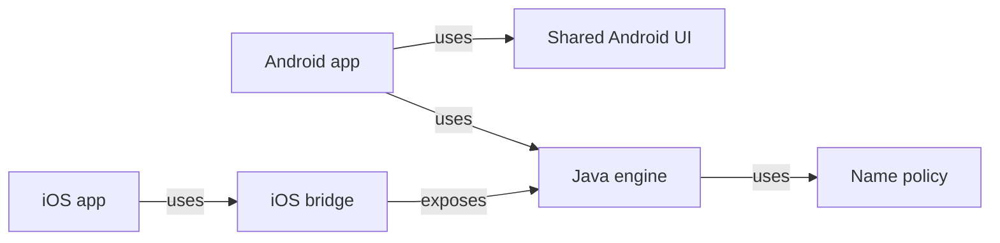

# Whist Lab

## Overview

Whist Lab is a local trick-taking game for 3–6 players, with an automation test framework (ATF) that verifies the engine, the apps and the release process. The same Java engine serves Android, Web and the iOS target. The lab compares playing policies on controlled deals.

## Game

- **[Download APK 0.21.11](https://github.com/crististefanita/whist/releases/download/v0.21.11/WhistLab-0.21.11.apk)**
- **[Play Whist online](https://crististefanita.github.io/whist/)**

## Module map

### From source to release

Gradle builds the APK and runs the JVM tests for the game. The Maven reactor adds the ATF infrastructure, on-device scenarios and project governance.



<details>
<summary>Legend for builds and evidence</summary>

- Gradle includes the Android app, the engine and the Java bridge for iOS. The native iOS build uses Xcode and the translated engine. The JVM build configures the engine, the lab, the player-name policy and test auditing.
- Maven checks the project and coordinates Android tests. It consumes Core, Reporting, Console, Mock and Test Kit from JAR/POM pairs. The Gradle audit uses Reporting and Test Kit in its test configurations.
- Qualification checks the test selection, the APK and the evidence together. The release dossier records the binary identity, the results and the download verification. [Qualification guide](docs/testing/ATF_ReleaseQualification.md)

</details>

### Engine and platforms

The engine validates commands, calculates scores and exposes game state. Android and iOS integrate it through their native builds. Web calls it through the JVM adapter or compiles it for GitHub Pages. [Android and Web integration](atf-ui-browser/README.md#what-android-and-web-share)



<details>
<summary>Legend for state ownership</summary>

- The engine owns the rules, the session, scoring and AI decisions. The AI policy receives its own hand and public table information.
- Android handles screen layouts, preferences and checkpoints. The shared UI library presents the table and emits user interaction intents.
- SwiftUI calls a narrow bridge into the engine translated with J2ObjC. The iOS target has its own simulator qualification. [iOS guide](docs/platform/ATF_iOSDelivery.md)
- The diagram shows the native build dependencies. The [Web adapter](atf-ui-browser/README.md#web-execution-paths) describes how Web uses the same engine and portable presentation contracts.

</details>

| Area | Modules and responsibilities |
|---|---|
| Engine and research | [`game-core`](whist-lab-app/game-core/README.md) owns the game domain. [`card-table-names`](whist-lab-app/card-table-names/README.md) validates and assigns player names. [`ai-lab`](whist-lab-app/ai-lab/README.md) evaluates policies offline through the [JVM build](whist-lab-app/algorithm-build/README.md). |
| Apps | [Android](whist-lab-app/app/src/main/java/ro/whistlab/app/README.md) integrates [`atf-card-table-ui`](whist-lab-app/atf-card-table-ui/README.md). [iOS](ios/README.md) calls the [Java bridge](whist-lab-app/ios-bridge/src/main/java/ro/whistlab/ios/WhistGameBridge.java). The [browser](atf-ui-browser/README.md) uses the compiled engine. |
| ATF infrastructure | [`atf-validation`](atf-validation/README.md) checks API response semantics. [`atf-test-android`](atf-test-android/README.md) runs ADB commands and scenarios. [`atf-tests`](atf-tests/README.md) checks integration, governance and release delivery. |
| Audit and execution | [`test-audit`](whist-lab-app/test-audit/README.md) captures Gradle comparisons. [`lib`](lib/README.md) stores libraries and their provenance. [`scripts`](scripts/README.md) sets up isolated runs. |
| Delivery | The [release catalog](release/README.md) identifies the available version and its qualification dossier. |

The entries below come from the [Gradle settings](whist-lab-app/settings.gradle) and the [root POM](pom.xml). Governance checks the module inventories, direct dependencies and their configurations. [Documentation governance](docs/governance/ATF_Documentation.md#main-readme)

<details>
<summary>Verified Maven and Gradle declarations</summary>

| Build | Declared modules |
|---|---|
| Maven | atf-validation, atf-test-android, atf-tests |
| Gradle | app, game-core, atf-card-table-ui, card-table-names, ai-lab, test-audit, ios-bridge |
| Gradle JVM | game-core, ai-lab, card-table-names, test-audit |

The direct dependency entries use the configuration declared by the consumer.

| Build | Consumer | Configuration | Direct dependencies |
|---|---|---|---|
| Maven | atf-validation | compile | atf-core |
| Maven | atf-validation | test | atf-test-kit |
| Maven | atf-test-android | compile | atf-core, atf-reporting, atf-test-kit |
| Maven | atf-test-android | test | atf-console |
| Maven | atf-tests | compile | atf-test-kit, atf-core, atf-test-android, atf-reporting |
| Maven | atf-tests | test | atf-console, atf-mock |
| Gradle | app | implementation | game-core, atf-card-table-ui |
| Gradle | game-core | implementation | card-table-names |
| Gradle | game-core | testImplementation | ai-lab |
| Gradle | ios-bridge | implementation | game-core |
| Gradle | shared fixtures | testImplementation | test-audit |

The Gradle table covers the default build modules and their direct dependencies. The `shared fixtures` row describes the shared test configuration. Maven lists direct dependencies in the ATF group and uses `compile` when the POM leaves the scope unspecified.

</details>

## Verification and guides

From the root, use Java 21, PowerShell 7 and Node.js. The quick collection checks game rules and public game contexts in a temporary copy. [Prerequisites and test collections](docs/testing/ATF_Collections.md)

```powershell
.\scripts\run-whist-collection.ps1 -Collection quick
```

| What you need | Where to start |
|---|---|
| Testing and governance | [Test strategy](docs/testing/README.md) · [Quality governance](docs/governance/README.md) · [Android checks](docs/testing/ATF_Android.md) |
| Qualification and publication | [RAG process](docs/testing/ATF_ReleaseQualification.md) · [Android delivery](docs/platform/ATF_AndroidDelivery.md) · [iOS delivery](docs/platform/ATF_iOSDelivery.md) |
| Game and AI | [Rules and variants](docs/game/README.md) · [Score history](docs/game/ATF_ScoreHistory.md) · [Achievements](docs/game/ATF_Achievements.md) · [AI architecture](docs/ai/README.md) |
| Documentation and open work | [Guide index](docs/README.md) · [Feedback](docs/feedback/README.md) |
