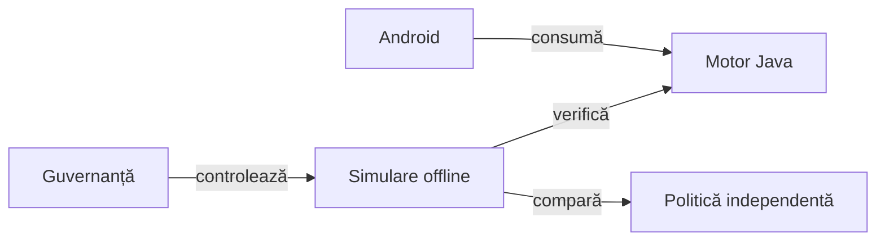

# Whist Lab și testarea Android

Whist Lab este un joc Android cu motor Java independent de interfață. Include
jucători automați, verificarea regulilor și a scorului prin teste de componentă,
evaluări offline și scenarii UI proprii. Experimentele compară politici pe distribuții controlate și observații publice.

## Jocul

[Instalare APK 0.1.5](dist/WhistLab-0.1.5.apk) · [Verificarea jocului pe mai multe ecrane](docs/WHIST_RESPONSIVE_UI_SANITY.md)

Profilul principal este Whist românesc, patru jucători, cu programul 1–8–1.
Jucătorul urmează culoarea cerută; când nu o are, joacă atu dacă are atu.
Motorul aplică regulile variantei selectate, inclusiv pachetul, ordinea
licitațiilor, restricția ultimei licitații și calculul scorului.

Un contract românesc exact primește `5 + levate`; abaterea se penalizează cu
numărul levatelor în plus sau în minus. Bonusul pentru o serie de cinci mâini eligibile
reușite se alege înaintea partidei: **5 sau 10**, implicit **10**; seria de
cinci ratări se penalizează cu **−5** când această opțiune este activă.

Interfața și instrucțiunile sunt disponibile în română și engleză.

Jocul are două niveluri. **Normal** urmărește levatele licitate și evită să treacă peste contract. **Hard** evaluează șansa contractului din informația publică, apoi poate căuta ratări la adversari când limitele jocului îi arată că propriul contract a devenit imposibil.

[Regulile și limitele variantelor](docs/GAME_RULE_PROFILES.md) explică diferențele de profil.

[Motorul jocului](whist-lab-app/game-core/README.md) leagă comportamentele de implementare și teste.

Doar mâinile de 2–8 cărți avansează seria. La o carte, un rezultat de același tip păstrează contorul, iar rezultatul opus îl întrerupe.

## Arhitectura



<details>
<summary>Legendă și limite</summary>

Motorul deține regulile și tranzițiile. Aplicația deține interacțiunea, iar mediul offline controlează comparațiile fără a transmite mâinile adverse politicilor. Guvernanța condiționează promovarea, fără actualizare automată în timpul jocului.

</details>

## Organizarea surselor

| Director | Responsabilitate |
|---|---|
| `whist-lab-app/app` | Aplicația Android: configurare, masă, interacțiuni, salvare și localizare. |
| `whist-lab-app/game-core` | Reguli, distribuire, licitare, levate, scor și politica de joc. |
| `whist-lab-app/algorithm-build` | Construirea JVM a motorului pentru lucru offline, fără SDK Android. |
| `whist-lab-app/ai-lab` | Experimente și evaluator independent; nu este inclus în aplicație. |
| `atf-test-android` | Adaptor ADB, captură și temporizare Android, audituri reutilizabile, componente și E2E Whist Lab. |
| `atf-test-kit`, `atf-mock`, `atf-validation`, `atf-console` | Suportul comun al testelor și al execuției. |
| `atf-tests` | Contracte ale adaptoarelor, integrarea bibliotecilor și guvernanța calității. |
| `config`, `scripts` | Colecții, reguli declarative, selecție de partide și lansatoarele Whist Lab. |
| `lib` | Biblioteci binare; versiunile efective sunt în POM, iar proveniența în `library-provenance.json`. |

Aplicația se construiește cu Gradle; infrastructura de testare folosește Maven.
Sunt două procese de construire distincte, cu responsabilități și dependențe diferite.

## Început rapid offline

Sunt necesare Java 21, PowerShell și Node.js pentru verificatoarele JSON.
SDK-ul Android este necesar pentru aplicație și testele Android; verificările
algoritmului au și o intrare JVM separată.

Din rădăcina proiectului, o verificare mică a regulilor și a contextelor publice:

```powershell
.\scripts\run-whist-collection.ps1 -Collection context
.\scripts\run-whist-collection.ps1 -Collection quick
```

Pentru regresia completă a componentelor:

```powershell
.\scripts\run-whist-collection.ps1 -Collection regression
```

Lansatorul pregătește sursele într-un director temporar și păstrează rezultatele
în depozitul extern de dovezi. Aceste colecții nu comandă emulatorul.
Parametrii și delimitarea colecțiilor sunt în
[catalogul colecțiilor](docs/TEST_COLLECTIONS.md).

[Arhitectura testării](docs/TESTING_ARCHITECTURE.md) explică nivelurile unitar, componentă, integrare și E2E, cu o matrice verificată față de cod. [Guvernanța calității](docs/ATF_QUALITY_GOVERNANCE.md) descrie verificările surselor și documentației.

## Cum dezvoltăm jucătorii

Pornim de la partide salvate și extragem situații mici cu intrări publice.
O mutare devine regresie numai după justificarea așteptării printr-o regulă,
un invariant sau un oracol finit; o înfrângere singură nu dovedește o greșeală.

Comparăm un candidat cu o politică fixată pe aceleași distribuții și locuri,
apoi îl verificăm pe partide nefolosite la ajustare. Păstrăm și rezultatele
negative; un candidat fără progres demonstrat nu înlocuiește politica acceptată.

Datele complete ale adversarilor sunt disponibile numai pentru auditul de după partidă.

Jucătorul primește propria mână și informația publică; cărțile ascunse nu intră
în API-ul de decizie. În experimentele pereche, fiecare profil joacă din nou
aceleași distribuiri la fiecare loc; după prima licitație sau carte diferită,
starea publică evoluează firesc pe linia acelui profil.

[Arhitectura învățării](docs/AI_LEARNING_ARCHITECTURE.md), [modelul deciziei](docs/AI_DECISION_MODEL.md), [regulile și ponderile](docs/AI_RULES_AND_CONFIGURATION.md), [corpusul de partide](docs/AI_CORPUS.md), [selecția pentru învățare](docs/AI_LEARNING_FOCUS.md) și [catalogul regulilor AI](docs/rules/AI_HAND_PATTERNS_RO.md) descriu fluxul.

Aceste evaluări măsoară comportamente pe domenii declarate, fără garanția că Hard va câștiga orice partidă cu informație ascunsă.

## Lucrul pe Android

Testele pe dispozitiv urmează verificărilor offline și cer un dispozitiv
identificat explicit, conectivitate ADB și acces exclusiv pe durata scenariului.
[Ghidul Android](docs/ANDROID_TESTING.md) descrie pregătirea și comenzile;
[aplicația](whist-lab-app/README.md) descrie procesul de construire și salvările.

Sursele rămân în proiect, compilările intermediare în directoare temporare,
iar partidele și celelalte dovezi în depozitul extern configurat. Nu se
suprascrie o execuție închisă pentru a o transforma în rezultat curent.

## Documentație

[Indexul documentației](docs/README.md) pornește de la arhitectură, reguli,
testare și contractele de date. Modificările de comportament trebuie însoțite
de actualizarea ghidului relevant și de o verificare potrivită acelui comportament.
