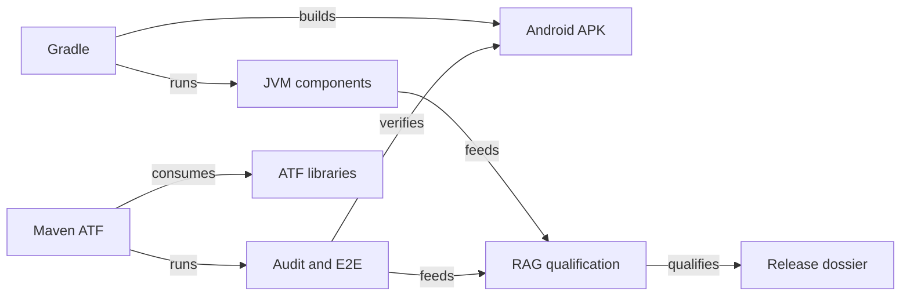
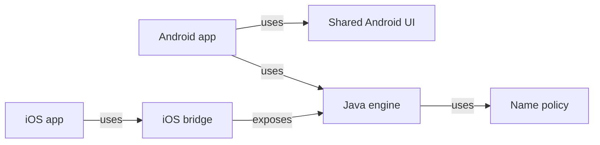

# Whist Lab

## Overview

Whist Lab combines a local trick-taking game for 3–6 players with an automation test framework (ATF) that verifies the engine, applications and delivery. The same Java engine serves Android, Web and the iOS target. The lab compares playing policies on controlled deals.

## Game

- **[Download APK 0.22.1](https://github.com/crististefanita/whist/releases/download/v0.22.1/WhistLab-0.22.1.apk)**
- **[Play Whist online](https://crististefanita.github.io/whist/)**

## Module map

### From source to release

Gradle builds the APK and runs JVM checks for the game. The Maven reactor adds ATF infrastructure, device scenarios and project governance.



<details>
<summary>Build and evidence legend</summary>

- Gradle includes the Android app, engine and Java bridge for iOS. The native iOS build uses Xcode and the translated engine. The Gradle JVM entry point configures the engine, lab, name policy and test audit.
- Maven verifies the project and coordinates Android tests. It consumes Core, Reporting, Console, Mock and Test Kit as JAR/POM pairs. The Gradle audit uses Reporting and Test Kit in its test configurations.
- Qualification checks the selection, APK and evidence together. The version dossier keeps binary identity, results and download verification. [Qualification guide](docs/testing/ATF_ReleaseQualification.md)

</details>

### Engine and platforms

The engine validates commands, calculates scores and provides state. Android and iOS integrate it through native builds. Web calls it through the JVM adapter or compiles it for GitHub Pages. [Android–Web path](atf-ui-browser/README.md#what-android-and-web-share)



<details>
<summary>State ownership legend</summary>

- The engine owns rules, session, score and AI decisions. The AI policy receives its own hand and the table's public information.
- Android owns screen adaptation, preferences and checkpoints. The shared visual library presents the table and emits interaction intents.
- SwiftUI calls the restricted bridge to the J2ObjC-translated engine. The iOS target has its own simulator qualification. [iOS guide](docs/platform/ATF_iOSDelivery.md)
- The diagram shows native-build dependencies. The [Web adapter](atf-ui-browser/README.md#web-execution-paths) explains the separate path for the same engine and portable display contracts.

</details>

| Area | Modules and responsibilities |
|---|---|
| Engine and research | [`game-core`](whist-lab-app/game-core/README.md) owns the domain. [`card-table-names`](whist-lab-app/card-table-names/README.md) validates and distributes names. [`ai-lab`](whist-lab-app/ai-lab/README.md) evaluates policies offline through the [JVM build](whist-lab-app/algorithm-build/README.md). |
| Applications | [Android](whist-lab-app/app/src/main/java/ro/whistlab/app/README.md) integrates [`atf-card-table-ui`](whist-lab-app/atf-card-table-ui/README.md). [iOS](ios/README.md) calls the [Java bridge](whist-lab-app/ios-bridge/src/main/java/ro/whistlab/ios/WhistGameBridge.java). [Browser](atf-ui-browser/README.md) uses the compiled engine. |
| ATF infrastructure | [`atf-validation`](atf-validation/README.md) evaluates API responses semantically. [`atf-test-android`](atf-test-android/README.md) runs ADB commands and scenarios. [`atf-tests`](atf-tests/README.md) verifies integration, governance and delivery. |
| Audit and execution | [`test-audit`](whist-lab-app/test-audit/README.md) captures Gradle comparisons. [`lib`](lib/README.md) keeps libraries with provenance, while [`scripts`](scripts/README.md) prepares isolated runs. |
| Delivery | The [catalog](release/README.md) identifies the available version and its qualification dossier. |

The declarations below come from [Gradle settings](whist-lab-app/settings.gradle) and the [root POM](pom.xml). Governance compares their inventories, direct dependencies and configurations. [Documentation governance](docs/governance/ATF_Documentation.md#main-readme)

<details>
<summary>Verified Maven and Gradle declarations</summary>

| Build | Declared modules |
|---|---|
| Maven | atf-validation, atf-test-android, atf-tests |
| Gradle | app, game-core, atf-card-table-ui, card-table-names, ai-lab, test-audit, ios-bridge |
| Gradle JVM | game-core, ai-lab, card-table-names, test-audit |

Direct dependencies use the configuration declared by the consuming module.

| Build | Consumer | Configuration | Direct dependencies |
|---|---|---|---|
| Maven | atf-validation | compile | atf-core |
| Maven | atf-validation | test | atf-test-kit |
| Maven | atf-test-android | compile | atf-core, atf-reporting, atf-test-kit |
| Maven | atf-test-android | test | atf-console |
| Maven | atf-tests | compile | atf-test-kit, atf-core, atf-test-android, atf-reporting |
| Maven | atf-tests | test | atf-console, atf-mock |
| Gradle | app | implementation | game-core, atf-card-table-ui |
| Gradle | game-core | implementation | card-table-names |
| Gradle | game-core | testImplementation | ai-lab |
| Gradle | ios-bridge | implementation | game-core |
| Gradle | shared fixtures | testImplementation | test-audit |

The Gradle table describes default-build modules and direct dependencies between them. The `shared fixtures` row describes shared test configuration. Maven lists direct dependencies from the ATF group and uses `compile` when a POM omits scope.

</details>

## Verification and guides

From the repository root, with Java 21, PowerShell 7 and Node.js, the quick collection checks rules and public contexts in a temporary copy. [Prerequisites and collections](docs/testing/ATF_Collections.md)

```powershell
.\scripts\run-whist-collection.ps1 -Collection quick
```

| Looking for | Start here |
|---|---|
| Testing and governance | [Test strategy](docs/testing/README.md) · [Quality governance](docs/governance/README.md) · [Android checks](docs/testing/ATF_Android.md) |
| Qualification and publication | [RAG process](docs/testing/ATF_ReleaseQualification.md) · [Android delivery](docs/platform/ATF_AndroidDelivery.md) · [iOS delivery](docs/platform/ATF_iOSDelivery.md) |
| Game and AI | [Rules and variants](docs/game/README.md) · [Score history](docs/game/ATF_ScoreHistory.md) · [Achievements](docs/game/ATF_Achievements.md) · [AI architecture](docs/ai/README.md) |
| Documentation and open work | [Guide index](docs/README.md) · [Feedback](docs/feedback/README.md) |
