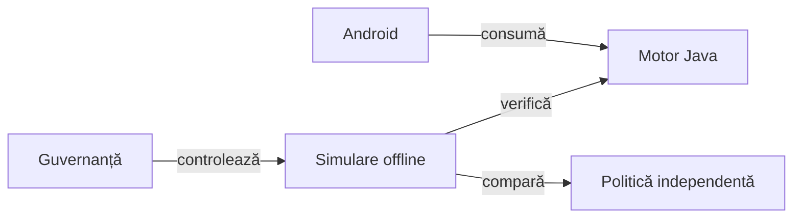

# Whist Lab: Android și motor comun

## Pe scurt

Whist Lab este un joc local Android, cu o țintă nativă iOS menținută separat.
Motorul Java comun este independent de interfață. Include jucători automați, reguli și
scor comune, teste de componentă și evaluări offline.

[Bibliotecile comune](lib/README.md) au un responsabil comun al codului și feedback-ului; aici păstrăm adaptoarele și acceptanța domeniului.

## Jocul

- **[Whist Lab 0.20.1 pe GitHub](https://github.com/crististefanita/atf_j4/releases/tag/v0.20.1)** — ediția Android curentă și asset-urile livrării.
- **[Descarcă APK 0.20.1](https://github.com/crististefanita/atf_j4/releases/download/v0.20.1/WhistLab-0.20.1.apk)** — APK Android semnat, găzduit pe GitHub.

[Livrare și instalare](docs/platform/ATF_AndroidDelivery.md) · [Verificarea jocului pe mai multe ecrane](docs/testing/ATF_Display.md)

- Profilul principal este Whist românesc, patru jucători, cu programul 1–8–1.
- Masa lasă un spațiu adaptiv între jucătorul de jos și cărțile din mână, păstrând pozițiile locurilor între licitare și joc.
- Jucătorul urmează culoarea cerută; dacă nu o are, joacă atu când deține atu.
- Motorul aplică regulile variantei selectate, pachetul, ordinea licitațiilor,
  restricția ultimei licitații și calculul scorului.

- Un contract românesc exact primește `5 + levate`; abaterea se penalizează cu
  numărul levatelor în plus sau în minus.
- Bonusul după cinci mâini eligibile reușite se alege înaintea partidei: **5 sau 10**,
  implicit **10**; seria de cinci ratări primește penalizarea în oglindă: **−5 sau −10**.

- Interfața și instrucțiunile sunt disponibile în română și engleză.
- Doar mâinile de 2–8 cărți avansează seria; la o carte, un rezultat de același tip păstrează contorul, iar rezultatul opus îl întrerupe.
- Numele omului se configurează din meniul inițial; adversarii primesc nume scurte aleatorii la fiecare partidă.
- [Istoricul comun](docs/game/ATF_ScoreHistory.md) și [clasamentele locale](docs/game/ATF_PlayerRecords.md) păstrează separat evoluția partidei și cele mai bune rezultate.
- [Realizările](docs/game/ATF_Achievements.md) urmăresc progresul local pe capitole; orice obiectiv poate avansa fără să blocheze celelalte.

Jocul are două niveluri. **Normal** urmărește levatele licitate și evită să treacă peste contract. **Hard** evaluează șansa contractului din informația publică, apoi poate căuta ratări la adversari când limitele jocului îi arată că propriul contract a devenit imposibil.

În ambele variante românești, opțiunea **Joc la 0** este bifată implicit. Un total final exact zero valorează 500 în clasament. Istoricul păstrează punctajul calculat după fiecare mână.

[Regulile și limitele variantelor](docs/game/README.md) explică diferențele de profil.

[Motorul jocului](whist-lab-app/game-core/README.md) leagă comportamentele de implementare și teste.

## iOS

Ținta SwiftUI este separată de APK-ul Android și se califică separat; ediția curentă livrează Android.
APK-ul nu se instalează pe iPhone sau iPad; pașii iOS sunt în
[ghidul dedicat](docs/platform/ATF_iOSDelivery.md).

## Arhitectura



<details>
<summary>Legendă și limite</summary>

Motorul deține regulile și tranzițiile. Aplicația deține interacțiunea, iar mediul offline controlează comparațiile fără a transmite mâinile adverse politicilor. Guvernanța condiționează promovarea, fără actualizare automată în timpul jocului.

</details>

## Organizarea surselor

| Director | Responsabilitate |
|---|---|
| `whist-lab-app/app` | Aplicația Android: configurare, masă, interacțiuni, salvare și localizare. |
| `whist-lab-app/game-core` | Reguli, distribuire, licitare, levate, scor și politica de joc. |
| `whist-lab-app/algorithm-build` | Construirea JVM a motorului pentru lucru offline, fără SDK Android. |
| `whist-lab-app/ai-lab` | Modul JVM: jucător independent, unelte și experimente offline; dependență doar pentru teste. |
| `atf-test-android` | Adaptor ADB, captură și temporizare Android, audituri reutilizabile, componente și E2E Whist Lab. |
| Test Kit JAR, `atf-validation` | Suportul comun al testelor, configurării și validării; sursa Kit are owner separat. |
| `atf-tests` | Contracte ale adaptoarelor, integrarea bibliotecilor și guvernanța calității. |
| `config`, `scripts` | Configurație declarativă și lansatoare comune; uneltele de domeniu sunt în modulele responsabile. |
| `lib` | Biblioteci binare; versiunile efective sunt în POM, iar proveniența în `library-provenance.json`. |

Aplicația se construiește cu Gradle; infrastructura de testare folosește Maven.
Sunt două procese de construire distincte, cu responsabilități și dependențe diferite.

## Început rapid offline

Sunt necesare Java 21, PowerShell 7 (`pwsh`) și Node.js pentru verificatoarele JSON.
SDK-ul Android este necesar pentru construirea aplicației și componentele ei JVM;
algoritmul și componentele adaptorului au intrări JVM separate, fără SDK.

Din rădăcina proiectului, o verificare mică a regulilor și a contextelor publice:

```powershell
.\scripts\run-whist-collection.ps1 -Collection context
.\scripts\run-whist-collection.ps1 -Collection quick
```

Pentru regresia completă a componentelor:

```powershell
.\scripts\run-whist-collection.ps1 -Collection regression
```

Lansatorul pregătește sursele într-un director temporar și păstrează rezultatele
în depozitul extern de dovezi. Aceste colecții nu comandă emulatorul.
Parametrii și delimitarea colecțiilor sunt în
[catalogul colecțiilor](docs/testing/ATF_Collections.md).

[Arhitectura testării](docs/testing/ATF_Architecture.md) explică nivelurile unitar, componentă, integrare și E2E, cu o matrice verificată față de cod. [Guvernanța calității](docs/governance/README.md) descrie verificările surselor și documentației.

## Cum dezvoltăm jucătorii

Politica primește mâna proprie și informația publică. Datele complete ale adversarilor aparțin auditului de după joc, iar progresul se califică înaintea promovării.

1. Extragem din partide o situație mică și justificăm așteptarea prin regulă, invariant sau oracol finit.
2. Comparăm candidatul cu o politică fixată pe aceleași distribuții și locuri; după prima alegere diferită, fiecare partidă își păstrează evoluția publică proprie.
3. Verificăm candidatul înghețat pe date nefolosite la ajustare și păstrăm rezultatele negative; promovarea cere progresul declarat.

| Întrebare | Ghid responsabil |
|---|---|
| Cum se ia decizia? | [Modelul deciziei](docs/ai/ATF_DecisionModel.md) și [configurarea regulilor](docs/ai/ATF_RulesConfiguration.md). |
| Cum alegem datele utile? | [Corpusul](docs/learning/ATF_Corpus.md) și [selecția pentru învățare](docs/learning/ATF_Selection.md). |
| Cum construim și calificăm o schimbare? | [Evoluția AI și lecțiile transferabile](docs/learning/ATF_PolicyEvolution.md), apoi [arhitectura AI](docs/ai/README.md). |

Evaluările au domenii și bugete declarate. Indiciile despre onoruri, estimările și certificatele finite sunt explicate separat în [ghidul tiparelor](docs/ai/ATF_HandPatternsRo.md).

## Lucrul pe Android

Testele pe dispozitiv urmează verificărilor offline și cer un dispozitiv
identificat explicit, conectivitate ADB și acces exclusiv pe durata scenariului.
[Ghidul Android](docs/testing/ATF_Android.md) descrie pregătirea și comenzile;
[aplicația](whist-lab-app/README.md) descrie procesul de construire și salvările.

Sursele rămân în proiect, compilările intermediare în directoare temporare,
iar partidele și celelalte dovezi în depozitul extern configurat. Nu se
suprascrie o execuție închisă pentru a o transforma în rezultat curent.

## Documentație

[Catalogul și dosarul versiunii curente](release/README.md)

[Indexul documentației](docs/README.md) pornește de la arhitectură, reguli,
testare și contractele de date. Modificările de comportament trebuie însoțite
de actualizarea ghidului relevant și de o verificare potrivită acelui comportament.

## Biblioteci comune

Reactorul păstrează modulele locale de testare și adaptoarele Android. [Contractul bibliotecilor comune](docs/platform/README.md) explică perechile binare din `lib`, identitatea lor și limitele acceptanței locale.
