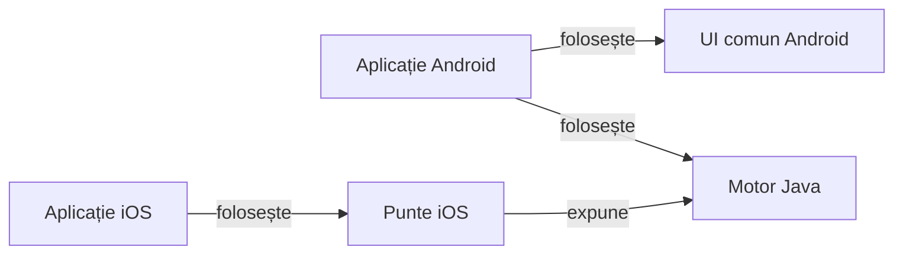

# Whist Lab

## Pe scurt

Proiectul reunește Whist Lab, un joc local de levate pentru 3–6 jucători, și infrastructura ATF care verifică regulile, aplicația și livrarea. Profilul principal este Whist românesc 1–8–1 la patru jucători. Jocul are două niveluri de dificultate și este disponibil în română și engleză.

## Jocul

- **[Whist Lab 0.21.3 pe GitHub](https://github.com/crististefanita/atf_j4/releases/tag/v0.21.3)** — ediție de test Android.
- **[Descarcă APK 0.21.3](https://github.com/crististefanita/atf_j4/releases/download/v0.21.3/WhistLab-0.21.3.apk)** — disponibil după autentificare cu un cont GitHub care are acces la proiect.

## Cum se joacă

La fiecare mână licitezi câte levate vei lua și urmezi culoarea cerută când o ai. În variantele românești, dacă nu ai culoarea cerută și ai atu, trebuie să joci atu. [Regulile, variantele și scorul](docs/game/README.md) explică diferențele dintre profiluri.

## Harta modulelor

Motorul Java decide dacă o comandă este legală și calculează starea următoare. Interfețele trimit comenzi, afișează starea și gestionează salvarea locală pe platforma lor.



<details>
<summary>Legendă: motorul și cele două interfețe</summary>

- Motorul deține regulile, scorul și politica adversarilor. Politica primește mâna proprie și informația publică a mesei.
- Android folosește componentele comune de masă, iar adaptorul Whist le furnizează datele și acțiunile jocului.
- SwiftUI apelează puntea către motorul tradus cu J2ObjC. Ținta iOS are [calificare separată](docs/platform/ATF_iOSDelivery.md).

</details>

| Zonă | Ce deține |
|---|---|
| [Motorul `game-core`](whist-lab-app/game-core/README.md) | Regulile și sesiunea Whist, legalitatea comenzilor, scorul, AI și datele necesare restaurării. [`card-table-names`](whist-lab-app/card-table-names/README.md) deține politica numelor. |
| [Aplicația Android](whist-lab-app/app/src/main/java/ro/whistlab/app/README.md) și [`atf-card-table-ui`](whist-lab-app/atf-card-table-ui/README.md) | Aplicația deține ecranele și checkpoint-ul Whist. Modulul comun oferă componente Android de prezentare pentru masa de joc. |
| [Aplicația iOS](ios/README.md) și [puntea către motor](whist-lab-app/ios-bridge/src/main/java/ro/whistlab/ios/WhistGameBridge.java) | Interfață SwiftUI, salvare locală și acces la motorul comun printr-un API restrâns. |
| [`ai-lab`](whist-lab-app/ai-lab/README.md) și [`algorithm-build`](whist-lab-app/algorithm-build/README.md) | Laborator offline, jucător independent, comparații pe aceleași distribuiri și intrare Gradle pentru verificările JVM. |
| [`test-audit`](whist-lab-app/test-audit/README.md) | Date de test și captură de comparații pentru componentele Gradle. |
| [`atf-validation`](atf-validation/README.md), [`atf-test-android`](atf-test-android/README.md) și [`atf-tests`](atf-tests/README.md) | Reactorul Maven: evaluare semantică API, adaptor ADB și scenarii Android, respectiv integrarea bibliotecilor, guvernanță și verificarea livrării. |
| [`lib`](lib/README.md) și [`scripts`](scripts/README.md) | Biblioteci ATF versionate cu proveniență și lansatoare care pregătesc și verifică rulările izolate. |

Configurațiile [Gradle](whist-lab-app/settings.gradle) și [Maven](pom.xml) declară modulele fiecărei construcții. [Ghidul aplicației](whist-lab-app/README.md) explică fluxurile de joc și relația dintre ecrane și motor.

<details>
<summary>Declarațiile verificate din Maven și Gradle</summary>

| Build | Module declarate |
|---|---|
| Maven | atf-validation, atf-test-android, atf-tests |
| Gradle | app, game-core, atf-card-table-ui, card-table-names, ai-lab, test-audit, ios-bridge |
| Gradle JVM | game-core, ai-lab, card-table-names, test-audit |

| Build | Consumator | Configurație | Dependențe directe |
|---|---|---|---|
| Maven | atf-validation | compile | atf-core |
| Maven | atf-validation | test | atf-test-kit |
| Maven | atf-test-android | compile | atf-core, atf-reporting, atf-test-kit |
| Maven | atf-test-android | test | atf-console |
| Maven | atf-tests | compile | atf-test-kit, atf-core, atf-test-android, atf-reporting |
| Maven | atf-tests | test | atf-console, atf-mock |
| Gradle | app | implementation | game-core, atf-card-table-ui |
| Gradle | game-core | implementation | card-table-names |
| Gradle | game-core | testImplementation | ai-lab |
| Gradle | ios-bridge | implementation | game-core |
| Gradle | fixture-uri comune | testImplementation | test-audit |

Tabelul Gradle descrie modulele buildului implicit și dependențele directe între ele. Rândul `fixture-uri comune` descrie configurarea partajată a testelor. Maven listează dependențele directe din grupul ATF și folosește `compile` când POM-ul omite scope-ul.

</details>

## Început rapid offline

Pentru o verificare scurtă a regulilor și a contextelor publice, rulează din rădăcină cu Java 21, PowerShell 7 și Node.js.

```powershell
.\scripts\run-whist-collection.ps1 -Collection quick
```

Lansatorul pregătește sursele într-un director temporar. Colecția rulează fără emulator. Alege nivelul potrivit în [strategia de testare](docs/testing/README.md) și consultă [catalogul comenzilor](docs/testing/ATF_Collections.md).

## Documentație

| Ce cauți | Unde începi |
|---|---|
| Reguli, scor și progres | [Regulile jocului](docs/game/README.md) · [Istoric](docs/game/ATF_ScoreHistory.md) · [Realizări](docs/game/ATF_Achievements.md) |
| Verificarea unei schimbări | [Guvernanța calității](docs/governance/README.md) · [Verificările Android](docs/testing/ATF_Android.md) |
| Versiuni, calificare și publicare | [Catalogul livrărilor](release/README.md) · [Procesul RAG](docs/testing/ATF_ReleaseQualification.md) · [Livrarea Android](docs/platform/ATF_AndroidDelivery.md) |
| Comportamentul adversarilor | [Arhitectura AI](docs/ai/README.md) · [Învățare și simulări](docs/learning/README.md) |
| Alte ghiduri | [Indexul documentației](docs/README.md) · [Feedback activ](docs/feedback/README.md) |
