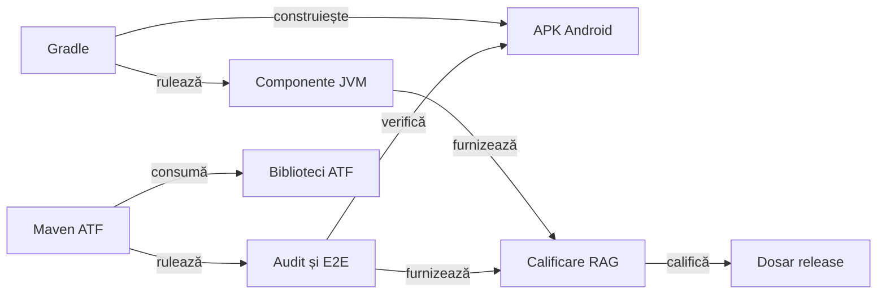
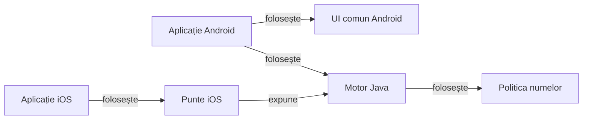

# Whist Lab

## Pe scurt

Proiectul reunește Whist Lab, un joc local de levate pentru 3–6 jucători, și infrastructura ATF care verifică motorul, aplicațiile și livrarea. Motorul Java deservește Android și ținta iOS, iar laboratorul compară politicile de joc pe distribuiri controlate.

## Jocul

- **[Whist Lab 0.21.3 pe GitHub](https://github.com/crististefanita/atf_j4/releases/tag/v0.21.3)** — ediție de test Android.
- **[Descarcă APK 0.21.3](https://github.com/crististefanita/atf_j4/releases/download/v0.21.3/WhistLab-0.21.3.apk)** — disponibil după autentificare cu un cont GitHub care are acces la proiect.

## Harta modulelor

### De la surse la livrare

Gradle construiește APK-ul și rulează verificările JVM ale jocului. Reactorul Maven adaugă infrastructura ATF, scenariile pe dispozitiv și guvernanța proiectului.



<details>
<summary>Legendă privind buildurile și dovezile</summary>

- Gradle include aplicația Android, motorul și puntea Java pentru iOS. Buildul nativ iOS folosește Xcode și motorul tradus. Intrarea Gradle JVM configurează motorul, laboratorul, politica numelor și auditul testelor.
- Maven verifică proiectul și coordonează testele Android. Consumă Core, Reporting, Console, Mock și Test Kit din perechile JAR/POM. Auditul Gradle folosește Reporting și Test Kit în configurațiile de test.
- Calificarea confruntă selecția, APK-ul și dovezile. Dosarul versiunii păstrează identitatea binarului, rezultatele și verificarea descărcării. [Ghidul calificării](docs/testing/ATF_ReleaseQualification.md)

</details>

### Motorul și platformele

Motorul validează comenzile, calculează scorul și furnizează starea. Aplicațiile afișează proiecțiile și păstrează salvarea locală.



<details>
<summary>Legendă privind proprietarii stării</summary>

- Motorul deține regulile, sesiunea, scorul și deciziile AI. Politica AI primește mâna proprie și informația publică a mesei.
- Android păstrează adaptarea la ecrane, preferințele și checkpoint-ul. Biblioteca vizuală comună oferă prezentarea mesei și emite intențiile de interacțiune.
- SwiftUI apelează puntea restrânsă către motorul tradus cu J2ObjC. Ținta iOS are o calificare proprie pe simulator. [Ghidul iOS](docs/platform/ATF_iOSDelivery.md)

</details>

| Zonă | Module și responsabilități |
|---|---|
| Motor și cercetare | [`game-core`](whist-lab-app/game-core/README.md) deține domeniul. [`card-table-names`](whist-lab-app/card-table-names/README.md) validează și distribuie numele. [`ai-lab`](whist-lab-app/ai-lab/README.md) evaluează politicile offline prin [buildul JVM](whist-lab-app/algorithm-build/README.md). |
| Aplicații | [Android](whist-lab-app/app/src/main/java/ro/whistlab/app/README.md) integrează [`atf-card-table-ui`](whist-lab-app/atf-card-table-ui/README.md). [iOS](ios/README.md) apelează [puntea Java](whist-lab-app/ios-bridge/src/main/java/ro/whistlab/ios/WhistGameBridge.java). |
| Infrastructură ATF | [`atf-validation`](atf-validation/README.md) evaluează semantic răspunsuri API. [`atf-test-android`](atf-test-android/README.md) execută comenzi ADB și scenarii. [`atf-tests`](atf-tests/README.md) verifică integrarea, guvernanța și livrarea. |
| Audit și execuție | [`test-audit`](whist-lab-app/test-audit/README.md) capturează comparațiile Gradle. [`lib`](lib/README.md) păstrează bibliotecile cu proveniență, iar [`scripts`](scripts/README.md) pregătește rulările izolate. |
| Livrare | [Catalogul](release/README.md) identifică versiunea disponibilă și dosarul de calificare. |

Declarațiile de mai jos provin din [setările Gradle](whist-lab-app/settings.gradle) și [POM-ul rădăcină](pom.xml). Verificarea confruntă inventarele, dependențele directe și configurațiile lor. [Guvernanța documentației](docs/governance/ATF_Documentation.md#readme-ul-principal)

<details>
<summary>Declarațiile verificate din Maven și Gradle</summary>

| Build | Module declarate |
|---|---|
| Maven | atf-validation, atf-test-android, atf-tests |
| Gradle | app, game-core, atf-card-table-ui, card-table-names, ai-lab, test-audit, ios-bridge |
| Gradle JVM | game-core, ai-lab, card-table-names, test-audit |

Dependențele directe folosesc configurația din modulul consumator.

| Build | Consumator | Configurație | Dependențe directe |
|---|---|---|---|
| Maven | atf-validation | compile | atf-core |
| Maven | atf-validation | test | atf-test-kit |
| Maven | atf-test-android | compile | atf-core, atf-reporting, atf-test-kit |
| Maven | atf-test-android | test | atf-console |
| Maven | atf-tests | compile | atf-test-kit, atf-core, atf-test-android, atf-reporting |
| Maven | atf-tests | test | atf-console, atf-mock |
| Gradle | app | implementation | game-core, atf-card-table-ui |
| Gradle | game-core | implementation | card-table-names |
| Gradle | game-core | testImplementation | ai-lab |
| Gradle | ios-bridge | implementation | game-core |
| Gradle | fixture-uri comune | testImplementation | test-audit |

Tabelul Gradle descrie modulele buildului implicit și dependențele directe între ele. Rândul `fixture-uri comune` descrie configurarea partajată a testelor. Maven listează dependențele directe din grupul ATF și folosește `compile` când POM-ul omite scope-ul.

</details>

## Verificare și ghiduri

Din rădăcină, cu Java 21, PowerShell 7 și Node.js, colecția rapidă verifică regulile și contextele publice într-o copie temporară. [Precondiții și colecții](docs/testing/ATF_Collections.md)

```powershell
.\scripts\run-whist-collection.ps1 -Collection quick
```

| Ce cauți | Unde începi |
|---|---|
| Testare și guvernanță | [Strategia de testare](docs/testing/README.md) · [Guvernanța calității](docs/governance/README.md) · [Verificările Android](docs/testing/ATF_Android.md) |
| Calificare și publicare | [Procesul RAG](docs/testing/ATF_ReleaseQualification.md) · [Livrarea Android](docs/platform/ATF_AndroidDelivery.md) · [Livrarea iOS](docs/platform/ATF_iOSDelivery.md) |
| Joc și AI | [Reguli și variante](docs/game/README.md) · [Istoric](docs/game/ATF_ScoreHistory.md) · [Realizări](docs/game/ATF_Achievements.md) · [Arhitectura AI](docs/ai/README.md) |
| Documentație și lucrări deschise | [Indexul ghidurilor](docs/README.md) · [Feedback](docs/feedback/README.md) |
