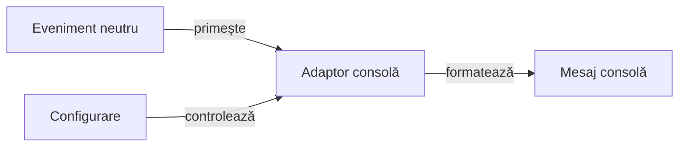

# Proiecția consolei

## Pe scurt

Modulul transformă evenimentele neutre de execuție în mesaje pentru consola configurată. Politica de afișare nu modifică verdictul testului sau semnificația evenimentului.

## Responsabilități



<details>
<summary>Legendă: proiecție diagnostică</summary>

Consola consumă evenimentele evaluate de test. Afișarea mesajelor și notificarea căii unui rezultat publicat au politici independente.

</details>

| Sursă | Responsabilitate |
|---|---|
| [AtfConsoleReporter](src/main/java/atf/console/AtfConsoleReporter.java) | Primește evenimente și aplică politica afișării. |
| [AtfConsoleFormatter](src/main/java/atf/console/AtfConsoleFormatter.java) | Formatează mesajele. |
| [AtfConsoleConfigurationLoader](src/main/java/atf/console/AtfConsoleConfigurationLoader.java) | Încarcă setările și valorile implicite. |
| [AtfConsoleTestExtension](src/main/java/atf/console/junit/AtfConsoleTestExtension.java) | Izolează ciclul JUnit pe invocare și restaurează contextul anterior. |
| [AtfConsoleTestContext](src/main/java/atf/console/junit/AtfConsoleTestContext.java) | Context explicit, inclusiv pentru testele dinamice. |

O metodă `TestFactory` este un container. Fiecare copil dinamic își deschide propriul ciclu prin API-ul contextului; containerul nu substituie rezultatul fiecărui copil.

Dezactivarea mesajelor nu dovedește publicarea unui rezultat. Calea finală se notifică după închiderea proprietarului și existența rezultatului.

## Niveluri și verificare

| Nivel | Contract |
|---|---|
| Unitar | Configurare, formatare și politici de afișare. |
| Integrare | Legătura dintre extensii, contexte și ciclul JUnit. |

[Arhitectura testării](../docs/TESTING_ARCHITECTURE.md) definește matricea comună. Dintr-o copie temporară proprie, cu POM-ul părinte și dependențele reactorului:

```powershell
mvn -B -pl atf-console -am test
```

[POM-ul](pom.xml) și [testele](src/test/java/) definesc contractele efective.
