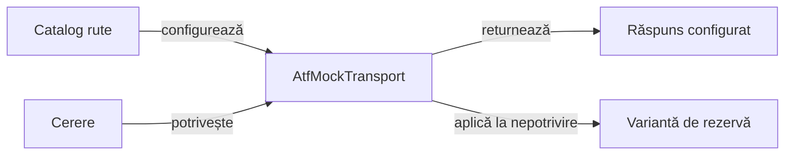

# Transport API simulat

## Pe scurt

Modulul implementează un transport API determinist pentru verificări fără serviciu extern. Catalogul de rute definește răspunsurile controlate; regulile și simularea partidelor aparțin motorului Whist.

## Responsabilități



<details>
<summary>Legendă: răspuns controlat</summary>

Transportul răspunde din catalog sau din configurația de rezervă. Acest rezultat nu dovedește apelarea unui serviciu real.

</details>

[AtfMockTransport](src/main/java/atf/mock/AtfMockTransport.java) aplică ruta potrivită. [Încărcătorul](src/main/java/atf/mock/AtfMockConfigurationLoader.java) definește calea explicită, descoperirea și prioritatea configurației.

[MockRoute](src/main/java/atf/mock/MockRoute.java) compară metoda, calea, parametrii, antetele și corpul cererii. Răspunsul configurat rămâne neschimbat.

## JSON și precizie numerică

| Suprafață | Contract |
|---|---|
| Document complet | Conținutul după rădăcină, rădăcinile multiple și cheile duplicate imbricate sunt refuzate. |
| Absență | Așteptarea absentă în YAML diferă de valoarea JSON `null`. |
| Tipuri | Obiectele și tablourile YAML nu devin tacit absența constrângerii. |
| Precizie | Numerele JSON și YAML se compară prin `BigDecimal`, fără conversie intermediară la `Double`. |
| Egalitate | Formele zecimale egale sunt eligibile; numărul și șirul rămân distincte. |
| Nepotrivire | Diferențele de precizie ori magnitudine ajung la răspunsul de rezervă. |
| Transport | Corpul cererii și răspunsul configurat nu sunt rescrise. |

## Nivel și verificare

| Nivel | Contract |
|---|---|
| Componentă | API-ul transportului, catalogul YAML și potrivirea exactă, cu așteptări independente. |

[Arhitectura testării](../docs/TESTING_ARCHITECTURE.md) definește matricea comună. Dintr-o copie temporară proprie, cu POM-ul părinte și dependențele reactorului:

```powershell
mvn -B -pl atf-mock -am test
```

[Contractele numerice](src/test/java/atf/mock/json/MockNumericContractComponentTest.java) verifică și răspunsul de rezervă. [POM-ul](pom.xml) definește dependențele.
