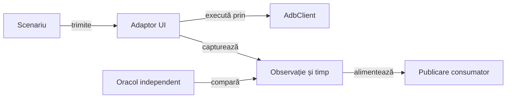

# Infrastructura și testele Android Whist Lab

## Pe scurt

Modulul reunește adaptorul ADB, captura și temporizarea Android, audituri reutilizabile și scenariile Whist Lab. Componentele locale și fluxurile pe dispozitiv au selecții explicite; fiecare verificare distinge comanda, observația și comparația independentă.

Infrastructura deține execuția și captura, iar scenariul deține sensul acțiunii și rezultatul așteptat. Construirea APK-ului, instalarea și acceptanța interacțiunii au contracte separate.

## Flux și responsabilități



<details>
<summary>Legendă: infrastructură și domeniu</summary>

Adaptorul ADB păstrează rezultatul comenzii delimitate. Adaptorul UI interpretează starea observată, iar oracolul verifică proprietatea scenariului; biblioteca comună primește datele tipizate ale publicării.

</details>

## Organizarea surselor

| Zonă | Contract |
|---|---|
| [AdbClient](src/main/java/atf/android/AdbClient.java) | Dispozitiv explicit, durată maximă, ieșiri text sau binare. |
| [TableViewportAudit](src/main/java/atf/android/whist/evidence/TableViewportAudit.java) | Compară o singură observație a mesei; E2E și componentele folosesc același oracol, cu date reale ori simulate. |
| [Captură](src/main/java/atf/android/evidence/AndroidScreenshotEvidence.java) și [temporizare](src/main/java/atf/android/evidence/timing/) | PNG original, ceas monoton, intervale și serializare. |
| [Audituri Whist](src/main/java/atf/android/whist/evidence/) | Verificări pure și publicarea indexului extern. |
| [Scenarii și oracole](src/test/java/atf/android/e2e/) | Navigare, extragerea stării, actori și comparații ale jocului. |
| [Suportul de flux](src/test/java/atf/android/e2e/support/) | Puncte de control, jurnal parțial și publicare individuală sau agregată. |

[POM-ul](pom.xml) adaugă sursele motorului și ale jucătorului independent numai în setul de surse de test. Profilul `responsive-sanity` folosește selecția restrânsă declarată în POM; configurația normală rămâne intrarea pentru setul complet de componente.

## Contracte de execuție

- Fiecare comandă are dispozitiv identificat și durată maximă; succesul transportului și tranziția semantică au verdicte distincte.
- PNG-ul integral și ierarhia aparțin aceluiași punct de control verificat.
- Dreptunghiurile logice UIAutomator sunt mapate la rasterul fizic înaintea comparațiilor de pixeli.
- Ceasul fazei pornește înaintea primei acțiuni și păstrează intervalele parțiale la eșec.
- Execuția, captura, jurnalul și publicarea păstrează axe temporale distincte.
- Indexurile și rezultatele se scriu extern; [contractul publicării](../docs/reporting/ATF_Handoff.md) definește identitatea și acceptarea lor.

## Verificare fără dispozitiv

Dintr-o copie temporară proprie, cu POM-ul părinte, bibliotecile și un depozit Maven propriu:

```powershell
mvn -B -pl atf-test-android -am '-Dtest=AndroidComponentSuite,AndroidPhaseClockTest,AndroidPhaseTimingCodecTest,AndroidUiFlowTimingComponentSuite' '-Dsurefire.failIfNoSpecifiedTests=false' '-Datf.android.enabled=false' test
```

[AndroidComponentSuite](src/test/java/atf/android/suites/AndroidComponentSuite.java) verifică ADB controlat și capturi. [AndroidUiFlowTimingComponentSuite](src/test/java/atf/android/e2e/support/AndroidUiFlowTimingComponentSuite.java) verifică temporizarea fluxului prin componente; aceste selecții sunt distincte de activarea scenariilor E2E.

Selecția `TableViewportAuditComponentTest` din profilul `responsive-sanity` verifică fără ADB observații controlate ale mesei. Cazurile negative acoperă cadre lipsă, fețe tăiate, suprapuneri, scroll și centrarea unei singure cărți; același oracol este folosit de E2E.

## Fluxuri Android

[Ghidul Android](../docs/testing/ATF_Android.md) definește dispozitivul, rezervarea exclusivă, activarea și starea inițială. [Matricea de ecrane](../docs/testing/ATF_Display.md) deține profilurile, distribuțiile controlate și fluxul de joc opțional; [verificarea jocului](../docs/testing/ATF_Gameplay.md) deține regulile și scorul.

Pentru o verificare vizuală scurtă, `-TableViewportOnly` selectează mâna maximă,
levata completă și licitarea cu selecție. `-Profiles` limitează matricea;
imaginile și ierarhiile sunt păstrate în Extent, fără o partidă completă.

```powershell
pwsh -NoProfile -File .\scripts\run-whist-responsive-sanity.ps1 -TableViewportOnly -Profiles '720x1280@360'
```

Runnerul necesită PowerShell 7 (`pwsh`), fiindcă adaptorul de proces ADB folosește
`ProcessStartInfo.ArgumentList`. Build-ul și raportul rămân în locațiile temporară
și externă documentate.

Oracolul geometric și existența nodurilor au limite diferite de vizibilitatea în PNG și interacțiunea observată. Masa compactă cere mâna, levata și toate chenarele simultan, fără scroll vertical; verificarea pixelilor și acceptanța nativă rămân distincte de observațiile simulate.

## Niveluri de testare

- **Unitar:** ceasul monoton și serializarea intervalelor.
- **Componentă:** ADB controlat, capturi, oracole, geometrie și publicare.
- **E2E:** acțiuni noi în aplicația identificată și instalată, sub rezervarea dispozitivului.

[Arhitectura testării](../docs/testing/ATF_Architecture.md) separă nivelul, colecția, mediul și publicarea. Reluarea unui jurnal păstrează execuția sa originală; acceptanța unor interacțiuni noi cere un scenariu nou pe dispozitiv.

## Îmbunătățiri prioritare ale infrastructurii

[AdbClient](src/main/java/atf/android/AdbClient.java) limitează așteptarea procesului, dar sincronizarea cititoarelor folosește join fără termen, iar întreruperea nu are un bloc unic de curățare. Contractul operațional trebuie calificat pentru întregul apel, inclusiv drenarea fluxurilor și oprirea descendenților.

| Prioritate | Cerință | Criteriu de închidere |
|---|---|---|
| P1 | Aplicați un termen total și curățare la întrerupere. | Procese controlate verifică ieșirea blocată, descendentul care ține fluxul deschis, întreruperea și depășirea termenului; apelul se închide în buget și cauza inițială rămâne vizibilă. |
| P2 | Delimitați memoria capturii și diagnosticului. | Limitele textului și binarului sunt configurate separat; depășirea este explicită și un PNG incomplet este refuzat înaintea publicării. |
| P2 | Continuați separarea scenariilor și a driverului după invariantă. | Navigarea, așteptarea, parsarea și oracolul au proprietari clari; extracțiile păstrează identitățile JUnit, ordinea acțiunilor și comparațiile independente. |

Componentele transportului folosesc procese locale controlate. [Acceptanța Android](../docs/testing/ATF_Android.md) verifică separat comportamentul pe dispozitiv; publicarea unei capturi valide are propriul contract.
