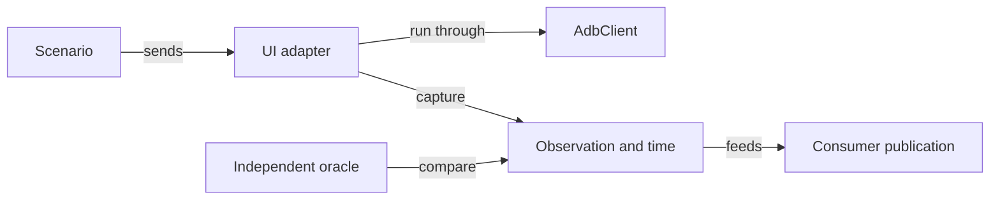

# Android Whist Lab infrastructure and tests

## Overview

The module brings together the ADB adapter, the capture and timing of Android, reusable audits and the Whist Lab scenarios. Local components and flows on the device have explicit selections; each check distinguishes command, observation and independent comparison.

The infrastructure has the execution and the capture and the scenario has the meaning of the action and the expected outcome. The construction of the APK, installation and acceptance of the interaction have separate contracts.

## Flow and responsibilities



<details>
<summary>Legend: infrastructure and domain</summary>

ADB adaptor retains the result of the demarcated command. The UI adapter interprets the observed state and the oracle checks the ownership of the scenario; the common library receives the printed publication data.

</details>

## Organisation of sources

| Area | Contract |
|---|---|
| [AdbClient](src/main/java/atf/android/AdbClient.java) | Explicit device, maximum duration, text or binary outputs. |
| [TableViewportAudit](src/main/java/atf/android/whist/evidence/TableViewportAudit.java) | Compare one observation of the table; E2E and components use the same oracle, with real or simulated data. |
| [Catch](src/main/java/atf/android/evidence/AndroidScreenshotEvidence.java) and [timing](src/main/java/atf/android/evidence/timing/) | Original PNG, monotonous clock, intervals and serialization. |
| [audits Whist](src/main/java/atf/android/whist/evidence/) | Pure checks and publication of the external index. |
| [Screenplays and oracles](src/test/java/atf/android/e2e/) | Navigation, state extraction, actors and game comparisons. |
| [Interpretation of the hierarchy](src/test/java/atf/android/e2e/driver/hierarchy/) | `HierarchyDocument` decodes XML and coordinates; `CardLabelText` keeps the card notation, and `CardHierarchy` interprets the accessible hand, edge and legality. |
| [Flow support](src/test/java/atf/android/e2e/support/) | Control points, partial log and individual or aggregated publication. |

[POM](pom.xml) adds the engine and independent player sources only to the test source set. The `responsive-sanity` profile uses the narrow selection declared in the POM; normal configuration remains the input for the complete set of components.

## Running contract checks

- Each command has identified device and maximum duration; the success of the transport and semantic transition have distinct verdicts.
- The XML interpretation receives one observation and does not order the device. The Decodator refuses statements `DOCTYPE`; generic and card selectors use the same node model and normalization.
- The full PNG and the hierarchy belong to the same checkpoint checked.
- UIAutomator logic points are mapped at the PNG raster observed prior to pixel comparisons. [DisplayRaster](src/main/java/atf/android/evidence/DisplayRaster.java) requires exact active physical or logical dimensions, without tolerance for cutting or arbitrary scaling.
- The phase clock starts before the first action and keeps the partial intervals at failure.
- The execution, capture, log and publication shall keep separate time axes.
- The index and results shall be written externally; [contract of publication](../docs/reporting/ATF_Handoff.md) defines their identity and acceptance.

## Verification without device

With his own temporary copy, with his own Pome, libraries and a Maven warehouse:

```powershell
mvn -B -pl atf-test-android -am '-Dtest=AndroidUnitSuite,AndroidComponentSuite' '-Dsurefire.failIfNoSpecifiedTests=false' '-Datf.android.enabled=false' test
```

| Collection | Contract verified |
|---|---|
| [AndroidComponentSuite](src/test/java/atf/android/suites/AndroidComponentSuite.java) | All Maven components of the adapter with controlled observations and without device. |
| [AndroidUiFlowTimingComponentSuite](src/test/java/atf/android/e2e/support/AndroidUiFlowTimingComponentSuite.java) | Temporisation of flow through components. |
| [AndroidDisplayComponentSuite](src/test/java/atf/android/suites/AndroidDisplayComponentSuite.java) | Profiles, parsing, geometry and synthetic raster; Maven profile `display-components` excludes the compilation of AI algorithms. |

Option `-ComponentsOnly` The launcher selects the display collection without the device. [Display Component Guide](../docs/testing/ATF_DisplayComponents.md) define simulated inputs, controlled defects and verification limits.

## Android flows

[Android guide](../docs/testing/ATF_Android.md) defines the device, exclusive booking, activation and initial status. [Screen matrix](../docs/testing/ATF_Display.md) holds the profiles, controlled distributions and optional game flow; [game verification](../docs/testing/ATF_Gameplay.md) holds the rules and score.

For a short visual check, `-TableViewportOnly` selects the maximum hand,
complete trick and bidding with selection. `-Profiles` limits the matrix;
images and hierarchies are kept in Extent without a full match.

```powershell
pwsh -NoProfile -File .\scripts\run-whist-responsive-sanity.ps1 -TableViewportOnly -Profiles '720x1280@360'
```

Runner requires PowerShell 7 (`pwsh`), because the ADB process adapter uses
`ProcessStartInfo.ArgumentList`. The building and report remain in temporary locations
and documented external.

Geometric oracle and nodes have different limits to visibility in the PNG and observed interaction. The compact table requires the hand, trick and all boxes simultaneously without vertical scroll; the check of pixels and native acceptance remain distinct from the simulated observations.

## Test levels

- **Unit: ** monotonous clock and serialization of the intervals.
- **Component: ** ADB controlled, captures, oracles, geometry and publication.
- **E2E: ** new actions in the identified and installed application under the device reservation.

[Test architecture](../docs/testing/ATF_Architecture.md) separates the level, collection, environment and publication. The resumption of a journal retains its original execution; the acceptance of new interactions requires a new scenario on the device.

## Auditable component reports

[The suite of history](src/test/java/atf/android/suites/AndroidHistoryComponentSuite.java) is a JVM entry without SDK or device. [Component Guide](../docs/testing/ATF_DisplayComponents.md#reporting-of-historical-components) holds the selection, output in TMP and modes Extent/fallback.

- The reusable catch and publication support is in [evidence.component](src/main/java/atf/android/evidence/component/); Kit holds JUnit protocol and comparisons and Reporting holds rendering.
- Liaison with JUnit metadata remains in [AndroidComponentAudit](src/test/java/atf/android/component/AndroidComponentAudit.java), without XML JUnit parsing for rebuilding assertions.
- Kit is a compilation dependency for captured models used in the main; the Android adapter does not introduce JUnit types directly into its main sources.
- The `history-components` profile compiles only this frontier. Profiles `display-components` and `responsive-sanity` select execution; do not remove from compilation the classes indirectly required by the suite.

## Interaction mechanisms

| Mechanism | Question verified | Owner |
|---|---|---|
| Passive expectation | Has the required status arisen before the deadline? | `UiStateAwaiter`, fresh-readable and monotonous watch. |
| Catch | Hierarchy and PNG belong to the current observation? | `UiDeviceCapture`, with transfer and measured range. |
| Transport | Has the command ended, including draining the exits? | `AdbClient` and `CommandProcess`, with one term. |

The driver composes these mechanisms and records the actions. Components control processes, clocks and observations; the native scenario qualifies the device and interaction separately.

| Contract changed | Verification without device |
|---|---|
| First observation and expiry of the wait | [AndroidUiDriverComponentTest](src/test/java/atf/android/e2e/driver/AndroidUiDriverComponentTest.java), with watch and controlled readings. |
| Catch, transfer and interval | [AndroidUiDriverCaptureTimingTest](src/test/java/atf/android/e2e/driver/AndroidUiDriverCaptureTimingTest.java), with processes and files controlled. |
| Start, finish, drain and clean | [CommandProcessComponentTest](src/test/java/atf/android/process/CommandProcessComponentTest.java), with controlled local processes. |

Transport, intervals and catch data may support another application. The card selectors, table interpretation and score check keep the Whist semantics; [Transfer to another game](../docs/learning/ATF_GameTransfer.md) requires adaptor and own oracle.

<details>
<summary>Contract of passive waiting and diagnosis of expiry</summary>

## Waiting for state

[UiStateAwaiter](src/test/java/atf/android/e2e/driver/waiting/UiStateAwaiter.java)
shares a common loop in passive expectations. The driver shall provide the condition,
Interrogation interval and diagnosis; reading produces a fresh hierarchy.

| Contract | Behaviour |
|---|---|
| First remark | The condition shall be assessed prior to the break, including when the deadline is already expired. |
| Reluare | The monotonous clock checks the term between the tests; the readout of the ADB shall retain its own termination contract. |
| Diagnostic | Expiration uses the last observed hierarchy; error or interruption is not replaced by success or resumption. |
| Navigation | Loops closing menus or activating controls remain distinct; passive waiting does not introduce actions. |

Components use watch and controlled breaks without emulator or thresholds
Host performance. [Package governance](../docs/governance/ATF_Packages.md)
delimit the mechanism for interaction and capture of evidence.

</details>

<details>
<summary>Contract of transport, capture and process cleaning</summary>

## Isolated transport execution

[Driver UI](src/test/java/atf/android/e2e/driver/AndroidUiDriver.java) keep
interactions and stock log. [Capture](src/test/java/atf/android/e2e/driver/UiDeviceCapture.java)
holds the transfer of the hierarchy and PNG, retesting and closing the range
measured. A hierarchy left over from another screen or prior PNG cannot demonstrate
success of current catch; interruption retains the cause and marking of the wire.

[AdbClient](src/main/java/atf/android/AdbClient.java) delegates [execution of the process](src/main/java/atf/android/process/CommandProcess.java) with a single monotonous term for starting, finishing and drainage exits. The interruption shall retain the wire marking and the reading errors shall not be converted into success.

- Native blocking operations use daemon wires independent of virtual thread planner.
- The wait shall observe both flows so that one locked exit does not conceal the error of the other; an error already observed takes precedence over the generic expiry diagnosis.

Transport components use controlled local processes. [Acceptance of Android](../docs/testing/ATF_Android.md) checks the behaviour on the device separately; publication of a valid catch has its own contract.

- The failure requires that the process and the observed offspring be stopped while the parent is active.
- Flow closure does not block the caller; a process created after the start-up is cleaned when it becomes available.
- The errors in cleaning are added to the original cause; a descendant removed before it can be observed has no identity guaranteed by API Java.

Memory budgets for text and binary stay [Open adaptor criterion](../docs/feedback/ATF_Android.md). [Package responsibilities](../docs/governance/ATF_Packages.md) hold the rules for extracting mechanisms without changing the identity and order of scenarios.

</details>

## Test catalogue

[Inputs and responsibilities of tests](src/test/README.md) explains the selection, preconditions and interpretation of the result, through the same common strategy for all deliveries.
