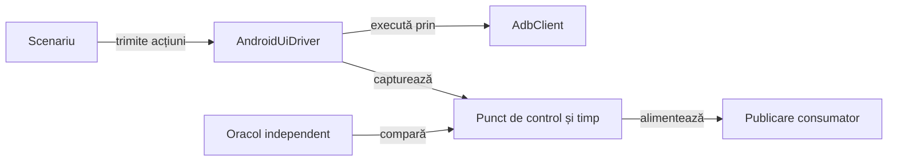

# Infrastructura și testele Android Whist Lab

## Pe scurt

Modulul reunește adaptorul ADB, captura și temporizarea Android, audituri reutilizabile și scenariile Whist Lab.
Componentele fără dispozitiv și fluxurile E2E au selecții explicite și păstrează limita dintre acțiune,
observație și verificarea independentă.

## Flux și responsabilități



<details>
<summary>Legendă: infrastructură și domeniu în același modul</summary>

Adaptorul execută comenzi delimitate și păstrează rezultatul original. Adaptorul de interacțiune interpretează interfața, iar oracolul verifică regulile; biblioteca comună primește datele de intrare tipizate pentru publicare.

</details>

## Organizarea surselor

| Zonă | Responsabilitate |
|---|---|
| [AdbClient](src/main/java/atf/android/AdbClient.java) | Identificator de dispozitiv explicit, durată maximă și rezultate text sau binare. |
| [AndroidScreenshotEvidence](src/main/java/atf/android/evidence/AndroidScreenshotEvidence.java) | PNG-ul original transmis prin API-ul public al raportării. |
| [Temporizare](src/main/java/atf/android/evidence/timing/) | Ceas monoton, intervale, codec și proiecție, fără interpretarea regulilor jocului. |
| [Audituri Whist](src/main/java/atf/android/whist/evidence/) | Validări pure și indexare externă reutilizabilă. |
| [Contracte de infrastructură](src/test/java/atf/android/) | ADB, captură și temporizare, verificate fără emulator. |
| [Scenarii și oracole](src/test/java/atf/android/e2e/) | Navigare, extragerea stării și comparații independente ale jocului. |
| [Suport de flux](src/test/java/atf/android/e2e/support/) | Puncte de control, jurnal parțial și contractele publicării individuale sau agregate. |

Codul reutilizabil se află în sursele principale ale acestui modul, cu pachetele atf.android păstrate. Sursele game-core și ai-lab sunt adăugate numai la calea de clase a testelor care le folosesc.

## Contracte de execuție

- Un identificator de dispozitiv explicit și o durată maximă delimitează fiecare comandă ADB.
- Rezultatul trimiterii comenzii și tranziția semantică observată au verdicte distincte.
- PNG-ul integral și ierarhia aparțin aceluiași punct de control verificat.
- Dreptunghiurile UIAutomator sunt logice; aserțiunile de pixeli le mapează la rasterul PNG fizic înainte de comparație.
- Ceasul fazei pornește înainte de prima acțiune și păstrează intervalele parțiale la eșec.
- Execuția, captura, persistența jurnalului și publicarea sunt axe temporale separate.
- Rapoartele și indexurile generate se scriu în depozitul extern; arborele de surse și copia temporară sunt refuzate ca destinații de indexare.

## Verificare fără dispozitiv

Dintr-o copie temporară proprie de lucru, cu POM-ul părinte și bibliotecile configurate:

```powershell
mvn -pl atf-test-android -am '-Dtest=AndroidComponentSuite,AndroidPhaseClockTest,AndroidPhaseTimingCodecTest,AndroidUiFlowTimingComponentSuite' '-Dsurefire.failIfNoSpecifiedTests=false' '-Datf.android.enabled=false' test
```

Profilul `responsive-sanity` compilează numai suportul și testele necesare pe ecrane diferite.

- Matricea standard verifică meniul, atuul, cartea jucată, mâna de 13 cărți și cele nouă opțiuni de licitare pe fiecare profil.
- `-IncludeGameFlow` activează opțional un singur flux pe primul profil.
- Setul complet de componente folosește configurația normală a modulului.

## Fluxuri Android

Scenariile pe dispozitiv se activează explicit, cu identificator de dispozitiv și rezervare exclusivă.

- Lansatorul verifică precondițiile și profilurile de ecran înainte de acces.
- Matricea vizuală verifică locurile și derulează până când cartea, locul activ și cărțile jucabile legal pot fi verificate pe ecranele compacte.
- Construirea APK-ului și acceptanța instalării au contracte separate.

[Verificarea jocului](../docs/testing/ATF_Gameplay.md) · [Testarea Android](../docs/testing/ATF_Android.md) · [Temporizare](../docs/reporting/ATF_PhaseTiming.md) · [Publicare](../docs/reporting/ATF_Android.md)

## Niveluri de testare

| Nivel | Contract |
|---|---|
| Unitar | Ceasul monoton și serializarea intervalelor. |
| Componentă | ADB controlat, capturi, oracole, geometrie și publicare fără dispozitiv. |
| E2E | Interacțiuni noi în aplicația instalată, cu rezervarea dispozitivului. |

[Arhitectura testării](../docs/testing/ATF_Architecture.md) separă nivelul, colecția, mediul și publicarea. Un jurnal reluat nu reprezintă o nouă execuție Android.
