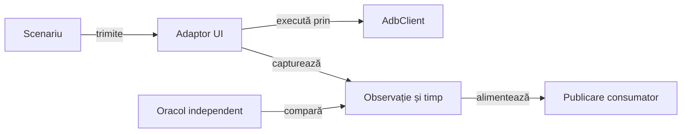

# Infrastructura și testele Android Whist Lab

## Pe scurt

Modulul reunește adaptorul ADB, captura și temporizarea Android, audituri reutilizabile și scenariile Whist Lab. Componentele locale și fluxurile pe dispozitiv au selecții explicite; fiecare verificare distinge comanda, observația și comparația independentă.

Infrastructura deține execuția și captura, iar scenariul deține sensul acțiunii și rezultatul așteptat. Construirea APK-ului, instalarea și acceptanța interacțiunii au contracte separate.

## Flux și responsabilități



<details>
<summary>Legendă: infrastructură și domeniu</summary>

Adaptorul ADB păstrează rezultatul comenzii delimitate. Adaptorul UI interpretează starea observată, iar oracolul verifică proprietatea scenariului; biblioteca comună primește datele tipizate ale publicării.

</details>

## Organizarea surselor

| Zonă | Contract |
|---|---|
| [AdbClient](src/main/java/atf/android/AdbClient.java) | Dispozitiv explicit, durată maximă, ieșiri text sau binare. |
| [TableViewportAudit](src/main/java/atf/android/whist/evidence/TableViewportAudit.java) | Compară o singură observație a mesei; E2E și componentele folosesc același oracol, cu date reale ori simulate. |
| [Captură](src/main/java/atf/android/evidence/AndroidScreenshotEvidence.java) și [temporizare](src/main/java/atf/android/evidence/timing/) | PNG original, ceas monoton, intervale și serializare. |
| [Audituri Whist](src/main/java/atf/android/whist/evidence/) | Verificări pure și publicarea indexului extern. |
| [Scenarii și oracole](src/test/java/atf/android/e2e/) | Navigare, extragerea stării, actori și comparații ale jocului. |
| [Interpretarea ierarhiei](src/test/java/atf/android/e2e/driver/hierarchy/) | `HierarchyDocument` decodează XML și coordonate; `CardLabelText` păstrează notația cărților, iar `CardHierarchy` interpretează mâna, atuul și legalitatea accesibilă. |
| [Suportul de flux](src/test/java/atf/android/e2e/support/) | Puncte de control, jurnal parțial și publicare individuală sau agregată. |

[POM-ul](pom.xml) adaugă sursele motorului și ale jucătorului independent numai în setul de surse de test. Profilul `responsive-sanity` folosește selecția restrânsă declarată în POM; configurația normală rămâne intrarea pentru setul complet de componente.

## Contracte de execuție

- Fiecare comandă are dispozitiv identificat și durată maximă; succesul transportului și tranziția semantică au verdicte distincte.
- Interpretarea XML primește o singură observație și nu comandă dispozitivul. Decodorul refuză declarațiile `DOCTYPE`; selectorii generici și cei de cărți folosesc același model de nod și aceeași normalizare.
- PNG-ul integral și ierarhia aparțin aceluiași punct de control verificat.
- Dreptunghiurile logice UIAutomator sunt mapate la rasterul PNG observat înaintea comparațiilor de pixeli. [DisplayRaster](src/main/java/atf/android/evidence/DisplayRaster.java) cere dimensiuni fizice sau logice active exacte, fără toleranță pentru tăiere ori scalare arbitrară.
- Ceasul fazei pornește înaintea primei acțiuni și păstrează intervalele parțiale la eșec.
- Execuția, captura, jurnalul și publicarea păstrează axe temporale distincte.
- Indexurile și rezultatele se scriu extern; [contractul publicării](../docs/reporting/ATF_Handoff.md) definește identitatea și acceptarea lor.

## Verificare fără dispozitiv

Dintr-o copie temporară proprie, cu POM-ul părinte, bibliotecile și un depozit Maven propriu:

```powershell
mvn -B -pl atf-test-android -am '-Dtest=AndroidComponentSuite,AndroidPhaseClockTest,AndroidPhaseTimingCodecTest,AndroidUiFlowTimingComponentSuite' '-Dsurefire.failIfNoSpecifiedTests=false' '-Datf.android.enabled=false' test
```

| Colecție | Contract verificat |
|---|---|
| [AndroidComponentSuite](src/test/java/atf/android/suites/AndroidComponentSuite.java) | ADB controlat și capturi. |
| [AndroidUiFlowTimingComponentSuite](src/test/java/atf/android/e2e/support/AndroidUiFlowTimingComponentSuite.java) | Temporizarea fluxului prin componente. |
| [AndroidDisplayComponentSuite](src/test/java/atf/android/suites/AndroidDisplayComponentSuite.java) | Profile, parsare, geometrie și raster sintetic; profilul Maven `display-components` exclude compilarea algoritmilor AI. |

Opțiunea `-ComponentsOnly` a lansatorului selectează colecția display fără dispozitiv. [Ghidul componentelor display](../docs/testing/ATF_DisplayComponents.md) definește intrările simulate, defectele controlate și limitele verificării.

## Fluxuri Android

[Ghidul Android](../docs/testing/ATF_Android.md) definește dispozitivul, rezervarea exclusivă, activarea și starea inițială. [Matricea de ecrane](../docs/testing/ATF_Display.md) deține profilurile, distribuțiile controlate și fluxul de joc opțional; [verificarea jocului](../docs/testing/ATF_Gameplay.md) deține regulile și scorul.

Pentru o verificare vizuală scurtă, `-TableViewportOnly` selectează mâna maximă,
levata completă și licitarea cu selecție. `-Profiles` limitează matricea;
imaginile și ierarhiile sunt păstrate în Extent, fără o partidă completă.

```powershell
pwsh -NoProfile -File .\scripts\run-whist-responsive-sanity.ps1 -TableViewportOnly -Profiles '720x1280@360'
```

Runnerul necesită PowerShell 7 (`pwsh`), fiindcă adaptorul de proces ADB folosește
`ProcessStartInfo.ArgumentList`. Build-ul și raportul rămân în locațiile temporară
și externă documentate.

Oracolul geometric și existența nodurilor au limite diferite de vizibilitatea în PNG și interacțiunea observată. Masa compactă cere mâna, levata și toate chenarele simultan, fără scroll vertical; verificarea pixelilor și acceptanța nativă rămân distincte de observațiile simulate.

## Niveluri de testare

- **Unitar:** ceasul monoton și serializarea intervalelor.
- **Componentă:** ADB controlat, capturi, oracole, geometrie și publicare.
- **E2E:** acțiuni noi în aplicația identificată și instalată, sub rezervarea dispozitivului.

[Arhitectura testării](../docs/testing/ATF_Architecture.md) separă nivelul, colecția, mediul și publicarea. Reluarea unui jurnal păstrează execuția sa originală; acceptanța unor interacțiuni noi cere un scenariu nou pe dispozitiv.

## Componente cu raport auditabil

[Suita istoricului](src/test/java/atf/android/suites/AndroidHistoryComponentSuite.java) este o intrare JVM fără SDK sau dispozitiv. [Ghidul componentelor](../docs/testing/ATF_DisplayComponents.md#raportarea-componentelor-istoricului) deține selecția, output-ul în TMP și modurile Extent/fallback.

- Suportul reutilizabil al capturii și publicării este în [evidence.component](src/main/java/atf/android/evidence/component/); Kit deține protocolul JUnit și comparațiile, iar Reporting deține randarea.
- Legătura cu metadatele JUnit rămâne în [AndroidComponentAudit](src/test/java/atf/android/component/AndroidComponentAudit.java), fără parsare de XML JUnit pentru reconstruirea aserțiunilor.
- Kit este dependență de compilare pentru modelele capturate folosite în main; adaptorul Android nu introduce tipuri JUnit direct în sursele sale main.
- Profilul `history-components` compilează numai această frontieră. Profilele `display-components` și `responsive-sanity` selectează execuția; nu elimină din compilare clase cerute indirect de suite.

## Mecanismele interacțiunii

| Mecanism | Întrebarea verificată | Responsabil |
|---|---|---|
| Așteptare pasivă | A apărut starea cerută înaintea termenului? | `UiStateAwaiter`, cu citire proaspătă și ceas monoton. |
| Captură | Ierarhia și PNG-ul aparțin observației curente? | `UiDeviceCapture`, cu transfer și interval măsurat. |
| Transport | S-a încheiat comanda, inclusiv drenarea ieșirilor? | `AdbClient` și `CommandProcess`, cu un singur termen. |

Driverul compune aceste mecanisme și înregistrează acțiunile. Componentele controlează procesele, ceasul și observațiile; scenariul nativ califică separat dispozitivul și interacțiunea.

| Contract schimbat | Verificare fără dispozitiv |
|---|---|
| Prima observație și expirarea așteptării | [AndroidUiDriverComponentTest](src/test/java/atf/android/e2e/driver/AndroidUiDriverComponentTest.java), cu ceas și citiri controlate. |
| Captură, transfer și interval | [AndroidUiDriverCaptureTimingTest](src/test/java/atf/android/e2e/driver/AndroidUiDriverCaptureTimingTest.java), cu procese și fișiere controlate. |
| Pornire, terminare, drenare și curățare | [CommandProcessComponentTest](src/test/java/atf/android/process/CommandProcessComponentTest.java), cu procese locale controlate. |

Transportul, intervalele și datele capturii pot susține altă aplicație. Selectorii cărților, interpretarea mesei și verificarea scorului păstrează semantica Whist; [transferul către alt joc](../docs/learning/ATF_GameTransfer.md) cere adaptor și oracol proprii.

<details>
<summary>Contractul așteptării pasive și diagnosticul expirării</summary>

## Așteptarea unei stări

[UiStateAwaiter](src/test/java/atf/android/e2e/driver/waiting/UiStateAwaiter.java)
deține bucla comună a așteptărilor pasive. Driverul furnizează condiția,
intervalul de interogare și diagnosticul; citirea produce o ierarhie proaspătă.

| Contract | Comportament |
|---|---|
| Prima observație | Condiția se evaluează înaintea pauzei, inclusiv când termenul este deja expirat. |
| Reluare | Ceasul monoton verifică termenul între încercări; citirea ADB păstrează propriul contract de terminare. |
| Diagnostic | Expirarea folosește ultima ierarhie observată; eroarea sau întreruperea nu este înlocuită printr-un succes ori o reluare. |
| Navigare | Buclele care închid meniuri sau activează controale rămân distincte; așteptarea pasivă nu introduce acțiuni. |

Componentele folosesc ceas și pauze controlate, fără emulator sau praguri de
performanță ale gazdei. [Guvernanța pachetelor](../docs/governance/ATF_Packages.md)
delimitează mecanismul de interacțiuni și de capturarea dovezilor.

</details>

<details>
<summary>Contractul transportului, capturii și curățării proceselor</summary>

## Execuția delimitată a transportului

[Driverul UI](src/test/java/atf/android/e2e/driver/AndroidUiDriver.java) păstrează
interacțiunile și jurnalul acțiunilor. [Captura](src/test/java/atf/android/e2e/driver/UiDeviceCapture.java)
deține transferul ierarhiei și al PNG-ului, reîncercările și închiderea intervalului
măsurat. O ierarhie rămasă de la alt ecran sau un PNG anterior nu poate demonstra
succesul capturii curente; întreruperea păstrează cauza și marcajul firului.

[AdbClient](src/main/java/atf/android/AdbClient.java) deleagă [execuția procesului](src/main/java/atf/android/process/CommandProcess.java) cu un singur termen monoton pentru pornire, terminare și drenarea ieșirilor. Întreruperea păstrează marcajul firului, iar erorile de citire nu sunt convertite în succes.

- Operațiile native blocante folosesc fire daemon independente de planificatorul firelor virtuale.
- Așteptarea observă ambele fluxuri, astfel încât o ieșire blocată să nu ascundă eroarea celeilalte; o eroare deja observată are prioritate față de diagnosticul generic de expirare.

Componentele transportului folosesc procese locale controlate. [Acceptanța Android](../docs/testing/ATF_Android.md) verifică separat comportamentul pe dispozitiv; publicarea unei capturi valide are propriul contract.

- La eșec se solicită oprirea procesului și a descendenților observați cât timp părintele este activ.
- Închiderea fluxurilor nu blochează apelantul; un proces creat după expirarea pornirii este curățat când devine disponibil.
- Erorile curățării se adaugă cauzei inițiale; un descendent desprins înainte să poată fi observat nu are identitate garantată de API-ul Java.

Bugetele de memorie pentru text și binar rămân [criteriu deschis al adaptorului](../docs/feedback/ATF_Android.md). [Responsabilitățile pachetelor](../docs/governance/ATF_Packages.md) dețin regulile extragerii mecanismelor fără schimbarea identității și ordinii scenariilor.

</details>
