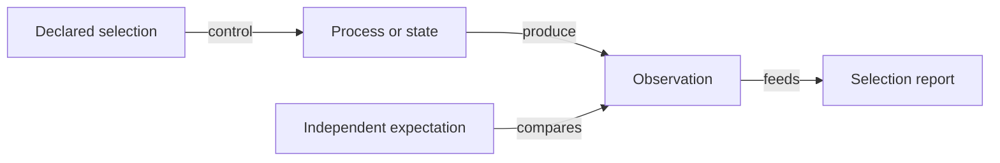

# Adapter and Android tests

## Overview

This catalogue explains the JUnit inputs of the Android adapter. [Common strategy](../../../docs/testing/README.md) has the choice of level and acceptance of the result; the test holds the comparison and the infrastructure holds the command and observation.

## Selection and resources

| Entry point | Purpose and preconditions |
|---|---|
| [AndroidComponentSuite](java/atf/android/suites/AndroidComponentSuite.java) | Primary suite: all Maven components of the adapter without emulator. |
| [AndroidDisplayComponentSuite](java/atf/android/suites/AndroidDisplayComponentSuite.java) | Profiles, drivers, history and geometric oracles with controlled inputs. |
| [AndroidHistoryComponentSuite](java/atf/android/suites/AndroidHistoryComponentSuite.java) | Focused historical selection; shares classes with display selection. |
| [AndroidUiFlowTimingComponentSuite](java/atf/android/e2e/support/AndroidUiFlowTimingComponentSuite.java) | Measured flow intervals, with watch and controlled processes. |
| [AndroidGameplayE2eSuite](java/atf/android/suites/AndroidGameplayE2eSuite.java) | Interaction on identified APK; requires activation, reserved device and restoration of status. |

[Catalog](../../../config/atf-test-suites.json) declares the primary suites for each level and the parents of the focused selections. Display, history and timing are subsets of the primary component suite; gameplay is subset of the E2E input, which remains activated separately.

## Verification flow

Legend: single execution and two types of environment

Components control processes, clocks and observations. E2E captures a new interaction on the device; republishing of an existing observation retains the original identity and does not execute Android again.

## Execution and interpretation

Use [Isolated input of the module](../../README.md#verification-without-device) and [Component Guide](../../../docs/testing/ATF_DisplayComponents.md). Select the suite or its classes with the declared overlap; temporary directories and reports belong to external running.

- **Audit:** [AndroidComponentAudit](java/atf/android/component/AndroidComponentAudit.java) link the plea to Kit. [Adapter contracts](java/atf/android/component/AndroidComponentReportContractTest.java) verify the publication and refusals; the intended failures are delimited by the result of the product.

- **Result:** JUnit identifies execution, and audited HTML keeps the input, expected/actual and the verdict. [Aggregate criterion](../../../docs/feedback/ATF_Reporting.md#rpt-android-component-html---captured-comparisons-not-just-junit-xml) remains distinct from JUnit passing.

[Module Android](../../README.md) · [Common strategy](../../../docs/testing/README.md) · [Audit of reports](../../../docs/reporting/ATF_Audit.md)
