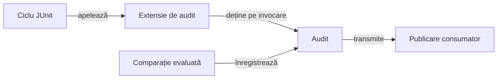

# Kit comun pentru teste

## Pe scurt

Modulul oferă clasificarea testelor, configurare, resurse cu proprietar explicit și auditul comparațiilor JUnit. Testul deține așteptarea, Kitul păstrează rezultatul evaluat, iar consumatorul furnizează publicarea.

Resursele pot fi partajate la nivel de clasă sau suită; fiecare invocare păstrează propriul audit și propria publicare. Motorul Whist rămâne independent de infrastructura JUnit.

## Responsabilități



<details>
<summary>Legendă: resursa partajată și auditul invocării</summary>

[ComponentAuditExtension](src/main/java/atf/testkit/assertions/ComponentAuditExtension.java) leagă fazele JUnit de [ComponentAssertionAudit](src/main/java/atf/testkit/assertions/ComponentAssertionAudit.java). Forma `scoped` poate reutiliza o resursă prin `TestRunScope`, păstrând auditul și publicarea independente pentru fiecare invocare; Kitul folosește portul publicării, fără tipurile rendererului.

</details>

## Alegerea API-ului

| Nevoie | Contract |
|---|---|
| Nivelul și canalul testului | [Adnotările](src/main/java/atf/testkit/) declară nivelul; canalul este o axă separată. |
| Resursă cu închidere controlată | [TestRunScope.resource](src/main/java/atf/testkit/scope/TestRunScope.java) o asociază proprietarului ales; `value` gestionează referința. |
| Comparație înregistrată | [AuditedAssertions](src/main/java/atf/testkit/assertions/AuditedAssertions.java) evaluează aserțiunea și păstrează valorile, mesajul și cauza. |
| Configurație tipizată | [AtfTestKitConfigurationLoader](src/main/java/atf/testkit/config/AtfTestKitConfigurationLoader.java) deține descoperirea și citirea. |

## Comparații și cerința corpului testului

Comparația JUnit se evaluează o singură dată. Pentru numere reale, așteptarea include toleranța; [AssertionValueDisplay](src/main/java/atf/testkit/assertions/AssertionValueDisplay.java) limitează separat previzualizarea, păstrând semnificația verdictului.

`ComponentAssertionAudit.AssertionRequirement` permite `ANY_PHASE` sau `TEST_BODY`. Adaptorul publicării alege explicit cerința; activarea `TEST_BODY` cere o comparație auditată în corpul invocării.

<details>
<summary>Cazuri de refuz și păstrarea cauzei originale</summary>

| Situație cu TEST_BODY | Rezultat |
|---|---|
| Numai comparații în pregătire sau închidere | Cerința corpului eșuează. |
| Numai diagnostic sau apel JUnit neînregistrat | Cerința auditului eșuează. |
| Comparație auditată în corp | Se păstrează verdictul ei, fără reevaluare. |
| Eșec ori întrerupere existentă | Lipsa comparației nu înlocuiește cauza existentă. |
| Eroare auditată interceptată ulterior | Eșecul înregistrat rămâne vizibil; poate avea prioritate față de o întrerupere. |

Lipsa comparațiilor într-un corp altfel reușit produce diagnosticul structural `Audited assertion coverage / TEST BODY`, cu așteptarea unei comparații și valoarea observată zero. Diagnosticul descrie auditul, fără a inventa o verificare a aplicației.

</details>

## Niveluri și verificare

Dintr-o copie temporară proprie, cu POM-ul părinte, bibliotecile și un depozit Maven propriu:

```powershell
mvn -B -pl atf-test-kit -am test
```

- [TestBodyAssertionRequirementTest](src/test/java/atf/testkit/assertions/requirements/TestBodyAssertionRequirementTest.java) verifică politica locală a cerinței.
- [TestBodyAssertionRequirementComponentTest](src/test/java/atf/testkit/assertions/requirements/TestBodyAssertionRequirementComponentTest.java) verifică aplicarea prin ciclul JUnit.
- [ScopedComponentAuditExtensionComponentTest](src/test/java/atf/testkit/assertions/ScopedComponentAuditExtensionComponentTest.java) verifică resursa partajată și izolarea invocărilor.

[Arhitectura testării](../docs/testing/ATF_Architecture.md) separă testele unitare de componentele care lansează ciclul JUnit real. [POM-ul](pom.xml) deține selecția efectivă; clasele imbricate pentru defecte controlate se execută prin lansatorul probei.

## Limitele concurenței

Primitivele resurselor au controale concurente, iar probele ciclului JUnit folosesc și execuție serială explicită. Calificarea partajării între invocări trebuie să includă și lansări Jupiter paralele reale.

- `ScopedAcceptanceRun` serializează apelurile propriei metode; cititorii externi ai proprietăților globale nu sunt izolați de acel monitor. [Feedback-ul infrastructurii](../docs/feedback/ATF_TestInfrastructure.md#concurența-kitului) deține calificarea Jupiter paralelă și verificarea cititorului concurent.

- [Matricea testării](../docs/testing/ATF_Architecture.md) deține nivelul fiecărei probe. Afirmația despre suportul concurent se limitează la combinațiile de proprietar și ciclu efectiv verificate.
