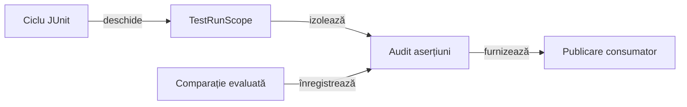

# Kit comun pentru teste

## Pe scurt

Modulul oferă clasificarea testelor, configurare, resurse cu ciclu de viață controlat și auditul comparațiilor. Integrarea JUnit este suport al testelor; motorul Whist rămâne independent de acest modul.

## Responsabilități



<details>
<summary>Legendă: evaluare și proprietate</summary>

Kitul controlează resursele și înregistrează comparațiile evaluate. Testul deține semnificația verificării, iar adaptorul consumatorului deține publicarea.

</details>

| API | Responsabilitate |
|---|---|
| [Adnotări](src/main/java/atf/testkit/) | Nivelul unitar, componentă, integrare sau E2E; canalul este o axă separată. |
| [TestRunScope](src/main/java/atf/testkit/scope/TestRunScope.java) | Resurse deținute de clasa sau suita declarată, cu închidere controlată. |
| [ComponentAssertionAudit](src/main/java/atf/testkit/assertions/ComponentAssertionAudit.java) | Faze, valori evaluate, verdict și cauză originală. |
| [ComponentAuditExtension](src/main/java/atf/testkit/assertions/ComponentAuditExtension.java) | Legătura cu JUnit; publicarea este furnizată explicit. |
| [Configurare](src/main/java/atf/testkit/config/AtfTestKitConfigurationLoader.java) | Descoperirea și citirea configurației tipizate. |

## Comparații și cerința corpului testului

`AuditedAssertions` evaluează comparația JUnit o singură dată. Pentru numerele reale, așteptarea include toleranța; prezentarea păstrează valorile, mesajul și cauza, cu previzualizarea implicită limitată la 240 de caractere.

`AssertionRequirement` permite `ANY_PHASE` sau `TEST_BODY`. Cerința strictă se selectează explicit în adaptorul publicării și nu se aplică automat tuturor testelor unitare.

| Situație cu `TEST_BODY` | Rezultat |
|---|---|
| Pregătirea ori închiderea au comparații, corpul nu are | Eșec; comparațiile altor faze nu înlocuiesc corpul. |
| Numai diagnostic sau apel JUnit neînregistrat | Eșec al cerinței de audit. |
| Comparație Kit reală în corp | Verdictul comparației originale, fără reevaluare. |
| Eșec ori întrerupere anterioară | Cauza și statutul original rămân primare. |
| Eroare auditată interceptată ulterior | Eșecul auditat nu devine succes. |

Un succes fără comparații produce diagnosticul structural `Audited assertion coverage / TEST BODY`, cu așteptarea unei comparații și valoarea observată zero. Acest diagnostic nu inventează o verificare a aplicației.

## Niveluri și verificare

| Nivel | Contract |
|---|---|
| Unitar | Configurare, politici de audit, temporizare și resurse locale. |
| Componentă | Ciclul JUnit real, izolarea invocărilor și extensiile de audit. |

[Arhitectura testării](../docs/TESTING_ARCHITECTURE.md) definește nivelurile și matricea comună. Dintr-o copie temporară proprie, cu POM-ul părinte și dependențele reactorului:

```powershell
mvn -B -pl atf-test-kit -am test
```

[POM-ul](pom.xml) și [testele](src/test/java/) definesc selecția efectivă. Clasele imbricate folosite pentru defecte controlate se execută prin lansatorul probei, fără selecție independentă accidentală.
