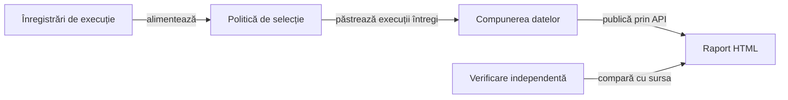

# Integrarea bibliotecilor și publicarea rezultatelor

## Pe scurt

Modulul verifică integrarea bibliotecilor comune și pregătește rezultatele testelor Whist pentru publicare.
Selectează înregistrările de execuție, păstrează comparațiile originale și verifică raportul publicat.
Biblioteca de raportare se folosește prin API-ul configurat în [POM-ul părinte](../pom.xml).

## Flux și responsabilități



<details>
<summary>Legendă și limite</summary>

O înregistrare descrie o invocare a unui test: identitate, parametri, intervale, comparații și verdict.
Selecția păstrează înregistrările întregi și declară ce a omis.
Modulul pregătește datele, iar biblioteca comună construiește prezentarea HTML.

</details>

## Organizare

| Sursă | Responsabilitate |
|---|---|
| [EvidencePolicyYaml](src/main/java/atf/tests/learning/EvidencePolicyYaml.java) | Citirea și validarea politicii de selecție. |
| [EvidenceSelection](src/main/java/atf/tests/learning/EvidenceSelection.java) | Selectează invocări întregi, păstrează toate rezultatele diferite de PASS și publică inventarul omisiunilor. |
| [LearningRunReport](src/main/java/atf/tests/learning/LearningRunReport.java) | Verifică integritatea înregistrărilor și compune datele publicării, cu comparațiile originale. |
| [GameReportConfiguration](src/main/java/atf/tests/reporting/GameReportConfiguration.java) | Configurație imutabilă pe publicare. |
| [GameReportSession](src/main/java/atf/tests/reporting/GameReportSession.java) | Organizează fazele și izolează contextul fiecărei publicări. |
| [GameEvidenceBodies](src/main/java/atf/tests/reporting/GameEvidenceBodies.java) | Corpuri complete sau părți TEXT ordonate; refuzul unei intrări indivizibile care depășește bugetul. |
| [LearningReportHtmlAudit](src/main/java/atf/tests/learning/LearningReportHtmlAudit.java) | Verificarea identității punctelor de control, rândurilor și valorilor publicate. |

Politica efectivă și sensul modurilor de prezentare sunt în
[contractul de prezentare](../docs/ATF_Game_Report_Presentation.md). Componentele
reutilizabile sunt în `src/main/java`; intrările JUnit sunt în `src/test/java`.

## Contracte importante

- Fiecare invocare selectată păstrează verdictul original, cauza eșecului și toate comparațiile obligatorii.
- Limitarea contextului opțional păstrează valorile așteptate, valorile observate și verdictul PASS/FAIL.
- Selecția publică inventarul complet și identifică invocările omise din prezentarea individuală.
- Testele de componente, partidele simulate, reluarea unei arhive și un scenariu Android nou au scopuri distincte.
- Republicarea folosește datele capturate anterior; imaginile istorice ori sintetice sunt etichetate explicit.

## Verificare focalizată

Rulați într-o copie proprie din `%TEMP%`, cu POM-ul părinte, modulele necesare,
configurația și perechile fizice JAR/POM din `lib`:

```powershell
mvn -B -pl atf-tests -am "-Dtest=GameReportComponentSuite,LearningRunReportContractTest,EvidenceSelectionContractTest" "-Dsurefire.failIfNoSpecifiedTests=false" test
```

Selecțiile din surse au responsabilități distincte:

- `GameReportComponentSuite`: politică, corpuri JSON/TEXT, redactare și publicare.
- `LearningRunReportContractTest`: proprietatea rândurilor, valori lungi,
  fragmente, timpi și respingerea unor mutații deliberate ale dovezii.
- `EvidenceSelectionContractTest`: populație, praguri, selecție completă și
  intrări incomplete.
- `CoreReportingConsumerContractTest` și `AndroidInlineScreenshotReportContractTest`:
  contractele binarelor și ale adaptorului PNG.

[LearningRunReportTest](src/test/java/atf/tests/LearningRunReportTest.java)
consumă o selecție capturată explicit. `DeepSuiteExtentReportTest` este o intrare
agregată cu activare explicită. Pentru o modificare punctuală se aleg contractele afectate.

Contractele curente se consultă din [indexul documentației](../docs/). Datele execuțiilor rămân în arhiva externă.

## Intervalele Android la republicare

[Contractul măsurării timpilor Android](../docs/ATF_Android_Phase_Timing.md) se aplică și jurnalelor agregate. `GameReportComponentSuite` respinge intervalele originale lipsă sau atribuite altei acțiuni, în ambele variante de publicare.

## Niveluri și guvernanță

| Nivel | Responsabilitate |
|---|---|
| Componentă | Politica selecției, adaptoare și contracte de publicare; verificarea surselor și documentației. |
| Integrare | Perechile fizice JAR/POM, configurația și compoziția modulelor. |

[Arhitectura testării](../docs/testing/architecture/README.md) definește matricea comună. [Suita de calitate](src/test/java/atf/tests/governance/AtfQualityGovernanceSuite.java) verifică pachetele, importurile, limitele modulelor, nivelurile și documentația.

Lansatorul [run-atf-governance.ps1](../scripts/run-atf-governance.ps1) construiește o copie temporară și păstrează rezultatele în afara proiectului. [Ghidul guvernanței](../docs/testing/governance/README.md) precizează perimetrul, excepțiile și limitele verificării.
