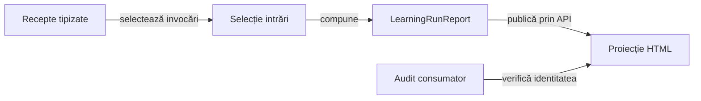

# Verificări de consumator și compoziția dovezilor

## Pe scurt

Modulul verifică integrarea binarelor comune și transformă receptele capturate
într-o prezentare auditabilă. Deține selecția datelor de intrare, semantica verificărilor
Whist și acceptorii de publicare. Implementarea generică este consumată prin
API-ul bibliotecii configurate în [POM-ul părinte](../pom.xml).

## Flux și responsabilități



<details>
<summary>Legendă și limite</summary>

Selecția păstrează invocările întregi, comparațiile obligatorii și omisiunile declarate. Modulul compune datele de intrare pentru biblioteca de raportare; implementarea generică a componentei de randare nu aparține consumatorului.

</details>

## Organizare

| Sursă | Responsabilitate |
|---|---|
| [EvidencePolicyYaml](src/main/java/atf/tests/learning/EvidencePolicyYaml.java) | Citirea și validarea politicii de selecție. |
| [EvidenceSelection](src/main/java/atf/tests/learning/EvidenceSelection.java) | Invocări întregi, criterii obligatorii și toate rezultatele non-PASS; inventarul selecției și omisiunilor. |
| [LearningRunReport](src/main/java/atf/tests/learning/LearningRunReport.java) | Compoziția receptei tipizate și păstrarea comparațiilor originale. |
| [GameReportConfiguration](src/main/java/atf/tests/reporting/GameReportConfiguration.java) | Configurație imutabilă pe publicare. |
| [GameReportSession](src/main/java/atf/tests/reporting/GameReportSession.java) | Faze și domenii de izolare native, cu limitele declarate. |
| [GameEvidenceBodies](src/main/java/atf/tests/reporting/GameEvidenceBodies.java) | Corpuri complete sau părți TEXT ordonate; refuzul unei intrări indivizibile care depășește bugetul. |
| [LearningReportHtmlAudit](src/main/java/atf/tests/learning/LearningReportHtmlAudit.java) | Verificarea identității punctelor de control, rândurilor și valorilor publicate. |

Politica efectivă și sensul modurilor de prezentare sunt în
[contractul de prezentare](../docs/ATF_Game_Report_Presentation.md). Componentele
reutilizabile sunt în `src/main/java`; intrările JUnit sunt în `src/test/java`.

## Contracte importante

Datele de intrare păstrează verdictul original, cauza eșecului și toate comparațiile
obligatorii ale unei invocări selectate. Contextele opționale pot fi limitate
conform politicii; limitarea lor nu schimbă valorile așteptate, valorile observate sau verdictul PASS/FAIL.
Selecția unei populații mari publică inventarul complet și nu pretinde că toate
invocările omise au fost prezentate individual.

Componentele native, partidele offline, reluarea unei arhive și un scenariu
Android nou verifică limite diferite. Republicarea nu produce noi partide sau
capturi. Imaginile istorice ori sintetice păstrează această etichetă.

## Verificare focalizată

Rulați într-o copie proprie din `%TEMP%`, cu POM-ul părinte, modulele necesare,
configurația și perechile fizice JAR/POM din `lib`:

```powershell
mvn -B -pl atf-tests -am "-Dtest=GameReportComponentSuite,LearningRunReportContractTest,EvidenceSelectionContractTest" "-Dsurefire.failIfNoSpecifiedTests=false" test
```

Selecțiile din surse au responsabilități distincte:

- `GameReportComponentSuite`: politică, corpuri JSON/TEXT, redactare și publicare.
- `LearningRunReportContractTest`: proprietatea rândurilor, valori lungi,
  fragmente, timpi și respingerea unor mutații deliberate ale dovezii.
- `EvidenceSelectionContractTest`: populație, praguri, selecție completă și
  intrări incomplete.
- `CoreReportingConsumerContractTest` și `AndroidInlineScreenshotReportContractTest`:
  contractele binarelor și ale adaptorului PNG.

[LearningRunReportTest](src/test/java/atf/tests/LearningRunReportTest.java)
consumă o selecție capturată explicit. `DeepSuiteExtentReportTest` este o intrare
agregată cu activare explicită, nu testul implicit care ar trebui lansat pentru orice schimbare.

Contractele curente se consultă din [indexul documentației](../docs/). Datele execuțiilor rămân în arhiva externă.

## Intervalele Android la republicare

[Contractul temporizării Android](../docs/ATF_Android_Phase_Timing.md) se aplică și jurnalelor agregate. `GameReportComponentSuite` respinge intervalele originale lipsă sau reasociate, în ambele variante de publicare.

## Niveluri și guvernanță

| Nivel | Responsabilitate |
|---|---|
| Componentă | Politica selecției, adaptoare și contracte de publicare; verificarea surselor și documentației. |
| Integrare | Perechile fizice JAR/POM, configurația și compoziția modulelor. |

[Arhitectura testării](../docs/TESTING_ARCHITECTURE.md) definește matricea comună. [Suita de calitate](src/test/java/atf/tests/governance/AtfQualityGovernanceSuite.java) verifică pachetele, importurile, limitele modulelor, nivelurile și documentația.

Lansatorul [run-atf-governance.ps1](../scripts/run-atf-governance.ps1) construiește o copie temporară și păstrează rezultatele în afara proiectului. [Ghidul guvernanței](../docs/ATF_QUALITY_GOVERNANCE.md) precizează perimetrul, excepțiile și limitele verificării.
