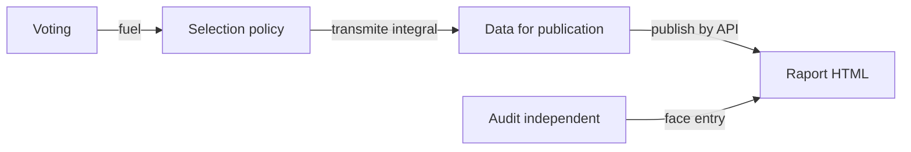

# Integration of libraries and publication of results

## Overview

The module verifies the integration of joint libraries, project governance and the publication of the Whist results. The consumer selects the records, retains the original comparisons and confronts the published result with the captured entry.

The common library holds HTML presentation and is consumed through API configured in [Pome parent](../pom.xml). Publication contracts, data selections and binary acceptance have separate checks.

## Flow and responsibilities



<details>
<summary>Legend: identity of execution prior to presentation</summary>

A record describes a statement of origin: identity, parameters, intervals, comparisons and verdict. The selection shall keep whole and declare omissions; the adapter shall prepare the data and the joint library shall build the presentation.

</details>

## Organizare

| Mechanism | Responsibility |
|---|---|
| [Selection](src/main/java/atf/tests/learning/EvidenceSelection.java) | Keeps results different from PASS, mandatory collections, population guards and selected deterministic examples. |
| [Composition](src/main/java/atf/tests/learning/LearningRunReport.java) | Check the records and transmit the original comparisons. |
| [Publication session](src/main/java/atf/tests/reporting/GameReportSession.java) | Isolate the configuration, context and phases of a publication. |
| [Auditul HTML](src/main/java/atf/tests/learning/LearningReportHtmlAudit.java) | Confront the identities, rows, values and purpose published with source data. |
| [Download APK](src/main/java/atf/tests/distribution/GitHubApkDownload.java) | Check GitHub metadata, full flow, SHA- 256 and CRC; main support, local HTTP samples and live acceptance in the test. |

[Presentation policy](../docs/reporting/ATF_Presentation.md) holds the rules of volume and navigation. The reusable code is in `src/main/java`; JUnit entries and negative samples are in `src/test/java`.

## Contracte importante

- Each selected claim shall retain the binding verdict, cause and comparison.
- The inventory of omissions shows what was executed and what is not individually presented in HTML.
- The budget of the optional context retains the expected, observed and verdict values; [GameEvidenceBodies](src/main/java/atf/tests/reporting/GameEvidenceBodies.java) refuses indivisible entries too high.
- The republican population consumes data captured and retains the identity of the original execution; historical or synthetic images have explicit labels.

## Focused verification

With his own temporary copy, with his own Pome, the necessary modules, physical pairs JAR/POM and a Maven deposit:

```powershell
mvn -B -pl atf-tests -am '-Dtest=GameReportComponentSuite,LearningRunReportContractTest,EvidenceSelectionContractTest' '-Dsurefire.failIfNoSpecifiedTests=false' test
```

Choose the check after the changed contract:

| Purpose | Intrare JUnit |
|---|---|
| Policy, JSON/TEXT payloads, redaction and publication | [GameReportComponentSuite](src/test/java/atf/tests/reporting/GameReportComponentSuite.java). |
| Ownership of values and deliberate mutations of published data | [LearningRunReportContractTest](src/test/java/atf/tests/learning/LearningRunReportContractTest.java). |
| Population, thresholds and selection | [EvidenceSelectionContractTest](src/test/java/atf/tests/learning/EvidenceSelectionContractTest.java). |
| Binaries and module composition | [CoreReportingConsumerContractTest](src/test/java/atf/tests/publishing/CoreReportingConsumerContractTest.java). |
| PNG capture through the API | [AndroidInlineScreenshotReportContractTest](src/test/java/atf/tests/contracts/AndroidInlineScreenshotReportContractTest.java). |
| Examples from the guides against the physical JARs | [LibraryReadmeExamplesIntegrationTest](src/test/java/atf/libraries/LibraryReadmeExamplesIntegrationTest.java). |
| Version link and refusal of an incomplete APK | [Distribution components](src/test/java/atf/tests/governance/documentation/release/download/ApkDownloadComponentTest.java), GitHub's not in. |
| Download Real GitHub | [Explicit acceptance](src/test/java/atf/tests/governance/documentation/release/download/PublishedApkDownloadAcceptanceTest.java), separate from the offline suite by tag. |

[LearningRunReportTest](src/test/java/atf/tests/learning/LearningRunReportTest.java) publishes an explicit selection by its dedicated activation. [DeepSuiteExtentReportTest](src/test/java/atf/tests/publishing/DeepSuiteExtentReportTest.java) composes an aggregate publication with separate preconditions and activation.

## Android intervals at republication

[Time measurement contract](../docs/reporting/ATF_PhaseTiming.md) keeps the original ranges and their association with the actions. The verification of this contract on captured logs has a distinct purpose of executing new Android interactions.

## Levels and governance

Components check selection, adapters and publication; integration checks physical binaries, configuration and composition of modules. [Matricea nivelurilor](../docs/testing/ATF_Architecture.md) is confronted with test statements.

[Quality Suite](src/test/java/atf/tests/governance/AtfQualityGovernanceSuite.java) checks the sources, documentation and contracts of libraries. [Governance Launcher](../scripts/run-atf-governance.ps1) prepares temporary copy and warehouse of its own Maven, retains external results and detects changes in source during the verification.

[Governance](../docs/governance/README.md) · [Publication architecture](../docs/reporting/README.md) · [Documentation index](../docs/README.md)

## Limits and qualification

The consumer's responsible shall also retain the auditability at large or predominantly inflows with failure. [Feedback-ul de volum](../docs/feedback/ATF_Reporting.md#cost-of-consumer-inputs) shall be qualified for cost and [handing over results](../docs/reporting/ATF_Handoff.md) shall be held the identity and refusal of contradictory provenance.

For another game, [contract of transfer](../docs/learning/ATF_GameTransfer.md) separate the semantics of the records from the library API. The new adapter keeps comparisons and provenance; the generic requirements of the JAR follow [Rerouting of responsibilities](../docs/feedback/README.md).

## Test catalogue

[Inputs and responsibilities of tests](src/test/README.md) explains the selection, preconditions and interpretation of the result, through the same common strategy for all deliveries.
