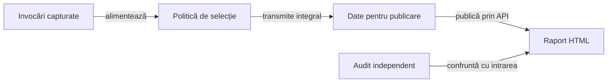

# Integrarea bibliotecilor și publicarea rezultatelor

## Pe scurt

Modulul verifică integrarea bibliotecilor comune, guvernanța proiectului și publicarea rezultatelor Whist. Consumatorul selectează înregistrările, păstrează comparațiile originale și confruntă rezultatul publicat cu intrarea capturată.

Biblioteca comună deține prezentarea HTML și se consumă prin API-ul configurat în [POM-ul părinte](../pom.xml). Contractele de publicare, selecțiile de date și acceptanța binară au verificări distincte.

## Flux și responsabilități



<details>
<summary>Legendă: identitatea execuției precede prezentarea</summary>

O înregistrare descrie o invocare: identitate, parametri, intervale, comparații și verdict. Selecția păstrează invocări întregi și declară omisiunile; adaptorul pregătește datele, iar biblioteca comună construiește prezentarea.

</details>

## Organizare

| Mecanism | Responsabilitate |
|---|---|
| [Selecția](src/main/java/atf/tests/learning/EvidenceSelection.java) | Păstrează rezultatele diferite de PASS, colecțiile obligatorii, gărzile populației și exemplele selectate determinist. |
| [Compoziția](src/main/java/atf/tests/learning/LearningRunReport.java) | Verifică înregistrările și transmite comparațiile originale. |
| [Sesiunea publicării](src/main/java/atf/tests/reporting/GameReportSession.java) | Izolează configurația, contextul și fazele unei publicări. |
| [Auditul HTML](src/main/java/atf/tests/learning/LearningReportHtmlAudit.java) | Confruntă identitățile, rândurile, valorile și scopul publicat cu datele sursă. |

[Politica prezentării](../docs/reporting/ATF_Presentation.md) deține regulile de volum și navigare. Codul reutilizabil este în `src/main/java`; intrările JUnit și probele negative sunt în `src/test/java`.

## Contracte importante

- Fiecare invocare selectată păstrează verdictul, cauza și comparațiile obligatorii.
- Inventarul omisiunilor arată ce a fost executat și ce nu este prezentat individual în HTML.
- Bugetul contextului opțional păstrează valorile așteptate, observate și verdictul; [GameEvidenceBodies](src/main/java/atf/tests/reporting/GameEvidenceBodies.java) refuză intrările indivizibile prea mari.
- Republicarea consumă date capturate și păstrează identitatea execuției originale; imaginile istorice ori sintetice au etichetă explicită.

## Verificare focalizată

Dintr-o copie temporară proprie, cu POM-ul părinte, modulele necesare, perechile fizice JAR/POM și un depozit Maven propriu:

```powershell
mvn -B -pl atf-tests -am '-Dtest=GameReportComponentSuite,LearningRunReportContractTest,EvidenceSelectionContractTest' '-Dsurefire.failIfNoSpecifiedTests=false' test
```

Alegeți verificarea după contractul schimbat:

| Scop | Intrare JUnit |
|---|---|
| Politică, corpuri JSON/TEXT, redactare și publicare | [GameReportComponentSuite](src/test/java/atf/tests/reporting/GameReportComponentSuite.java). |
| Proprietatea valorilor și mutații deliberate ale datelor publicate | [LearningRunReportContractTest](src/test/java/atf/tests/learning/LearningRunReportContractTest.java). |
| Populație, praguri și selecție | [EvidenceSelectionContractTest](src/test/java/atf/tests/learning/EvidenceSelectionContractTest.java). |
| Binare și compoziția modulelor | [CoreReportingConsumerContractTest](src/test/java/atf/tests/publishing/CoreReportingConsumerContractTest.java). |
| Capturi PNG prin API | [AndroidInlineScreenshotReportContractTest](src/test/java/atf/tests/contracts/AndroidInlineScreenshotReportContractTest.java). |

[LearningRunReportTest](src/test/java/atf/tests/learning/LearningRunReportTest.java) publică o selecție explicită prin activarea sa dedicată. [DeepSuiteExtentReportTest](src/test/java/atf/tests/publishing/DeepSuiteExtentReportTest.java) compune o publicare agregată, cu precondiții și activare separate.

## Intervalele Android la republicare

[Contractul măsurării timpilor](../docs/reporting/ATF_PhaseTiming.md) păstrează intervalele originale și asocierea lor cu acțiunile. Verificarea acestui contract pe jurnale capturate are un scop distinct de executarea unor interacțiuni Android noi.

## Niveluri și guvernanță

Componentele verifică selecția, adaptoarele și publicarea; integrarea verifică binarele fizice, configurația și compoziția modulelor. [Matricea nivelurilor](../docs/testing/ATF_Architecture.md) este confruntată cu declarațiile testelor.

[Suita de calitate](src/test/java/atf/tests/governance/AtfQualityGovernanceSuite.java) verifică sursele, documentația și contractele bibliotecilor. [Lansatorul guvernanței](../scripts/run-atf-governance.ps1) pregătește copia temporară și depozitul Maven propriu, păstrează rezultatele extern și detectează schimbările sursei pe durata verificării.

[Guvernanță](../docs/governance/README.md) · [Arhitectura publicării](../docs/reporting/README.md) · [Indexul documentației](../docs/README.md)

## Îmbunătățiri prioritare ale consumatorului

Responsabilul consumatorului trebuie să păstreze auditabilitatea și la intrări mari sau predominant cu eșec. Politica de selecție, compoziția și citirea dovezilor rămân mecanisme locale, iar randarea HTML aparține bibliotecii comune.

| Prioritate | Cerință | Criteriu de închidere |
|---|---|---|
| P2 | Calificați volumul intrărilor înaintea publicării. | Componente cu populații controlate măsoară costul selecției, numărul comparațiilor și corpul opțional; toate eșecurile, valorile obligatorii și inventarul omisiunilor sunt păstrate. |
| P2 | Faceți selecția și compoziția ușor de revizuit. | Pașii pentru populație, priorități, exemple și diagnostic sunt denumiți după invariantă, cu probe de frontieră; reformatarea sau extracția păstrează verdictul și ordinea originală. |
| P2 | Verificați separat temporalitatea și proveniența. | Replay-ul, captura sintetică și execuția Android nouă au identități și domenii distincte; intrările contradictorii ori incomplete sunt refuzate. |

[Politica prezentării](../docs/reporting/ATF_Presentation.md) deține selecția. Cerințele generice ale JAR-ului urmează [rutarea responsabilităților](../docs/feedback/README.md), împreună cu reproducerea și contractul așteptat.
