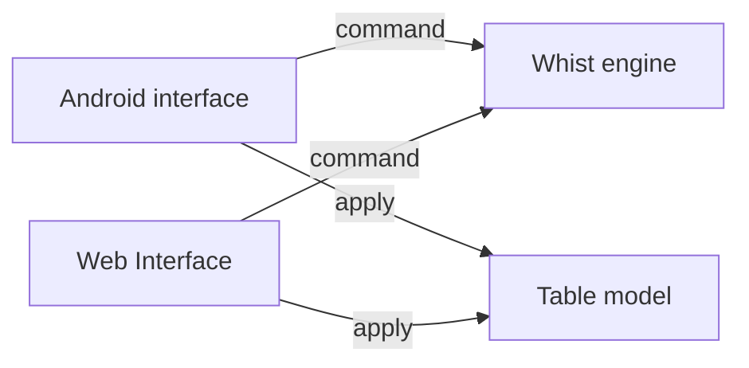
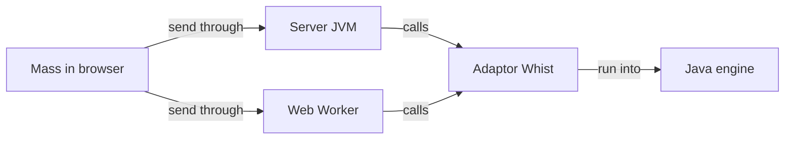
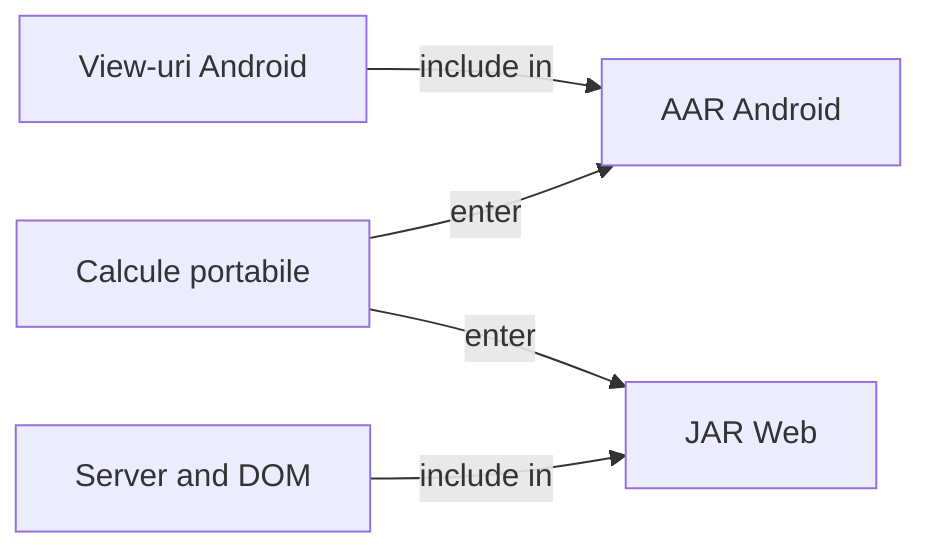

# Card Table Browser adapter

## Overview

Whist uses Java engine and portable table contracts in both APK and browser. Web runs either via local JVM server or as a static site with the engine compiled via TeaVM. Rentz and Hold'em integrate fixed versions of the Web library through their own adapters.

**Quick links** · [Android–Web contract](#what-android-and-web-share) · [Run on the Web](#web-execution-paths) · [JAR and AAR](#adapter-library) · [Verification](#verification)

## What Android and Web share

The two interfaces share game rules and table portable calculations. Each adapter measures and draws with the tools of its platform.



<details>
<summary>Legend on rules, geometry and rendering</summary>

- The engine validates the bids and the cards, declines the score and sets the actor. Adaptors publish the visible table status and player options.
- The table model includes geometry, fan, card appearance and timing. Android applies it through Views, and Web through font measurements and DOM elements.
- The printing press and system areas shall be measured separately. Samples with the same inputs check the formulae, and the APK-browser comparison on the device measures the randed result. [Display components](../docs/testing/ATF_DisplayComponents.md)

</details>

## Web execution paths



<details>
<summary>Legend on the route of controls and local data</summary>

- JVM server runs the game in local process and serves Web resources. The session of the match belongs to the server and remains associated with the tab.
- The static site loads the adapter and engine transcribed into JavaScript. The messages to Web Worker remain on the device. Local transport keeps the profile and checkpoint by storing the browser.
- The diagram follows the command. The answer returns the revision, legal options and public status on the same route. [Transport of the static edition](pages/web/local-transport.mjs)

</details>

| Strat | Responsibility |
|---|---|
| [The game contract](src/main/java/ro/cardtable/browser/BrowserGame.java) | Publish the places, the cards allowed, the legal orders and scores. Validation remains in the engine of each game. |
| [Serverul](src/main/java/ro/cardtable/browser/BrowserServer.java) | Serves the resources of the same origin. Isolate the parties on the tab, validate the revisions and reject repeated commands. |
| [Geometria](src/main/java/ro/cardtable/browser/BrowserGeometry.java) | Apply Java plan used in Android for seats and fans. On the phone, it measures the useful view port. On the desktop it sets the logical frame at 414 × 896, calculates the scale by the useful height and centreates. |
| [Adaptorul Whist](whist/src/main/java/ro/whistlab/browser/WhistBrowser.java) | Use distribution, AI policies and engine settlement. The recommendation comes from the same human selection as on Android. |

## Whist on GitHub Pages

The static edition distributes the Java engine compiled with TeaVM in a Web Worker. The table sends the same commands and reads the same public projection through local messages. After loading resources, bidding, AutoGame and settlement shall not make requests to an API.

| Contract taken out of Android | Application in browser |
|---|---|
| [Header printing](../whist-lab-app/app/src/main/java/ro/whistlab/app/theme/GameHeaderTypography.java) and [paleta](../whist-lab-app/atf-card-table-ui/src/main/java/ro/cardtable/ui/theme/TableColors.java) | The adapter transmits the text's roles and colors. The order applies to the header, menu and table. |
| [Table reservation](../whist-lab-app/app/src/main/java/ro/whistlab/app/table/TableLayoutMetrics.java) | Measure the window and keep the same centre reserved for all hands of the variant. |
| [Bidding checks](../whist-lab-app/app/src/main/java/ro/whistlab/app/bidding/BidGridMetrics.java) | The figure and confirmation shall keep the tactile target of 48 logical units. The outline is withdrawn inside, and the number of columns and removable row come from APK policy. |
| [The pace of the moves](../whist-lab-app/atf-card-table-ui/src/main/java/ro/cardtable/ui/turn/TurnPacing.java) | Each automatic card appears after the delay defined by APK. The adapter plays the actor, card and collection in order produced by the engine. |

[Contractul mesei](../whist-lab-app/atf-card-table-ui/src/main/java/ro/cardtable/ui/table/TableGeometry.java) receives the measured dimensions and phase reservation. Android applies the rectangle in the ViewGroup, and the web applies it in the DOM.
[Collection curve](../whist-lab-app/atf-card-table-ui/src/main/java/ro/cardtable/ui/animation/TrickCollectionMotion.java) assesses progress on Android and provides web-based frames that the browser interpolates.

| Date | Retention in the static edition |
|---|---|
| Limba | The Romanian or English option is saved in the browser. The menu, rules, table status and achievements use the texts of the APK. |
| Profiles, Achievements and Rankings | The browser saves the name, progress and leaderboards in the same local record as the game. The leaderboards use the top, the filter by configuration and the AI and Example markings in the APK. |
| Party | The menu allows for the resumption after reopening. The browser saves the checkpoint at each accepted command and uses the same validation as the APK. |
| Site data | Wiping the site storage or changing the browser starts a new profile. If storage is disabled, the session uses the memory of the tab. |

- [Checkpoint codeine](../whist-lab-app/app/src/main/java/ro/whistlab/app/persistence/GameCheckpointCodec.java) restores distribution, tricks and history at the last accepted command. The identity of the match remains stable and prevents duplication of results. A damaged checkpoint can be removed independently of profile and progress.
- Web Locks serializes the writings between compatible tabs. A tab with an overhaul reacts the checkpoint before the next command. If the browser refuses writing, the game can continue in memory and display the storage error.
- The history displays all hands and total after each hand in column P A red diagonal marks the missed bid. In column P, a box marks the serial bonus, and a red box marks the penalty.
- Settings use [Same default values as APK](../whist-lab-app/app/src/main/java/ro/whistlab/app/screens/MatchSetup.java). The change of language keeps the options on the screen, and the rules dialogue shows the schedule of the option for the selected number of players.
- In the game menu, the current score opens up the history when there are hands closed. At the last score, **Play noun ** retains the configuration and replaces the local game with a new distribution and identifier.
- The chenars of the table take over the name, bid and levatates of the APK projection. The gold tag shows the playable cards. The total appears in score and history.
- [Hand adapter](src/main/java/ro/cardtable/browser/BrowserHandAdapter.java) sends gestures to the common model used in the APK. The refusal highlights the pressed card and legal options for 1.100 ms. When choosing a legal card, the deposit follows the raise of 150 ms. API projects the same curve and layers of the fan as in APK.
- The face of the Whist takes the mark from the Android hand. The rank and symbol in the corner, the central symbol and the inverted corner shall be proportionately scaled in the trick. Collection copies face off the table. Accessible text includes the player and the card.
- The main menu of Whist takes over the dedication from the location used on Android. The site uses the same photo, copied to the building from the application's resources.
- [The contract of the trump box](../whist-lab-app/atf-card-table-ui/src/main/java/ro/cardtable/ui/table/trump/TrumpTileMetrics.java) provides the basic dimensions and printing. Android measures with native font, and Web with Canvas. [Same cases of classification](../whist-lab-app/app/src/test/resources/whist-trump-text-fit.tsv) checks both adapters.
- The collection shall apply the time-setting in the common module. Full wattage and the current count of the winner are in the collection event. The hand is reviewed immediately after deposit, and the stable mass contains the cards in the current trick. Resize can remove the temporary drawing, and the next card will respect the already scheduled range.
- AutoGame is activated for current hand. The debunking cancels the next decision instead of the player. The accepted movements shall be terminated and the menus and dialogues shall suspend the following decision for as long as they are open. The score or return to the main menu turn off the tick.

- The building requires PowerShell 7, JDK 21, Maven and the environment of generating the catalogue. `$WorkRoot` and `$EvidenceRoot` indicate external directories.
- The Node.js test the public inventory and play through the compiled engine. For gestures and profile reopening, run [scenariile Playwright](#verification).

```powershell
$Site = .\atf-ui-browser\Build-WhistPages.ps1 -WorkRoot $WorkRoot
node .\atf-ui-browser\pages\verify.mjs $Site $EvidenceRoot
```

- For bidding changes, AutoGame, language or achievements, run `node .\atf-ui-browser\pages\verify-controls.mjs $Site $EvidenceRoot`. The sample uses the engine compiled and replaces the timer and the browser storage in controlled cases.
- Add `--ui-only` to geometry and rhythm of the moves. To include the visual path, cross the path to Chrome or Edge before option. `--browser-only` selects only the visual course and asks the executable.
- For score history and checkpoint compatibility, generate legal data with [WhistRecordsFixture](pages/WhistRecordsFixture.java) and run [checking Pages](pages/verify-records.mjs) with site directory, evidence file and JSON data file. The fixture compiles with the JVM launcher and `ScoredHandFixture` of the application tests.
- For language, settings, navigation and Play again, run `node .\atf-ui-browser\pages\verify-navigation.mjs $Site $EvidenceRoot`. The sample also produces a local checkpoint for visual check of the retake from the final score.
- For bookmarking, trick order and resize, run `node .\atf-ui-browser\pages\verify-effects.mjs $Site $EvidenceRoot`.
- For reaction to card pressing, lifting and trick face, run `node .\atf-ui-browser\pages\verify-card-adapter.mjs $Site $EvidenceRoot`The JVM test and test of the UI module consume the same [gestures scenario](../whist-lab-app/atf-card-table-ui/src/test/resources/hand-feedback.tsv).
- Use `--contract-only` to check only geometry on phases and curve samples from the compiled artifact. For this selection, omit the browser executable.

The workflow [.github/workflows/whist-pages.yml](https://github.com/crististefanita/whist/blob/main/.github/workflows/whist-pages.yml) builds and verifies the static site before deploying it from `main` through GitHub Actions. After deployment, open the public URL in an anonymous session and verify the assets and the start of a hand.

The artifacts of static distribution are on the publishing branch. The [TeaVM dependencies](pages/teavm-dependencies.xml) file serves the Pages building independently of the Maven ATF reactor.

## Running locally

Run the project command with PowerShell 7, JDK 21 and the environment Gradle Android configured for the catalog generation. `$WorkRoot` indicates the external directory for the build and profile data. Open the full terminal address in Edge or Chrome.

```powershell
.\atf-ui-browser\Start-WhistBrowser.ps1 -WorkRoot $WorkRoot
```

For a phone connected to the test network, `-ListenAddress $LocalLanAddress` selects the local address accessible. Open the full address in your phone browser.

## Data in the JVM server

| Date | Where to store |
|---|---|
| Name and identifier | On the device, for the same web origin as defined by protocol, host and port. In a new tab, Whist gets his profile back. The browser copy can remake the name if his file is missing from the server. |
| Achievements | In `$WorkRoot/whist-profile-data`, associated with the identifier and credited from the results confirmed by the engine. |
| Party | Independent on the tab. The same tab can resume the game by recharging while the server process is running. |

- Wiping the site data, changing the browser or changing the origin creates a new profile. In private mode, retention follows browser policy.
- Whist uses Android's task of generating the catalogue and dependence `org.json:json:20240205`. `-JsonLibrary` selects JARI from another directory, and `-CatalogSource` reuses the output generated from the same checkout.

## Adapter library

Whist builds Web and APK from sources. The library for other games is exported in two formats with own checks on each consumer.



<details>
<summary>Legend on the content of the packages</summary>

- [AAR-ul Android](../whist-lab-app/atf-card-table-ui/README.md#packaging-and-consumption) contains the widgets, themes, resources and portable calculations selected by Gradle.
- [Lansatorul Web](Start-CardTableBrowser.ps1) compiles an explicit selection of portable sources, including the contents of the seats, table cards, colors and the rhythm of the moves. The JAR includes the server, adaptor contract and DOM resources. Each game provides the engine and adapter.
- Web test archive is exported separately. Probe resources, revisions, menu, pick up, collect, frame the asset and the boxes in the browser. The exported JARs have Sha- 256 files next to them.
- Whist site uses [alt build](Build-WhistPages.ps1), which produces static resources from the Whist adapter and engine. Pages test and JARs acceptance by Rentz or Hold'em have different inputs.

</details>

```powershell
.\atf-ui-browser\Package-CardTableBrowser.ps1 -WorkRoot $WorkRoot -Version $BrowserLibraryVersion
```

- Choose `$BrowserLibraryVersion` and start out from a clean checkout Git. The exhibition writes the two JARs, fingerprints and `browser-build.json` in the external directory of the version. The registry links the files to the source comma and the input inventory.
- Check the commit and SHA- 256 at adoption. The manifesto installed near the two JARs shows which version each adapter uses.
- Export shall re-use the Director of the same version after confrontation with entries and bytes. Changing entries requires a new version. The integration challenge starts the first match through the physical JARs, adaptor and game dependencies.
- Promote the same bytes and same fingerprints in qualified consumers. The version of the HTML cache aims at updating the site's resources. [Consumer verification](#verification)

## Verification

- The Web Adapter increases by 50% the 2- rankings of the regular cards. It centres the indices in the same band, measured with `10`, and limits the rank of the compact face to the available space. The faces, colours and the trump shall retain their reference dimensions.
- The width of the visible index sets the overlap in the fan, including `10` and 17 cards.
- The Web Header retains the anchor of the APK title, progress and asset. The progress and summary of the bids, the game menu, the main menu and settings use text with 50% higher in the Web. The trump scale shall retain the natural height of the two rows and shall restrict the text exceeding the width available.
- In the Web, the button is the player's only visual urge to manually bid.
- Touch the table outside the game menu closes the menu. Probe targets from inside and outside separately, including after redrawing the table.
- After the moves of the opponents, the visible board retains its geometry until the next condition is settled. The component sample delays measurement just before the player's turn returns. The card's quenary keeps its position and colors in the manual game, AutoGame and during collection.
- The batches have the same coordinates at bidding, playing and collecting. The component sample compares all the boxes in the hands of one card to five and six players, manually and with AutoGame.
- The symbols of the cards use the same face ink in hand, on the table and when collecting. The theme provides the colors, and the Web adapter requires the rendering of symbols as text.
- In the Whistle Web, the bid summary uses 90% of the larger rows, and the rewind lists use 75% of the labels. The check at 360 and 414 px measures the Normal/Dificil selector in the same row as the Romanian label.

Use `-BuildOnly` to the three launchers and pass the classSPath values returned to the suite of components. JVM processes serve the Loopback adapters, and the suite sends HTTP requests and checks the public status. `$EvidenceRoot` indicates an existing and dedicated external rolling directory.

```powershell
node .\atf-ui-browser\tests\run-components.mjs $EvidenceRoot $WhistClasses $RentzClasses $HoldemClasses
java -cp $WhistClasses .\atf-ui-browser\tests\WhistParity.java > (Join-Path $EvidenceRoot 'whist-parity.json')
```

For UI, prepare the Pages edition in `$Site` and generates `hand-fixture.json` with sample `verify-card-adapter.mjs`Running uses Playwright Java with Chromium headless, locators by role and an isolated context for each scenario. [Playwright Locators and Expectations](https://playwright.dev/docs/locators)

`-BrowserExecutable` allows the choice of a Chrome or Edge installation. Compatible chromium should be available when the parameter is omitted.

```powershell
node .\atf-ui-browser\pages\verify-card-adapter.mjs $Site $AdapterEvidence
.\atf-ui-browser\tests\Run-BrowserUi.ps1 -Site $Site -HandFixture (Join-Path $AdapterEvidence 'hand-fixture.json') -EvidenceRoot $EvidenceRoot
.\atf-ui-browser\tests\Publish-BrowserExtent.ps1 -EvidenceRoot $EvidenceRoot -MavenClasspathFile $MavenClasspath
```

`$MavenClasspath` is the list of dependencies produced by the Maven gate of [componente](../docs/testing/README.md). The report links the comparisons and inline images to the browser's running. [Parity criteria still open](../docs/feedback/ATF_UiBrowser.md)

| Test layer | Responsibility |
|---|---|
| Component | Check revisions, refusals, geometry, profile and settlement through HTTP contract or Pages engine with controlled storage and timing. |
| UI Web | Check the Chromium index `10` and access to the last card in a hand of 17 cards, including text at 200%. Check the keyboard bid, rejected touch, AutoGame and post-reload profile. Write `browser-ui-checks.json` and the catches in the running directory. |
| UI desktop | Check in Chrome and Edge with browser zoom 100% and 125%, frame at 1280 × 720, 1920 × 1080 and in a narrow window. Measure the useful viewport and frame position. Confirm visible focus and profile, bid and legal card path from the keyboard. |
| Comparison on Android | Compare APK and Chrome to the same view, to bidding and playing. Check in EN and RO the header and the card card, symbol and no trump, including the larger text. Record the viewport, density and shah of APK in `paired-android.json`. |
| Reporting | Extent reads the results of each level and attaches the catches of PNG inline. |

The trump scale is loading a Noto Sans Symbols subset locally 2 with the four suite symbols. [OFL licence](src/main/web/card-suits-OFL.txt)
