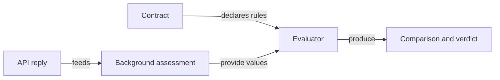

# Semantic validation API

## Overview

The module shall assess response contracts and produce comparisons and independent disclosure decisions. Transport provides the answer; the rules set expectations and the outcome policy interprets the comparisons assessed.

Full values decide the verdict. The projection for publication and limitation of preview shall take place after evaluation, with the maintenance of the cause and the comparative values.

## Responsibilities



<details>
<summary>Legend: local context and unique evaluation</summary>

[ContractEvaluation](src/main/java/atf/validation/contract/ContractEvaluation.java) leaves the JSON body under the first rule that requires it and reuses the document only in the current assessment. Header rules can function separately; publication consumes the captured result without repeating the assessment after the text is shortened.

</details>

## JSON contracts

- The invalid path, absence and present value are distinct; `null` explicitly present.
- Simple paths and JSON Pointer have an explicit subset; general selections, filters and recursive search are denied.
- The scheme shall be checked for a preliminary period, including in branches not touched by the court; the unknown keywords shall be refused.
- The assessment of a scheme shall have its own compiled deviations and regular expressions; the same expression shall be reused for repetitive values without common cache between applications or after file modification.
- Strict policy is failing and warning policy retains negative comparisons and status `WARNING`.

<details>
<summary>Subset of the scheme and sources of contract</summary>

| Surface | Meaning |
|---|---|
| Scheme | Object or Boolean; pre-validation independent of court. |
| Types and values | `type`, `enum`, exact value equality and numerical comparisons; `integer` accepts a total numerical value. |
| Objects | `required`, `properties` and `additionalProperties` Boolean or scheme. |
| arrays | `items` Boolean or schematic, `minItems` and `maxItems`. |
| Rings | Limits in Unicode code points and valid Java regular expressions. |
| Numbers | `minimum` and `maximum` inclusive, by `BigDecimal`. |
| Metadata | `$schema` accepts the 2020-12 Draft Identifier; the other permitted metadata are annotations. |
| Rejections | Key and unsupported forms including `const`, `$ref` and `format`. |

[JsonSchemaCapabilities](src/main/java/atf/validation/contract/schema/JsonSchemaCapabilities.java) defines the vocabulary and accepted forms and [JsonSchemaValidator](src/main/java/atf/validation/contract/JsonSchemaValidator.java) assesses the court. The accepted URIO is `https://json-schema.org/draft/2020-12/schema`; the module implements the declared subset with explicit refusal outside it.

[JsonPathSupport](src/main/java/atf/validation/contract/JsonPathSupport.java) holds the solution of the paths. The scalar rules refuse objects and paintings as scalar values, instead of turning them into an empty string.

</details>

## Type of content and common parser

`contentTypeJson()` delegates the classification of the concrete type to `MediaTypes.isJson` of Core. The header classification and syntactic validity of the body shall be checked separately.

- The type and subtype ignore the differences in capitals, and the subtypes with suffix `+json` use the common vocabulary.
- Absent type, general selection and type lists are refused; parameters do not convert `text/plain` into JSON.
- `contentTypeContains` maintains the literal comparison of compatibility.
- [JsonDocument](src/main/java/atf/validation/contract/json/JsonDocument.java) uses the full parser of Core, with the refusal of duplicate keys and the content after the root.

## Levels and verification

With his own temporary copy, with his own Pome, libraries and a Maven warehouse:

```powershell
mvn -B -pl atf-validation -am test
```

| Contract | Verification |
|---|---|
| Presence and scalar values | [JsonPresenceContractTest](src/test/java/atf/validation/JsonPresenceContractTest.java). |
| Supported schema subset and rejection cases | [JsonSchemaContractTest](src/test/java/atf/validation/JsonSchemaContractTest.java). |
| Header classification | [JsonMediaTypeContractTest](src/test/java/atf/validation/media/JsonMediaTypeContractTest.java). |

[Test architecture](../docs/testing/ATF_Architecture.md) separates the rules from the components of the contract evaluation and the collaboration through the Public API. [POM](pom.xml) defines the dependencies and the limit of the module.

## Cost and limits

The JSON sub-set is explicit and refuses unsupported construction. The following qualification shall delimit the cost of prevalidation and evaluation on large, deep or repetitive structures.

- [Validation feedback](../docs/feedback/ATF_TestInfrastructure.md#cost-of-validating-api) is qualified for volume and depth budgets. The re-use of expressions in the same assessment shall preserve prevalidation, regex Java semantics, the paths and order of deviations; the components shall also verify the independence of successive assessments.

- The result of the performance and identity of the entries shall be kept externally. Optimization shall be accepted by semantic parity and measurement, with publication separate from the assessment of the full values.

## Test catalogue

[Inputs and responsibilities of tests](src/test/README.md) explains the selection, preconditions and interpretation of the result, through the same common strategy for all deliveries.
