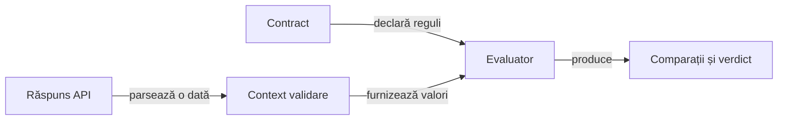

# Validare semantică API

## Pe scurt

Modulul evaluează contracte de răspuns și produce comparații și decizii independente de prezentare. Transportul și regulile jocului au proprietari separați.

## Responsabilități



<details>
<summary>Legendă: evaluare și prezentare</summary>

Evaluatorul stabilește rezultatul din valorile integrale. Publicarea primește comparațiile evaluate și nu repetă evaluarea după trunchierea previzualizării.

</details>

## Contractele JSON

| Suprafață | Semnificație |
|---|---|
| Prezență | Calea invalidă, absența și valoarea prezentă sunt distincte; `null` explicit este prezent. |
| Căi | Proprietăți și indici, formă simplă și JSON Pointer cu secvențe de evitare valide; selecțiile generale, filtrele și căutarea recursivă sunt refuzate. |
| Egalitate scalară | Obiectele și tablourile nu devin șir gol; regulile scalare refuză containerele. |
| Schemă | Validare preliminară independentă de instanță, inclusiv pentru ramuri neatinse; schemă obiect sau boolean. |
| Tipuri și valori | `type`, `enum` și comparații numerice exacte; `integer` acceptă valoarea numerică integrală. |
| Obiecte | `required`, `properties` și `additionalProperties` boolean sau schemă. |
| Tablouri | `items` boolean sau schemă, `minItems` și `maxItems`. |
| Șiruri | Limite în puncte de cod Unicode și expresii regulate Java valide. |
| Numere | `minimum` și `maximum` incluzive, prin `BigDecimal`. |
| Metadate | `$schema` acceptă numai identificatorul draft 2020-12; celelalte metadate acceptate sunt adnotări. |
| Forme nesuportate | Orice cuvânt-cheie necunoscut ori formă invalidă este refuzată, inclusiv `const`, `$ref` și `format`. |

URI-ul acceptat este `https://json-schema.org/draft/2020-12/schema`. Modulul implementează un subset explicit; validarea unei ramuri nu legitimează ignorarea unui cuvânt-cheie refuzat în altă ramură.

Politica strictă produce eșec, iar politica de avertizare păstrează rândurile negative și statutul `WARNING`. Valorile integrale decid rezultatul, cu previzualizarea implicită limitată la 240 de caractere.

## Tipul conținutului și parserul comun

`contentTypeJson()` delegă clasificarea tipului concret către `MediaTypes.isJson` din Core. Parametrii antetului nu pot transforma `text/plain` în JSON; subtipurile concrete JSON și cele cu sufix `+json` respectă vocabularul comun.

- Clasificarea ignoră diferențele de majuscule ale tipului și subtipului.
- Tipul absent, selecțiile generale și listele de tipuri sunt refuzate.
- `contentTypeContains` păstrează comparația literală de compatibilitate.
- Sintaxa corpului este verificată separat de clasificarea antetului.
- Documentele complete folosesc `JsonDocuments` din Core, fără chei duplicate sau conținut ulterior rădăcinii.

## Niveluri și verificare

| Nivel | Contract |
|---|---|
| Unitar | Prezență, scalari, scheme, politici și proiecția comparațiilor. |
| Componentă | Contractele evaluării AI și colaborarea regulilor prin API-ul public. |

[Arhitectura testării](../docs/testing/architecture/README.md) definește matricea comună. Dintr-o copie temporară proprie, cu POM-ul părinte și dependențele reactorului:

```powershell
mvn -B -pl atf-validation -am test
```

[Prezența](src/test/java/atf/validation/JsonPresenceContractTest.java), [schema](src/test/java/atf/validation/JsonSchemaContractTest.java) și [tipurile JSON](src/test/java/atf/validation/media/JsonMediaTypeContractTest.java) au contracte distincte. [POM-ul](pom.xml) definește dependențele.
