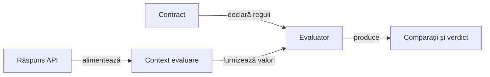

# Validare semantică API

## Pe scurt

Modulul evaluează contracte de răspuns și produce comparații și decizii independente de prezentare. Transportul furnizează răspunsul; regulile stabilesc așteptările, iar politica rezultatului interpretează comparațiile evaluate.

Valorile integrale decid verdictul. Proiecția pentru publicare și limitarea previzualizării au loc după evaluare, cu păstrarea cauzei și a valorilor comparate.

## Responsabilități



<details>
<summary>Legendă: context local și evaluare unică</summary>

[ContractEvaluation](src/main/java/atf/validation/contract/ContractEvaluation.java) parsează corpul JSON la prima regulă care îl cere și reutilizează documentul numai în evaluarea curentă. Regulile de antet pot funcționa separat; publicarea consumă rezultatul capturat, fără a repeta evaluarea după scurtarea textului.

</details>

## Contractele JSON

- Calea invalidă, absența și valoarea prezentă sunt distincte; `null` explicit este prezent.
- Căile simple și JSON Pointer au un subset explicit; selecțiile generale, filtrele și căutarea recursivă sunt refuzate.
- Schema este verificată preliminar, inclusiv în ramuri neatinse de instanță; cuvintele-cheie necunoscute sunt refuzate.
- Politica strictă produce eșec, iar politica de avertizare păstrează comparațiile negative și statutul `WARNING`.

<details>
<summary>Subsetul schemei și sursele contractului</summary>

| Suprafață | Semnificație |
|---|---|
| Schemă | Obiect sau boolean; prevalidare independentă de instanță. |
| Tipuri și valori | `type`, `enum`, egalitate de valori și comparații numerice exacte; `integer` acceptă o valoare numerică integrală. |
| Obiecte | `required`, `properties` și `additionalProperties` boolean sau schemă. |
| Tablouri | `items` boolean sau schemă, `minItems` și `maxItems`. |
| Șiruri | Limite în puncte de cod Unicode și expresii regulate Java valide. |
| Numere | `minimum` și `maximum` incluzive, prin `BigDecimal`. |
| Metadate | `$schema` acceptă identificatorul draft 2020-12; celelalte metadate permise sunt adnotări. |
| Refuzuri | Cuvinte-cheie și forme nesuportate, inclusiv `const`, `$ref` și `format`. |

[JsonSchemaCapabilities](src/main/java/atf/validation/contract/schema/JsonSchemaCapabilities.java) definește vocabularul și formele acceptate, iar [JsonSchemaValidator](src/main/java/atf/validation/contract/JsonSchemaValidator.java) evaluează instanța. URI-ul acceptat este `https://json-schema.org/draft/2020-12/schema`; modulul implementează subsetul declarat, cu refuz explicit în afara lui.

[JsonPathSupport](src/main/java/atf/validation/contract/JsonPathSupport.java) deține rezolvarea căilor. Regulile scalare refuză obiectele și tablourile ca valori scalare, în loc să le transforme într-un șir gol.

</details>

## Tipul conținutului și parserul comun

`contentTypeJson()` delegă clasificarea tipului concret către `MediaTypes.isJson` din Core. Clasificarea antetului și validitatea sintactică a corpului se verifică separat.

- Tipul și subtipul ignoră diferențele de majuscule, iar subtipurile cu sufix `+json` folosesc vocabularul comun.
- Tipul absent, selecțiile generale și listele de tipuri sunt refuzate; parametrii nu transformă `text/plain` în JSON.
- `contentTypeContains` păstrează comparația literală de compatibilitate.
- [JsonDocument](src/main/java/atf/validation/contract/json/JsonDocument.java) folosește parserul complet din Core, cu refuzul cheilor duplicate și al conținutului ulterior rădăcinii.

## Niveluri și verificare

Dintr-o copie temporară proprie, cu POM-ul părinte, bibliotecile și un depozit Maven propriu:

```powershell
mvn -B -pl atf-validation -am test
```

| Contract | Verificare |
|---|---|
| Prezență și scalar | [JsonPresenceContractTest](src/test/java/atf/validation/JsonPresenceContractTest.java). |
| Subsetul schemei și refuzuri | [JsonSchemaContractTest](src/test/java/atf/validation/JsonSchemaContractTest.java). |
| Clasificarea antetului | [JsonMediaTypeContractTest](src/test/java/atf/validation/media/JsonMediaTypeContractTest.java). |

[Arhitectura testării](../docs/testing/ATF_Architecture.md) separă regulile unitare de componentele evaluării contractelor și de colaborarea prin API-ul public. [POM-ul](pom.xml) definește dependențele și limita modulului.

## Cost și limite

Subsetul JSON este explicit și refuză construcțiile nesuportate. Următoarea calificare trebuie să delimiteze costul prevalidării și al evaluării pe structuri mari, adânci sau repetitive.

- [Feedback-ul validării](../docs/feedback/ATF_TestInfrastructure.md#costul-validării-api) deține calificarea bugetelor și reutilizarea expresiilor validate. Corectitudinea subsetului și costul pe structuri mari ori adânci au verificări distincte.

- Rezultatul performanței și identitatea intrărilor se păstrează extern. Optimizarea se acceptă după paritate semantică și măsurare, cu publicarea separată de evaluarea valorilor integrale.
