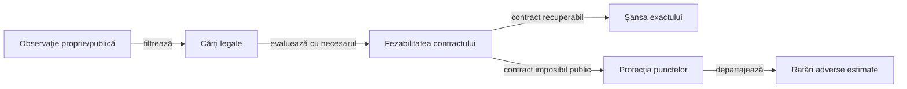

# Decizii contextuale și siguranța contractului

Valoarea unei cărți depinde de obiectivul rămas și de informația publică. [Manifestul contextual](../config/whist-contextual-discard.yaml) leagă condițiile generale de implementare și de regresiile independente.

## Ordinea evaluării

Legendă: prioritatea obiectivelor

Legalitatea precedă orice intenție. Fezabilitatea folosește limite publice și certificate în domeniul lor; o estimare de rollout nu este o demonstrație că un contract este imposibil sau o mutare este universal sigură.

## Reguli condiționale

| Condiție | Implicație |
|---|---|
| Contractul este realizat | Reduceți riscul levatelor suplimentare în limitele legalității. |
| Mai lipsesc levate realizabile | Păstrați sau folosiți cărțile care oferă oportunitățile necesare. |
| Lipsește culoarea cerută, dar există atu | Tăierea obligatorie prevalează asupra intenției de evitare. |
| Lipsește culoarea și nu există atu | Un onor lateral poate deveni o ieșire legală. |
| Există un atu superior încă pe masă | Un atu propriu jucabil poate fi consumat fără o levată proprie. |
| Atuul superior este întors sau într-o levată încheiată | El nu mai poate câștiga levata curentă. |
| Dezechilibrul total sugerează evitare | Evaluați în continuare necesarul fiecărui loc; totalul nu înlocuiește obiectivul individual. |

## Mărimi de stare

| Mărime | Definiție | Proprietate |
|---|---|---|
| Necesar semnat | contract − levate câștigate | Păstrează semnul după depășirea contractului. |
| Oportunități | (cărți rămase în mâini + cărți pe masa neterminată) / jucători | Include levata curentă o singură dată. |
| Diferență semnată a mesei | suma necesarelor − oportunități | Rămâne constantă în aceeași mână. |
| Cerere pozitivă | suma valorilor max(0, necesar) | Nu compensează nevoile pozitive prin contracte deja depășite. |
| Densitatea necesarului | necesar / oportunități, când există oportunități | Indicator contextual, fără interpretare automată drept probabilitate. |

## Garanții și estimări

Hard prioritizează șansa estimată a contractului recuperabil, apoi punctele proprii și scorul rivalului principal. Dacă limitele publice dovedesc imposibilitatea, prioritizează punctele proprii estimate și folosește ratarea contractelor adverse drept criteriu ulterior.

Un certificat complet poate prefera o continuare numai în domeniul enumerat și cu protejarea punctelor proprii în toate lumile și răspunsurile relevante. Bugetul epuizat sau o lume neenumerată păstrează fallback-ul.

- [Independentul](../whist-lab-app/ai-lab/README.md) are implementare și utilitate separate.
- [Testele contextuale](../whist-lab-app/game-core/src/test/java/ro/whistlab/core/ContextualHonorDiscardTest.java) verifică proprietățile, frontierele și schimbarea alegerii când se modifică necesarul.

[Arhitectura AI](AI_LEARNING_ARCHITECTURE.md) · [Obiectivele politicilor](../config/whist-play-objectives.yaml)

[Contractul parametrilor și priorităților](AI_RULES_AND_CONFIGURATION.md) explică diferența dintre regula activă, estimare și modelul experimental.
