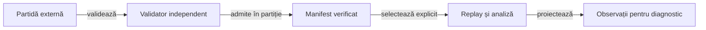

# Contractul corpusului de partide

Corpusul este o intrare externă pentru replay, selecție și analiză offline. Proiectul deține schema și validatoarele; fișierele partidelor, manifestele concrete și registrele loturilor rămân în depozitul extern configurat.

## Modelul datelor

| Entitate | Contract |
|---|---|
| Partidă | Identitate, partiție, profil de reguli, politici și ordinea mâinilor. |
| Mână | Dealer, distribuție, atu și carte întoarsă, licitații ordonate, levate și închiderea scorului. |
| Observație | Mâna actorului și prefixul public disponibil la decizie. |
| Manifest | Fișiere selectate, hash-uri, identitatea părintelui și scopul selecției. |
| Registru de lot | Separarea dezvoltării de evaluare și evidența intervalelor deja consumate. |



<details>
<summary>Legendă: accesul la date</summary>

Validatorul poate verifica proprietatea tuturor cărților după încheierea jocului. Politica primește proiecția permisă la decizie, iar analiza nu transformă mâinile adverse reale în intrări ale acelei politici.

</details>

## Partiții și integritate

- Development permite analiza și ajustarea; selecția activă citește numai manifestul declarat.
- Heldout este rezervat evaluării candidatului înghețat și se înregistrează ca expus la deschidere.
- Reference păstrează intrări de compatibilitate; ele nu justifică o afirmație despre puterea actuală a unei politici.
- Repetările aceleiași distribuții sau urme nu se numără drept observații independente.
- Seed-ul se serializează fără pierderea preciziei tipului Java long.
- Identitatea, partiția, căile și SHA-256 se verifică înainte de utilizare.

## Utilizare

[Configurația corpusului](../config/learning-corpus.json) indică arhiva și pointerul activ. [Validatorul](../scripts/whist-corpus.mjs) verifică regulile și scorul, iar [selectorul activ](../scripts/whist-active-corpus.mjs) controlează selecția.

```powershell
$gamePath = Read-Host 'Fișierul JSON extern pentru replay'
node scripts/whist-corpus-cli.mjs replay $gamePath
node scripts/whist-active-corpus.mjs verify-current
```

[Criteriile selecției](AI_LEARNING_FOCUS.md) și [protocolul evaluării](AI_TRAINING_PROTOCOL.md) explică folosirea corpusului pentru îmbunătățirea politicilor.
