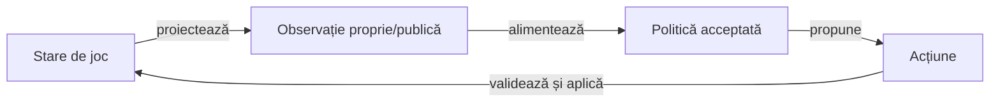
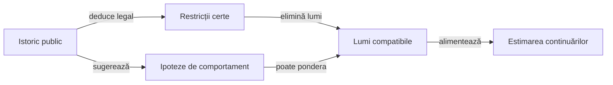

# Arhitectura îmbunătățirii jucătorilor

Îmbunătățirea AI este un ciclu offline controlat: observăm comportamentul, formulăm o regulă, implementăm un candidat și îl evaluăm înainte de promovare. În partidă, politica își adaptează decizia la contextul public; schimbarea algoritmului sau a parametrilor trece prin ciclul de calificare.

## Două fluxuri cu responsabilități distincte

Legendă: decizia din timpul jocului

Observația conține mâna actorului, contractele cunoscute, cărțile publice, necesarul și scorurile. Motorul verifică legalitatea acțiunii înainte de schimbarea stării; mâinile reale ale adversarilor nu intră în politica de decizie.

```mermaid
flowchart LR
    GAMES[Jocuri de dezvoltare] -->|selectează| DIAG[Diagnostic]
    DIAG -->|generalizează| RULE[Regulă și limite]
    RULE -->|verifică local| TEST[Regresie de componentă]
    TEST -->|califică| CAND[Candidat înghețat]
    CAND -->|compară pe lot nou| EVAL[Evaluare rezervată]
    EVAL -->|permite revizie| PROMOTE[Promovare explicită]
```

Legendă: ciclul offline

O observație localizează o problemă posibilă, iar regula trebuie justificată independent de rezultatul partidei. Promovarea este o decizie explicită după criteriile declarate; datele evaluării nu revin în ajustarea aceluiași candidat.

## Straturi și surse de adevăr

| Strat | Responsabilitate | Implementare |
|---|---|---|
| Domeniu | Legalitate, distribuire, tranziții și scor | [game-core](../whist-lab-app/game-core/README.md) |
| Politică runtime | Licitare și alegerea cărții din observația permisă | `AiPolicy`, politicile Normal și `MonteCarloAi` |
| Politică independentă | Model separat pentru verificare și comparații | [ai-lab](../whist-lab-app/ai-lab/README.md) |
| Corpus | Validarea jocurilor și selecția explicită a datelor de dezvoltare | [whist-corpus](../scripts/whist-corpus.mjs), [whist-active-corpus](../scripts/whist-active-corpus.mjs) |
| Tipare | Descrierea combinațiilor și calibrare descriptivă | [catalog și limite](rules/AI_HAND_PATTERNS_RO.md) |
| Experiment | Copie izolată, candidat identificat, comparații pereche | [runnerul colecțiilor](../scripts/run-whist-collection.ps1), [arena](AI_STRATEGY_ARENA.md) |
| Promovare | Criterii fixate, lot neatins și păstrarea gărzilor de domeniu | [protocolul evaluării](AI_TRAINING_PROTOCOL.md) |

## Rolul YAML-urilor

| Manifest | Semnificație | Efect asupra execuției |
|---|---|---|
| [Obiective](../config/whist-play-objectives.yaml) | Priorități Normal/Hard, condiții și teste asociate | Documentează comportamentul implementat; nu interpretează reguli arbitrare în timpul jocului. |
| [Reguli contextuale](../config/whist-contextual-discard.yaml) | Deducții certe, limite și ipoteze de cercetare | Leagă fiecare regulă de implementare și componentă. |
| [Tipare de cărți](../config/whist-hand-patterns.yaml) | Indicii contextuale cu statut explicit | Catalogul declară influență runtime zero până la un consumator implementat și promovat. |

O pondere are nevoie de definiția caracteristicii, domeniul ei, contextul de aplicare și un consumator de cod. Un fișier editat nu modifică implicit algoritmul; proprietatea `research_only` păstrează ipoteza în afara politicii acceptate.

## Datele susțin mecanismul

- Schema, validatoarele, selecția și criteriile aparțin surselor proiectului.
- Partidele, calibrările, selecțiile concrete, registrele loturilor și rezultatele sunt date externe.
- [Configurația corpusului](../config/learning-corpus.json) indică arhiva și pointerul activ; analiza obișnuită citește numai manifestul selectat și verificat.
- Selecția elimină urmele duplicate, păstrează originile protejate și urmărește categorii noi în limita bugetului.
- O categorie observată măsoară varietatea setului, fără să demonstreze acoperirea codului sau optimalitatea unei acțiuni.
- Regresia implicită păstrează cazuri mici generate sau construite pentru o proprietate generală, cu așteptare independentă.

## Interpretarea adversarilor

Legendă: certitudine și estimare

Obligația de culoare sau atu permite deducții despre lipsa unei culori. Licitația și o alegere voluntară sugerează intenții numai printr-un model declarat; o carte jucată forțat nu dovedește intenția de a câștiga sau de a evita levata.

Hard folosește contractele cunoscute drept ținte ale simulărilor și constrânge mâinile ipotetice prin cărțile publice și lipsurile deduse. Ponderarea generală a mâinilor ascunse prin probabilitatea licitației observate rămâne o ipoteză de cercetare, fără activare implicită în politica acceptată.

## Condiții pentru progres

1. Testul local dovedește proprietatea și cazurile în care ea încetează să fie valabilă.
2. Comparația pereche controlează distribuția, locul, adversarii și bugetul de calcul.
3. Rezultatul se separă după rol, loc și mărimea mâinii; un agregat favorabil nu compensează un criteriu obligatoriu eșuat.
4. Candidatul și pragurile sunt înghețate înaintea lotului rezervat.
5. Schimbările concurente invalidează calificarea copiei afectate și cer o nouă identitate de sursă.
6. Promovarea actualizează codul, manifestele, regresiile și documentația generală în aceeași revizie.

## Limite de transfer către alte sisteme

| Abstracție reutilizabilă | Adaptor specific domeniului |
|---|---|
| Proiecția observației | Ce informație este permisă fiecărui actor. |
| Filtrul de acțiuni | Legalitatea definită de varianta jocului. |
| Reducerea istoricului | Faptele și restricțiile deduse din acțiunile publice. |
| Generatorul de lumi | Distribuțiile compatibile cu observația și ipotezele samplerului. |
| Utilitatea și prioritățile | Contractul, scorul, seria și obiectivul politicii. |
| Verificarea și promovarea | Proprietăți independente, comparații controlate și criterii fixate. |

[Modelul deciziei](AI_DECISION_MODEL.md), [regulile și ponderile](AI_RULES_AND_CONFIGURATION.md) și [proiectarea testelor](testing/ai/README.md) detaliază aceste limite fără a depinde de o partidă concretă.
