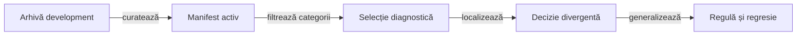

# Selecția focalizată pentru învățare

Selecția focalizată reduce volumul de analiză la jocurile care aduc lecții distincte despre licitare și carte. Algoritmul, criteriile și validatoarele aparțin proiectului; selecția concretă și rezultatele ei sunt date externe.

## Două niveluri de selecție

| Nivel | Mecanism | Limită |
|---|---|---|
| Corpus activ | Urme deduplicate, origini protejate, acoperire ponderată prin raritatea lecțiilor și schimburi cu progres strict | Buget configurat și manifest extern explicit. |
| Focus diagnostic | Acoperire greedy a categoriilor urmărite, cu egalități rezolvate în ordinea manifestului părinte | Nu parcurge arhiva brută sau loturile rezervate. |

Legendă: selecția urmărește înțelegerea

Fiecare selecție păstrează identitatea și hash-ul sursei părinte. Categoriile acoperite descriu varietatea datelor; ele nu sunt acoperire de cod și nu etichetează automat o acțiune drept optimă.

## Categorii de diagnostic

- Rolul politicii, mărimea mâinii și sensul diferenței dintre licitat și câștigat.
- Poziția în licitație, dezechilibrul mesei și necesarul individual.
- Numărul de atuuri, lipsurile de culoare, secvențele și ieșirile legale.
- Consecințele pentru punctele de bază și seria configurată.
- Prima diferență observabilă dintre două politici pe aceeași distribuție și același loc.

## Invariante de proces

1. Verificați partiția de dezvoltare și hash-ul fiecărei intrări înainte de replay.
2. Recalculați independent legalitatea și scorul.
3. Reconstruiți observația disponibilă actorului înainte de decizie.
4. Separați rezultatul ulterior de informația utilizabilă în acel moment.
5. Stabiliți regula și așteptarea printr-un invariant sau oracol independent.
6. Păstrați cel mai mic caz care exprimă proprietatea și cazul-limită relevant.

Selecția este diagnostică și nu schimbă politica activă, pointerul corpusului sau statutul loturilor rezervate. Promovarea unei strategii urmează [protocolul de evaluare](AI_TRAINING_PROTOCOL.md).

[Arhitectura învățării](AI_LEARNING_ARCHITECTURE.md) · [Selectorul corpusului](../scripts/whist-active-corpus.mjs) · [Contractul partidelor](AI_CORPUS.md)
