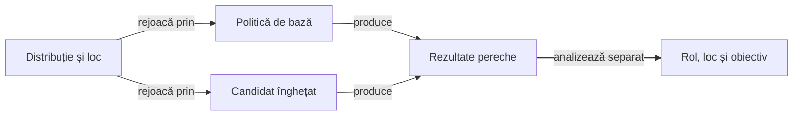

# Compararea strategiilor la aceeași masă

Arena compară politici pe partide românești complete. Protocolul declară distribuțiile, ordinea, rolurile, strategiile de bază, rotația locurilor și regulile de scor înainte de evaluare.

## Principii de comparare



<details>
<summary>Legendă: aceeași distribuție, decizii independente</summary>

Fiecare politică primește numai observația permisă actorului. Distribuția și locul se păstrează între perechi, iar stările publice pot diverge după prima alegere diferită.

</details>

| Principiu | Interpretare |
|---|---|
| Aceeași lume inițială | Candidatul și baza pornesc de la aceleași distribuții și aceeași ordine. |
| Aceleași informații publice | Fiecare decizie folosește numai mâna proprie și prefixul public disponibil atunci. |
| Rotația locurilor | Evaluarea din locuri diferite măsoară sensibilitatea la poziție și reduce confundarea avantajului locului cu efectul politicii. |
| Partidă completă | Scorul final include consecințele tuturor licitațiilor, cărților și regulilor de scor declarate. |
| Lot rezervat | Evaluarea de promovare folosește distribuții care nu au fost folosite la alegerea candidatului. |

## Limitele interpretării

După prima divergență, partida compară trasee complete și nu izolează efectul unei singure mutări, deoarece acțiunile schimbă starea publică ulterioară.

Raportați separat rolul, locul, familia adversă, mărimea mâinii, punctele, contractele exacte și componentele scorului, inclusiv bonusurile de serie.

O partidă câștigată sau o rată agregată nu dovedește singură superioritatea unei reguli; evaluarea folosește criteriile stabilite înaintea lotului rezervat.

## Din observație într-o regulă verificabilă

1. Reconstruiți numai starea disponibilă public înaintea deciziei.
2. Separați deducțiile certe din reguli de ipotezele despre intenția sau cărțile adversarilor.
3. Formulați condiția generală, condițiile-limită și cazurile în care regula nu se aplică.
4. Reduceți observația la o componentă cu rezultat așteptat justificat de o regulă, invariant sau oracol independent.
5. Rulați regresia de domeniu, apoi comparați candidatul înghețat pe aceleași distribuții și locuri.
6. Păstrați rezultatele fiecărei rulări în afara codului sursă și rezervați date noi pentru promovare.

## Informație și artefacte

Mâinile adverse reale și ordinea viitoare a cărților nu sunt intrări ale deciziei. Simulările pot crea lumi compatibile cu informația publică, dar nu pot substitui cărțile reale ale adversarilor în observația jucătorului.

Rularea păstrează metadatele de reproducere, hash-urile surselor și configurației, rolurile, licitațiile publice, cărțile jucate și rezultatele. Directorul de dovezi este în afara ATF; locația implicită este configurată de runner și poate fi suprascrisă.

```powershell
$firstSeed = [long](Get-Date -Format 'yyyyMMddHHmmss')
$seeds = @($firstSeed, $firstSeed + 1)
foreach ($seed in $seeds) { .\scripts\run-offline-strategy-profiles.ps1 -Seed $seed }
.\scripts\summarize-offline-strategy-profiles.ps1 -Seeds $seeds
```

Folosiți o singură înregistrare de rulare pentru fiecare seed dintr-un rezumat. Pentru promovare, înghețați candidatul și protocolul înainte să selectați lotul neatins.

[Protocolul arenei](../config/strategy-arena.json) · [Colecțiile disponibile](testing/collections/README.md) · [Reguli contextuale](rules/AI_HAND_PATTERNS_RO.md) · [Protocolul de învățare](AI_TRAINING_PROTOCOL.md)
