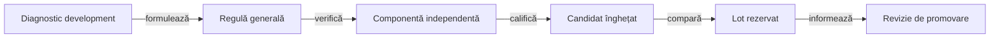

# Evaluarea offline a unui jucător

Fiecare candidat reprezintă o modificare identificată a licitării sau a alegerii cărții. Protocolul precizează rolul evaluat, sursele, familiile de adversari, profilul de scor și distribuțiile înaintea execuției.

| Etapă | Ce se verifică |
|---|---|
| Diagnostic | Se extrage o observație publică dintr-o partidă de dezvoltare. Un contraexemplu trebuie justificat independent de rezultatul înregistrat. |
| Componentă | Se verifică legalitatea mutării, necesarul contractului, cartea întoarsă și cazurile în care concluzia încetează să fie valabilă. |
| Dezvoltare | Fiecare pereche folosește distribuții și locuri identice. Rezultatele se separă pe rol, familie de adversari și mărimea mâinii. |
| Evaluare rezervată | Sursele sunt înghețate înainte de deschiderea intervalului. Registrul extern păstrează intervalele utilizate. |
| Decizie | Se aplică pragurile declarate și cerința de progres strict. Rezultatele neutre și negative rămân disponibile. |

## Interpretare

- Un seed cu locurile rotite dă mai multe partide corelate.
- Contractele exacte, punctele și victoriile împărțite la egalitate se citesc separat.
- Numărul lumilor fezabile enumerate este o măsură a domeniului demonstrației. O probabilitate necesită și un model al distribuției lor.
- O alegere diferită poate schimba licitațiile și scorurile mâinilor ulterioare. Prima divergență trebuie identificată înainte de atribuirea câștigului.

## Reproducere

Runnerul selectează turneul din schema protocolului și refuză candidații incompatibili cu sursele înghețate. Rezultatele vechi se reproduc din snapshot-ul lor.

[Colecțiile și parametrii](testing/collections/README.md) · [Arena](AI_STRATEGY_ARENA.md) · [Corpusul](AI_CORPUS.md) · [Guvernanța arhivării](history/README.md)

## Reguli stabile și date de experiment

YAML-urile descriu comportament și structură, nu rezultatele unor rulări particulare. `whist-play-objectives.yaml` definește obiectivele și prioritățile; `whist-contextual-discard.yaml` leagă condiții, limite de informație, cod și teste; `whist-hand-patterns.yaml` cataloghează indicii de cercetare fără activare runtime implicită.

Partidele de dezvoltare, replay-urile, hash-urile, rezumatele și registrele de lot se păstrează în directorul de dovezi configurat în afara ATF. Documentația stabilă păstrează regulile generalizabile și procesul; seed-urile, scorurile de rulare și deciziile dintr-un caz concret rămân în acele artefacte.

## Ciclul de îmbunătățire

Legendă: datele și politica au cicluri distincte

Politica este înghețată înaintea evaluării rezervate. Datele de dezvoltare ajută la formularea regulii; rezultatul lotului rezervat informează decizia de promovare fără ajustarea retrospectivă a criteriilor.

1. Generați jocuri de dezvoltare cu intrări și politici declarate înaintea rulării.
2. Validați legalitatea, regulile și scorul înainte de a analiza performanța.
3. Găsiți prima decizie divergentă și reconstruiți numai informația publică disponibilă atunci.
4. Formulați regula ca o condiție generală, cu limite și cazuri care o infirmă; separați deducțiile certe de estimările despre adversari.
5. Reduceți problema la o regresie de componentă cu rezultat așteptat justificat independent.
6. Rulați colecțiile de componentă și regresie pe surse identificate prin hash.
7. Înghețați candidatul înaintea comparației pe distribuții noi și locuri rotite.
8. Promovați numai după ce criteriile declarate sunt îndeplinite fără regresii de reguli sau scor.

O schimbare de licitație sau carte poate schimba întregul traseu ulterior. De aceea comparațiile de partidă completă măsoară efectul politicii asupra jocului, iar testul de componentă verifică regula locală; niciuna nu o substituie pe cealaltă.

Politica nu primește mâinile reale ale adversarilor. Replay-ul complet poate servi analizei după încheierea partidei, dar informația privată nu devine input pentru decizia care este evaluată.

[Reguli și configurare](AI_RULES_AND_CONFIGURATION.md) · [Componente și oracole](testing/ai/README.md)
