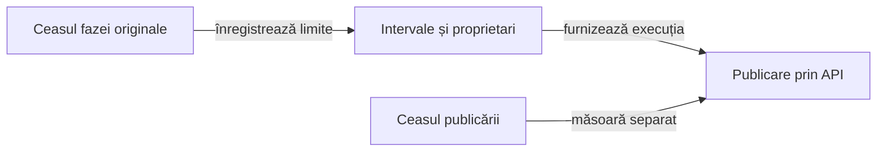

# Măsurarea timpilor Android

Ceasul unei faze înregistrează intervalul monoton al activității originale. Trimiterea comenzilor, capturarea, persistența jurnalului și publicarea ulterioară au măsurători distincte.

## Axele temporale

| Axă | Sursă | Semnificație |
|---|---|---|
| Interval original | Început și sfârșit față de aceeași origine monotonă. | Interval complet sau întrerupt, măsurat direct. |
| Execuție originală | Intervalul original minus captura și persistența măsurate. | Comenzi, așteptări, citiri și verificări de domeniu din acea fază. |
| Trimitere ADB | Înregistrările originale ACTION. | Durata comenzii, ca parte a execuției. |
| Captură | Intervalul controlat de adaptorul de interacțiune. | Obținerea PNG-ului și a ierarhiei, inclusiv încercările eșuate. |
| Persistență | Scrierea manifestului în intervalul fazei. | Operații de intrare/ieșire păstrate separat de execuție. |
| Publicare | Un ceas nou la proiectarea punctului de control. | Activitatea publicării curente, distinctă de salvarea finală a HTML-ului. |



<details>
<summary>Legendă: activitatea capturată și prezentarea ulterioară</summary>

Un interval aparține unui flux, unei faze și unei poziții ordinale. Revenirea într-o fază creează un interval separat; timpul petrecut între timp în altă fază nu este atribuit retroactiv primei faze.

</details>

## Captură și asociere

[AndroidPhaseClock](../atf-test-android/src/main/java/atf/android/evidence/timing/AndroidPhaseClock.java) măsoară timpul monoton. [AndroidPhaseTiming](../atf-test-android/src/main/java/atf/android/evidence/timing/AndroidPhaseTiming.java) validează intervalele și axele; aceste componente nu execută comenzi ADB sau verificări ale jocului.

- [AndroidUiFlowTrace](../atf-test-android/src/test/java/atf/android/e2e/support/AndroidUiFlowTrace.java) deschide faza înaintea primei acțiuni.
- Captura măsoară întreaga obținere a imaginii și ierarhiei; un punct de control ulterior nu reconstruiește un început lipsă.
- Schema `phase.<ordinal>.timing` păstrează identitatea fluxului, fazei și ordinii, intervalele, duratele capturii și persistenței, plus starea COMPLETE/PARTIAL.
- Schema aditivă păstrează compatibilitatea formatului de jurnal cu cititoarele vechi.
- Octeții PNG, acțiunile și comparațiile rămân asociate punctului de control original.

## Date complete, parțiale sau absente

| Intrare | Politica publicării |
|---|---|
| Interval original complet | Transmite execuția prin API-ul tipizat al bibliotecii. |
| Interval întrerupt | Păstrează PARTIAL și cauza eșecului, inclusiv înaintea primei capturi. |
| Date temporale absente într-un jurnal vechi | Afișează UNAVAILABLE; duratele comenzilor nu substituie intervalul complet. |
| Date declarate RUNNING ori invalide | Refuză publicarea completă și semnalează metadatele corupte. |
| Interval atribuit altui flux sau altei faze | Refuză asocierea înaintea acceptării rezultatului. |

## Publicare individuală și agregată

[AndroidPhaseReportTiming](../atf-test-android/src/main/java/atf/android/evidence/timing/AndroidPhaseReportTiming.java) proiectează intervalele capturate în API-ul public. Publicatorul Android și adaptorul jurnalului agregat folosesc aceeași proiecție.

Înregistrarea explică axele originale, iar salvarea finală a HTML-ului rămâne în afara duratei proiectării unui punct de control. Politica previzualizării se configurează separat; capturile originale își păstrează asocierea.

## Verificarea mecanismului

| Limită | Controale |
|---|---|
| Ceas | Separarea axelor, revenirea în fază, mersul înapoi, întreruperea și suprapunerea capturilor. |
| Serializare | Conversie dus–întors exactă, scalari lipsă, intervale imposibile și proprietar greșit. |
| Publicare individuală | Execuția originală, trimiterea comenzii și publicarea sunt controlate separat. |
| Publicare agregată | Aceleași intervale prin Extent și prezentarea de rezervă, cu mutații ale scalarilor și proprietarilor. |
| Revizie interactivă | Durata originală, tabelele, secțiunile pliabile și PNG-urile integrale rămân accesibile. |

```powershell
mvn -pl atf-test-android -am '-Dtest=AndroidUiFlowTimingComponentSuite' '-Dsurefire.failIfNoSpecifiedTests=false' test
mvn -pl atf-tests -am '-Dtest=GameReportComponentSuite' '-Dsurefire.failIfNoSpecifiedTests=false' test
```

Compilările se execută într-o copie temporară proprie. Verificarea unui ceas controlat sau a unui jurnal arhivat are un scop distinct de o interacțiune Android nouă.
