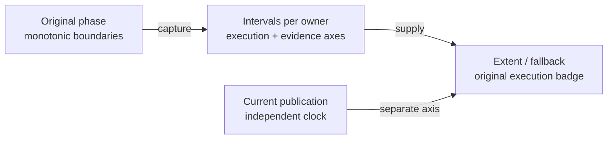

# Android phase timing — execution and publication

## Contract

The phase clock records the original monotonic interval of each Android phase. Dispatch, capture, trace persistence and current report publication remain distinct measurements.

| Axis | Source | Meaning |
|---|---|---|
| original elapsed | phase start/end offsets from one trace clock origin | complete or interrupted interval; never derived from child durations |
| original execution | elapsed minus measured capture and trace persistence | commands, settling, reads and independent business checks within that phase |
| ADB dispatch | original ACTION records | command duration only; a subset of execution, not its replacement |
| evidence capture | driver capture scope | full PNG and optional hierarchy acquisition, including failed attempts |
| trace persistence | original manifest writes inside the interval | IO excluded from execution; retained separately |
| report publication | a fresh clock during checkpoint projection | separate from original execution and from final HTML flush |



<details>
<summary><strong>Legend — captured work and later projection</strong></summary>

- Each interval belongs to one flow ID, phase name and ordinal; repeated visits retain separate ordered intervals.
- Time spent in another phase does not enter a returning phase's duration.
- PNG bytes, action records and comparisons retain their original checkpoint ownership.
- A later PASS does not erase an interrupted interval or the original failure.

</details>

## Capture and ownership

[AndroidPhaseClock](../atf-test-android/src/main/java/atf/android/evidence/timing/AndroidPhaseClock.java) owns monotonic measurement. [AndroidPhaseTiming](../atf-test-android/src/main/java/atf/android/evidence/timing/AndroidPhaseTiming.java) validates immutable offsets and evidence axes; neither component dispatches ADB or evaluates application assertions.

- [AndroidUiFlowTrace](../atf-test-android/src/test/java/atf/android/e2e/support/AndroidUiFlowTrace.java) enters the phase before its first action. Driver capture scopes measure the whole PNG/hierarchy operation; checkpoint arrival never reconstructs a missing phase start.
- The additive `phase.<ordinal>.timing` schema keeps trace format 1 compatible with legacy readers. It retains the flow/phase/ordinal tuple, interval offsets, capture and journal nanoseconds, and COMPLETE/PARTIAL state.

| Input | Publication policy |
|---|---|
| complete original interval | supply execution through the existing public Reporting typed API |
| interrupted original interval | preserve PARTIAL and FAIL at its owner, including failure before the first checkpoint |
| absent legacy timing | show UNAVAILABLE explicitly; legacy dispatch/child badges are not complete original execution |
| RUNNING or malformed declared timing | refuse complete publication; do not downgrade corrupted metadata to legacy |
| interval moved to another flow/phase | reject the owner mismatch before accepting the report |

## Immediate and combined reports

[AndroidPhaseReportTiming](../atf-test-android/src/main/java/atf/android/evidence/timing/AndroidPhaseReportTiming.java) projects captured timing into the public Reporting API. Both the immediate Android publisher and the combined trace bridge use it; no private renderer or HTML rewrite is introduced.

The Android receipt explains the original interval axes, while final HTML flush remains outside the checkpoint-publication measurement. Preview policy is configured separately; original PNGs and checkpoint ownership are retained.

## Permanent checks

| Boundary | Controls |
|---|---|
| monotonic clock | execution/capture/journal separation, phase reentry, backward clock, interrupted capture and evidence overlap |
| manifest codec | exact round trip, missing final scalar, wrong flow/phase/ordinal and impossible intervals |
| individual publisher | controlled original execution versus dispatch and publication; exact timing marker and PNG ownership |
| suite | the same controls with trace and existing publisher compatibility tests |
| combined bridge | Extent/fallback republication and owner/scalar mutation controls |
| browser review | native execution badge, original-row tables, disclosures and complete original Android PNGs |

```powershell
mvn -pl atf-test-android -am '-Dtest=AndroidUiFlowTimingComponentSuite' '-Dsurefire.failIfNoSpecifiedTests=false' test
mvn -pl atf-tests -am '-Dtest=GameReportComponentSuite' '-Dsurefire.failIfNoSpecifiedTests=false' test
```

Run agent builds in an owned TMP staging directory. Clock-controlled and archived-report checks are separate from a new device journey; a shared Android lease must be respected.
