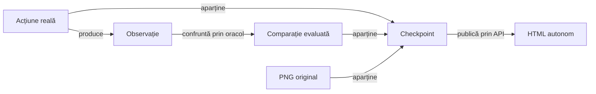

# Contractul publicării Android și al componentelor

Publicarea oferă o prezentare autonomă a scopului, intrărilor și rezultatelor evaluate. Consumatorul furnizează semantica domeniului și înregistrările tipizate; biblioteca comună furnizează prezentarea prin API-ul public.

## Responsabilități

Legendă: proprietatea datelor

Acțiunea, observația, comparația și captura sunt fapte distincte, asociate aceleiași invocări și stări. Rendererul proiectează rezultatul evaluat fără să execute din nou oracolul sau să deducă succesul dintr-o imagine.

| Owner | Contract |
|---|---|
| Consumer | Captură, extragere stare, oracol independent, reguli, selecție și compoziție. |
| Bibliotecă | Tipuri neutre, tabele, disclosure, timing și vizualizatorul imaginilor. |
| Acceptor | Integritate, proprietate, completitudine și verificarea interactivă a scopului declarat. |

## Invocarea și fazele

| Nivel | Conținut obligatoriu |
|---|---|
| Invocare | Identitate reală de clasă, metodă și parametri, cu profilul efectiv. |
| Setup | Intrări și precondiții evaluate; pregătirea nu înlocuiește verificarea corpului. |
| Corp | Stare anterioară, input, stare rezultată, expected independent, actual și verdict. |
| Teardown | Curățarea efectivă și cauza secundară, fără înlocuirea erorii inițiale. |
| Populație | Cazuri, partide, perechi, mutări și comparații delimitate ca unități distincte. |

- Fiecare invocare reală rămâne identificabilă, inclusiv parametrizările cu același nume.
- Setup-ul, contextul sau o statistică agregată nu generează invocări PASS fictive.
- Rezultatele PASS, FAIL, ERROR și SKIP sunt păstrate distinct.
- Captura parțială la eșec păstrează ultimul context sigur și cauza originală.
- Rezultatul JUnit fără comparații capturate nu permite reconstruirea lor ulterioară prin text.

## Acțiune, observație și rezultat

Tabelul de acțiuni păstrează operația expediată, ținta semantică, așteptarea, observația, timpul și rezultatul. Tabelul de comparații păstrează ASSERTION, EXPECTED, ACTUAL și RESULT pentru evaluarea executată o singură dată.

- ADB este sursa dispatch-ului Android, iar UI Automator furnizează ierarhia.
- Browserul care inspectează HTML-ul este auditorul raportului.
- O comandă acceptată și o tranziție semantică corectă au criterii distincte.
- OBSERVE descrie o stare fără inventarea unui input.
- HTTP, SQL, comparațiile de componentă și acțiunile UI folosesc suprafața semantică a faptului real.
- Titlurile și rezumatele nu substituie comparațiile detaliate.
- O atribuire falsă a driverului este refuzată chiar când celelalte valori coincid.

## Capturi și proprietate

- Fiecare checkpoint publicat poate conține PNG-ul original al întregului ecran fizic, cu orientarea și marginile păstrate.
- Analiza unei regiuni poate deriva o imagine separată, fără înlocuirea capturii originale.
- PNG-urile sunt încorporate Base64 în HTML; payload-urile identice pot fi canonice, cu referințe exacte pentru fiecare checkpoint.
- Statusul local al checkpoint-ului se păstrează; rezultatul final nu recolorează retrospectiv toate stările.
- Dacă între capturi au loc mai multe acțiuni, fereastra observată este declarată explicit.
- Componentele fără dispozitiv folosesc date de stare și comparații, fără capturi Android fabricate.

Vizualizatorul păstrează proporțiile imaginii și oferă acces la dimensiunea originală. Revenirea păstrează proprietarul curent, disclosure-urile, derularea și focusul; verificarea consumerului confruntă payload-ul original cu referința exactă.

## Conținut autonom și bugete

Cititorul trebuie să înțeleagă o verificare din HTML fără acces la checkout sau fișiere auxiliare. Contextul obligatoriu include regula aplicată, unitățile, intrarea comparată și limitele afirmației.

| Suprafață | Invariantă |
|---|---|
| Comparații | Numele, valorile integrale și verdictul original rămân disponibile. |
| Preview | Limita de afișare nu modifică valoarea evaluată. |
| Fragmente | Părți JSON/TEXT complete, ordonate și legate de proprietarul inițial. |
| Context opțional | Buget cumulativ, cu selecție și omisiuni explicite. |
| Conținut obligatoriu | Datele necesare afirmației, cauza eșecului și capturile nu dispar prin selecția opțională. |
| Refuz | Inputul incomplet sau indivizibil peste buget păstrează refuzul publicării complete. |

Checksum-ul descrie proveniența tehnică, fără să fie oracol de domeniu. Un link local, dump brut sau rezumat „replay reușit” nu înlocuiește comparațiile cerute în scopul publicat.

## Timp și status

- Execuția, dispatch-ul, capturarea, persistența trace-ului și publicarea au surse temporale distincte.
- Intervalele originale aparțin flow-ului și fazei care le-au capturat.
- Absența datelor vechi rămâne explicită; metadatele declarate și corupte sunt refuzate.
- Republicarea păstrează identitatea și datele execuției originale.
- Eșecul unei acțiuni, comparații sau al capturării nu este anulat de un apel ulterior de finalizare cu succes.
- Verdictul funcțional și rezultatul publicării sunt fapte distincte.
- Zero invocări, date obligatorii lipsă sau numai SKIP nu închid un scop drept verificat.

## Implementare și verificare

[AndroidUiFlowReportPublisher](../atf-test-android/src/test/java/atf/android/e2e/support/AndroidUiFlowReportPublisher.java) proiectează checkpoint-urile prin API-ul UI al bibliotecii. [AndroidUiFlowTrace](../atf-test-android/src/test/java/atf/android/e2e/support/AndroidUiFlowTrace.java) păstrează ordinea și proprietatea datelor înaintea publicării.

Controalele urmăresc proprietarul exact, multiplicitatea, ultima comparație, ordinea fragmentelor și bytes-ii PNG. Căutarea globală a unei valori sau a unui hash nu demonstrează asocierea ei cu scenariul corect.

[Politica de prezentare](ATF_Game_Report_Presentation.md) · [Timing original](ATF_Android_Phase_Timing.md) · [Auditul publicării](testing/reporting/README.md) · [Responsabilități](feedback/README.md)
