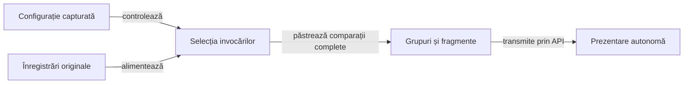

# Politica prezentării rezultatelor de joc

O politică imutabilă controlează selecția AUTO, SUMMARY și FULL și limitele prezentării. Consumatorul pregătește datele; biblioteca binară furnizează API-urile, tabelele, secțiunile pliabile și vizualizatorul capturilor.

## Configurația capturată la început

| Configurație | Responsabilitate |
|---|---|
| `config/game-evidence.yml` | Selecția și limitele specifice consumatorului; cale explicită prin `atf.evidence.policy`. |
| `atf.yaml` sau `atf.yml` | Previzualizarea comparațiilor și bugetul conținutului; cale explicită prin `atf.report.config`. |
| `EvidencePolicy` și `GameReportConfiguration` | Rezolvarea configurației o singură dată pentru publicare. |

Schimbarea ulterioară a unui fișier sau a unei proprietăți nu modifică configurația deja capturată. Cheile necunoscute ori duplicate, documentele multiple, tipurile invalide, depășirile numerice și limitele nepozitive sunt refuzate.

Valorile implicite se consultă în [configurația efectivă](../config/game-evidence.yml).

Legendă: selecție și completitudine

Selecția decide ce invocări sunt prezentate și declară omisiunile. Gruparea păstrează toate comparațiile obligatorii ale invocărilor selectate, cu identitatea și verdictul original.

## Modurile de prezentare

| Mod | Invocări păstrate | Context și prezentare |
|---|---|---|
| AUTO | Toată populația furnizată în limitele incluzive; altfel exemple complete deterministe, rezultate diferite de PASS și verificări obligatorii. | Context opțional în bugetul capturat și toate comparațiile selectate. |
| SUMMARY | Exemple complete reușite, rezultate diferite de PASS și verificări obligatorii. | Omite contextul opțional și amprentele; declară inventarul original, păstrat și omis. |
| FULL | Toate invocările și punctele de control furnizate. | Păstrează detaliul cerut în limitele pozitive sau refuză publicarea completă. |

Colecțiile marcate explicit pentru păstrare completă se păstrează conform politicii în fiecare mod. Modul de prezentare nu extinde populația furnizată de producător și nu execută jocul sau oracolul.

## Grupare și conținut integral

| Suprafață | Contract |
|---|---|
| Comparații | Grupuri native cu cel mult `rowsPerGroup` rânduri; continuările indică intervalul original. |
| Verdict de fragment | Derivat din rândurile păstrate; fragmentul terminal păstrează și rezultatul grupului furnizat explicit. |
| Valori lungi | Previzualizare nativă de 240 de caractere și acces la valorile complete, asociate grupului original. |
| Observații | Cel mult `fieldsPerGroup` rânduri; valorile lungi păstrează conținutul complet. |
| TEXT | Părți ordonate, cu preferință pentru sfârșitul de linie și păstrarea CR/LF, Unicode și entităților literale. |
| JSON | Documente complete la limite de obiect sau tablou; un element indivizibil peste buget este refuzat. |
| Capturi Android | PNG integral original, asociat punctului de control; selecția nu înlocuiește ori decupează imaginea. |
| Observație fără comparații | API-ul explicit pentru materiale atașate, fără aserțiuni de domeniu inventate. |

Fiecare fragment JSON este un document complet. Formele numerice originale se păstrează prin formatare și fragmentare; lipsa ori reordonarea unei părți invalidează completitudinea.

## Date opționale și refuzul publicării

- Apelantul marchează explicit diagnosticul opțional; eticheta ori numele fișierului nu decid caracterul obligatoriu.
- Amprentele selectate și observațiile opționale folosesc același buget cumulativ de elemente și caractere.
- Pregătirea obligatorie, intrările comparate, verdictele, cauzele eșecului și capturile rămân date obligatorii.
- Referințele diagnostice externe sunt numărate și omise din HTML; fișierul extern nu substituie informația obligatorie încorporată.
- Starea INCOMPLETE păstrează refuzul publicării până la închidere, chiar dacă apelantul interceptează o eroare anterioară de buget.

| Unitate | Limită |
|---|---|
| Conținut | Numărare în unități UTF-16, conform politicii bibliotecii. |
| HTML | Marcajele, etichetele și caracterele de evitare adaugă volum peste bugetul conținutului. |
| Date obligatorii | Pot produce un rezultat mare; politica nu garantează o dimensiune totală fixă a HTML-ului sau a memoriei. |

## Implementare și verificare

Compoziția datelor se află în sursele principale ale [modulului de integrare](../atf-tests/README.md). Întreținerea componentei generice de randare se direcționează prin [responsabilitățile comune](feedback/README.md).

[Verificarea publicării](testing/reporting/README.md) confruntă identitatea, valorile, ordinea și accesul la conținut. [Contractele Android](ATF_Android_Report_Contract.md) disting publicarea unui jurnal de o interacțiune nouă pe dispozitiv.
