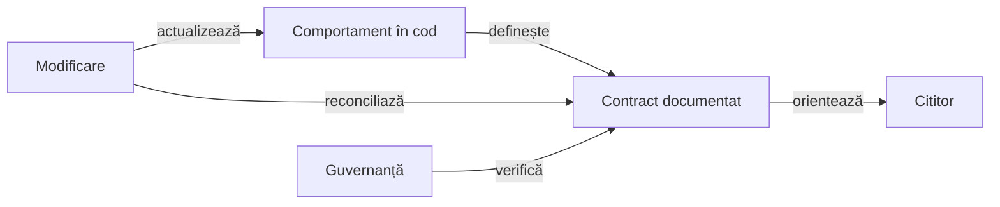

# Guvernanța documentației

Documentația explică mecanismele, arhitectura, principiile și contractele proiectului. Fiecare afirmație despre comportament trebuie să poată fi confruntată cu sursa care îl implementează.

## Responsabilități

Legendă: sincronizarea contractului

Verificarea automată controlează structura și relațiile documentului. Revizia factuală verifică sensul, responsabilitățile și limitele față de cod; trecerea unui validator nu înlocuiește această revizie.

| Document | Ce explică |
|---|---|
| README principal | Scop, arhitectură, organizare și primul pas util. |
| README de modul | Responsabilitate, intrări/ieșiri, dependențe, invariante și utilizare. |
| Ghid tematic | Un mecanism complet și relațiile lui cu celelalte componente. |
| Manifest de reguli | Identificatori stabili, condiții, prioritate, implementare și teste. |
| Feedback | Problemă generalizabilă, proprietar și criterii de închidere. |

## Ce rămâne stabil

- Descrieți reguli și condiții, fără numere de teste trecute, seed-uri de antrenare, scoruri de partide sau inventare de rulări.
- Explicați diferența dintre o regulă certă, un invariant verificat și o estimare de model.
- Păstrați comenzile utile, parametrizate prin intrări explicite și destinații externe.
- Referiți sursa care deține un prag sau un buget în loc să reproduceți un rezultat dependent de o rulare.
- Păstrați seturile de date și evaluările editoriale în arhiva externă, cu roluri și integritate verificabile.
- Folosiți relații și nume de concepte stabile; o etapă istorică nu este identitatea arhitecturii curente.

## Structură și diagrame

- Toate README-urile se redactează în română; identificatorii API, comenzile și etichetele originale citate își păstrează forma.
- Un README are un singur titlu și o orientare scurtă înaintea detaliilor.
- Tabelele compară responsabilități sau contracte; listele descriu pași ori condiții paralele.
- O diagramă exprimă dependențe, stare sau flux, fără să repete ornamental lista directoarelor.
- Muchiile au verbe semantice, iar legenda imediată precizează sensul și limita relațiilor.
- Diagramele Mermaid folosesc tipurile acceptate de guvernanță și etichete scurte.
- Linkurile locale sunt relative la document și rezolvabile; căile de execuție se configurează.

## Aplicarea verificărilor

Validatorul trebuie să primească rădăcina consumerului explicit și să publice inventarul Markdown verificat. Un rezultat fără identificarea rădăcinii și a populației nu poate certifica documentele proiectului.

Verificările includ titluri, orientare, structură pliabilă, linkuri și fragmente, densitatea prozei, stil, diagrame și căi configurabile. Limitele de scanare exclud directoarele generate și sunt declarate înaintea execuției.

- Revizia factuală urmărește API-urile, direcția dependențelor, proprietatea datelor și existența mecanismelor descrise.
- [Feedback-ul](feedback/README.md) direcționează lacunele validatorului către proprietarul comun.

[Suita locală de calitate](ATF_QUALITY_GOVERNANCE.md) aplică verificatoarele adaptate pe rădăcina explicită a proiectului. [Arhitectura testării](TESTING_ARCHITECTURE.md) păstrează matricea nivelurilor în acord cu declarațiile executabile.

## Evaluarea editorială

| Criteriu | Punctaj maxim | Întrebarea de revizie |
|---|---|---|
| Corectitudine | 20 | Contractele corespund codului și își precizează limitele? |
| Arhitectură | 20 | Sunt clare responsabilitățile, relațiile și proprietatea datelor? |
| Utilitate | 20 | Cititorul poate localiza implementarea și folosi mecanismul? |
| Claritate | 20 | Textul, schema și navigarea se înțeleg fără contextul conversației? |
| Guvernanță | 20 | Documentul rămâne stabil, verificabil și întreținabil? |

Nota unui README este o judecată editorială pe această grilă, cu justificare și hash-ul conținutului evaluat în auditul extern. Trecerea verificărilor automate nu produce automat nota maximă.
