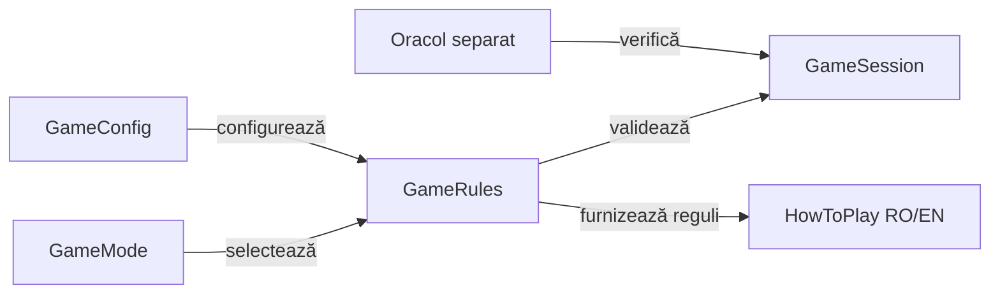

# Contractele variantelor Whist

Fiecare variantă are propriul contract pentru pachet, program, atu, licitare și scor. Similaritatea numelui jocului nu autorizează transferul implicit al unei reguli între profiluri.

## Responsabilități

Legendă: aceeași variantă în joc și verificare

Configurația stabilește regulile aplicabile înainte de distribuire. Ajutorul și testele folosesc identitatea variantei, iar oracolul verifică regulile și scorul prin implementare independentă.

## Contractul profilului românesc

| Aspect | Regulă |
|---|---|
| Pachet | Pachet redus după numărul de jucători, cu rangurile mari definite de GameRules. |
| Program | Secvență determinată de variantă și numărul de locuri; blocurile extreme urmează programul profilului. |
| Licitare | Contract în intervalul legal; ultima ofertă nu poate egaliza suma cu mărimea mâinii. |
| Culoare | Urmarea culorii este obligatorie când există în mână. |
| Atu | În lipsa culorii, tăierea este obligatorie dacă există atu; supratăierea nu este obligatorie. |
| Levata | Câștigă cel mai mare atu sau cel mai mare rang din culoarea cerută; câștigătorul conduce. |
| Scor | Contract exact: 5 + levate; ratare: minus diferența absolută. |
| Serii | Opțiuni configurate înainte de partidă, cu eligibilitate și resetare definite de RomanianScoring. |

## Principii de implementare

- [GameMode](../whist-lab-app/game-core/src/main/java/ro/whistlab/core/GameMode.java) identifică profilul.
- [GameConfig](../whist-lab-app/game-core/src/main/java/ro/whistlab/core/GameConfig.java) validează configurația și migrarea valorilor compatibile.
- [GameRules](../whist-lab-app/game-core/src/main/java/ro/whistlab/core/GameRules.java) deține pachetul, programul, acțiunile legale și câștigătorul.
- [RomanianScoring](../whist-lab-app/game-core/src/main/java/ro/whistlab/core/RomanianScoring.java) deține scorul și seriile.
- [HowToPlay](../whist-lab-app/game-core/src/main/java/ro/whistlab/core/HowToPlay.java) produce ajutorul în română și engleză.

## Guvernanța schimbărilor de reguli

1. Identificați varianta și condiția exactă înaintea modificării.
2. Formulați regula și frontierele ei prin componente independente.
3. Verificați tranzițiile, scorul și restaurarea sesiunii.
4. Actualizați ajutorul RO/EN și manifestele afectate.
5. Verificați separat integrarea Android prin scenarii activate explicit.

[Motorul de reguli](../whist-lab-app/game-core/README.md) · [Reguli RO](rules/WHIST_RO.md) · [Rules EN](rules/WHIST_EN.md) · [Colecții](testing/collections/README.md)
