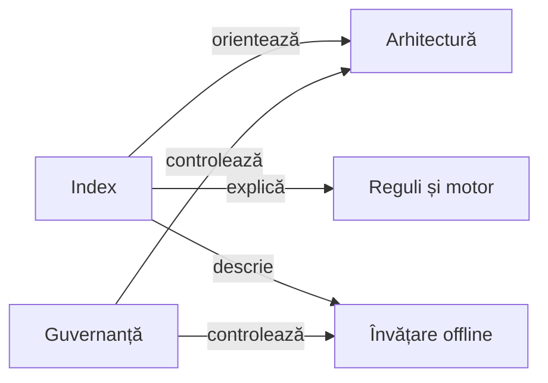

# Documentația Whist Lab

## Pe scurt

Acest index orientează cititorul prin arhitectura, regulile, mecanismele de învățare și guvernanța proiectului. Ghidurile descriu responsabilități și contracte verificabile față de cod.

## Harta documentației

Legendă și limite

Ghidurile definesc responsabilități, contracte și principii. Datele de rulare aparțin arhivei externe; navigarea documentației nu este un inventar de acceptanțe.

## Joc, motor și aplicație

| Întrebare | Ghid |
|---|---|
| Cum este organizat proiectul? | [Prezentarea proiectului](../README.md) |
| Cum se livrează aplicația? | [Contractul livrării Android](ANDROID_DELIVERY_CONTRACT.md) |
| Cum se construiește aplicația și cum se păstrează partida? | [Aplicația Android](../whist-lab-app/README.md) |
| Unde sunt regulile și tranzițiile jocului? | [Motorul Java](../whist-lab-app/game-core/README.md) |
| Cum se delimitează variantele jocului? | [Contractele de reguli](GAME_RULE_PROFILES.md) |
| Cum se joacă? | [Română](rules/WHIST_RO.md) · [Engleză](rules/WHIST_EN.md) |
| Ce se păstrează în tabela de scor? | [Istoricul scorului](WHIST_SCORE_HISTORY.md) |
| Ce înseamnă cele două niveluri? | [Normal și Hard](TWO_GAME_LEVELS.md) |

## Testare și învățare offline

[Ghidurile de testare](testing/README.md) oferă traseul de la proprietatea verificată la nivel, colecție, resurse și rezultat.

| Activitate | Ghid |
|---|---|
| Alegerea nivelului unitar, componentă, integrare sau E2E | [Arhitectura testării și matricea modulelor](testing/architecture/README.md) |
| Calitatea pachetelor, limitelor și documentației | [Guvernanța ATF](testing/governance/README.md) |
| Alegerea unei colecții mici sau a regresiei complete | [Colecțiile de teste](testing/collections/README.md) |
| Construire fără SDK Android | [Construirea algoritmului](../whist-lab-app/algorithm-build/README.md) |
| Formatul partidelor și validarea independentă | [Corpusul](AI_CORPUS.md) |
| Selecția diagnostică a partidelor utile | [Selecția pentru învățare](AI_LEARNING_FOCUS.md) |
| Modelul observației, simulării și alegerii | [Decizia AI](AI_DECISION_MODEL.md) |
| Semantica YAML-urilor și influența ponderilor | [Reguli și configurare](AI_RULES_AND_CONFIGURATION.md) |
| Componente cu așteptări independente | [Proiectarea testelor AI](testing/ai/README.md) |
| Arhitectura mecanismelor de învățare | [Fluxul de îmbunătățire AI](AI_LEARNING_ARCHITECTURE.md) |
| Separarea dezvoltării de evaluarea nouă | [Protocolul AI](AI_TRAINING_PROTOCOL.md) |
| Comparații între strategii și locuri la masă | [Arena](AI_STRATEGY_ARENA.md) |
| Onoruri, acoperiri și reguli contextuale | [Română](rules/AI_HAND_PATTERNS_RO.md) · [Engleză](rules/AI_HAND_PATTERNS_EN.md) |
| Decizia de aruncare a unei cărți mari | [Context și limite](AI_CONTEXTUAL_DISCARD.md) |

## Android și infrastructură

| Activitate | Ghid |
|---|---|
| Contractul verificării unei partide | [Verificarea jocului](testing/gameplay/README.md) |
| Pregătirea dispozitivului și alegerea lansatorului | [Testarea Android](testing/android/README.md) |
| Meniu, masă și scor pe mai multe ecrane | [Verificarea pe profiluri de ecran](testing/android/display/README.md) |
| Testele și oracolele jocului | [Modulul Android](../atf-test-android/README.md) |
| Contractul acțiunilor și publicării Android | [Contractul publicării](ATF_Android_Report_Contract.md) |
| Integrarea API-urilor comune | [Contractul bibliotecilor](LIBRARY_INTEGRATION.md) |
| Livrarea și acceptanța bibliotecilor binare | [Consumul bibliotecilor comune](ATF_Platform_Libraries.md) |
| Verificarea datelor și navigării rezultatului publicat | [Auditul publicării](testing/reporting/README.md) |
| Responsabilitățile și datele de intrare pentru publicare | [Arhitectura raportării](reporting/README.md) |
| Publicarea și reluarea offline a unui jurnal UI | [Predarea rezultatelor UI](WHIST_UI_REPORT_HANDOFF.md) |
| Probleme, responsabilități și criterii de închidere | [Feedback](feedback/README.md) |
| Retenție și roluri ale datelor externe | [Guvernanța arhivării](history/README.md) |

## Întreținerea documentației

- Ghidurile curente descriu API-urile, comenzile și limitele implementate.
- Rezultatele numerice, hash-urile și verdictul unei rulări apar în dovezile
  acelei rulări; un rezultat vechi nu certifică sursele modificate ulterior.
- O schimbare de reguli actualizează catalogul, exemplele de componentă și
  ghidurile generate în ambele limbi.
- O schimbare de persistență precizează migrarea, informația recuperabilă și
  tratarea datelor care lipsesc din salvări vechi.
- Guvernanța verifică structura, lizibilitatea, diagramele, linkurile și căile
  relocabile; ea completează verificarea factuală a documentelor față de cod.

[Principiile și contractele documentației](DOCUMENTATION_GOVERNANCE.md) definesc structura ghidurilor, diagramele, verificarea factuală și guvernanța editorială.
