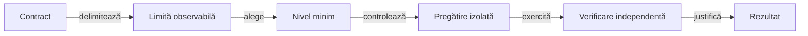

# Arhitectura testării

## Pe scurt

Nivelul unui test rezultă din limita pe care o verifică. Colecția stabilește scopul și costul selecției, iar mediul stabilește dacă execuția folosește numai JVM sau și un dispozitiv Android.

## Alegerea nivelului minim

Legendă: contractul precede instrumentul

Nivelul depinde de colaborarea reală necesară verificării. Un fișier arhivat, un raport sau numele pachetului nu transformă un test într-o execuție E2E.

| Nivel | Contract verificat | Pregătire potrivită | Limită |
|---|---|---|---|
| Unitar — `unit` | Politică pură, model, calcul, parsare sau formatare | Intrări tipizate, ceas controlat, fără servicii | Nu certifică integrarea dintre module. |
| Componentă — `component` | API-ul public al unui modul ori adaptor | Dubluri controlate, date locale, fișiere temporare | Nu certifică o călătorie nouă în aplicația instalată. |
| Integrare — `integration` | Colaborarea reală dintre componente sau module | Bibliotecile fizice, configurație și resurse controlate | Nu repetă toate variantele deja acoperite la nivel inferior. |
| Cap la cap — `e2e` | Parcurs observabil în aplicația Android | Dispozitiv rezervat, aplicație identificată, stare inițială explicită | Cere acțiuni și observații noi; se activează separat. |

O funcție auxiliară, un constructor de date, un încărcător sau un oracol este suport. O clasă executabilă dintr-un pachet de suport își declară propriul nivel.

## Matricea executabilă Maven

Tabelul reflectă adnotările claselor executabile, inclusiv adnotările compuse. „—” înseamnă absența unei clase declarate la acel nivel; nu impune crearea unei suite artificiale.

| Modul | Unitar | Componentă | Integrare | E2E | Responsabilitate |
|---|---|---|---|---|---|
| `atf-test-kit` | Da | Da | — | — | Configurare, izolare, resurse și auditul comparațiilor. |
| `atf-mock` | — | Da | — | — | Transport controlat, catalog și potrivirea cererilor. |
| `atf-validation` | Da | Da | — | — | Reguli de validare și evaluarea contractelor publice. |
| `atf-console` | Da | — | Da | — | Politici de afișare și integrarea cu ciclul de viață JUnit. |
| `atf-test-android` | Da | Da | — | Da | Timp, ADB simulat, oracole și parcursuri Android reale. |
| `atf-tests` | — | Da | Da | — | Contractele adaptoarelor, binarele comune și guvernanța proiectului. |

[Verificarea matricei](../atf-tests/src/test/java/atf/tests/governance/source/TestLayerGovernanceTest.java) confruntă acest tabel cu sursele curente. Fiecare clasă executabilă Maven are exact una dintre `@AtfUnitTest`, `@AtfComponentTest`, `@AtfIntegrationTest` și `@AtfE2eTest`, direct sau printr-o adnotare compusă.

| Contract reprezentativ | Sursă |
|---|---|
| Ceas și intervale | [AndroidPhaseClockTest](../atf-test-android/src/test/java/atf/android/evidence/timing/AndroidPhaseClockTest.java) |
| Adaptor fără dispozitiv | [AdbClientContractTest](../atf-test-android/src/test/java/atf/android/AdbClientContractTest.java) |
| Binar și integrarea consumatorului | [CoreReportingConsumerContractTest](../atf-tests/src/test/java/atf/tests/CoreReportingConsumerContractTest.java) |
| Parcurs Android | [WhistLabGameplayE2eTest](../atf-test-android/src/test/java/atf/android/e2e/WhistLabGameplayE2eTest.java) |
| Calitatea surselor și documentelor | [AtfQualityGovernanceSuite](../atf-tests/src/test/java/atf/tests/governance/AtfQualityGovernanceSuite.java) |

## Motorul și interfața în Gradle

Motorul folosește JUnit JVM prin [configurația proprie](../whist-lab-app/game-core/build.gradle). Nu depinde de Test Kit și nu pretinde adnotările Maven.

| Zonă | Nivel semantic | Ce verifică | Execuție |
|---|---|---|---|
| Reguli și scor | Unitar sau componentă, după API-ul exercitat | Legalitate, levate, puncte, serii și limite | JVM, fără Android. |
| Sesiune și restaurare | Componentă | Comenzi, tranziții și respingerea unei stări inconsistente | Situații legale controlate. |
| Politici AI | Componentă | Observația permisă, decizia și proprietățile justificate independent | [Proiectarea testelor AI](AI_TEST_DESIGN.md). |
| Partidă simulată | Integrare de domeniu | Colaborarea politicilor cu motorul și oracolul până la scorul final | Distribuții și locuri declarate. |
| Geometrie și texte Android | Unitar sau componentă JVM | Dimensiuni, regiuni, localizare și modele de prezentare | [Testele aplicației](../whist-lab-app/app/src/test/java/ro/whistlab/app/). |
| Interacțiune în aplicația instalată | E2E | Legătura dintre comandă, stare, captură și scor | [Infrastructura Android](ANDROID_TESTING.md). |

Un turneu este o evaluare de politică, cu populație și criterii proprii. Numărul partidelor sau victoria nu înlocuiesc așteptarea independentă a unei regresii de componentă.

## Axe independente

| Axă | Întrebarea la care răspunde | Sursa contractului |
|---|---|---|
| Nivel | Ce limită este verificată? | Acest ghid și declarațiile executabile. |
| Colecție | De ce și când rulăm selecția? | [Catalogul colecțiilor](TEST_COLLECTIONS.md). |
| Mediu | Ce resurse reale sunt necesare? | JVM, copie temporară sau dispozitiv rezervat explicit. |
| Canal | Ce observație verificăm? | Interfață, API ori combinația declarată. |
| Publicare | Ce invocări și date prezentăm? | [Contractul datelor publicate](REPORTING_AUDIT_CONTRACT.md). |

`quick`, `regression`, `strategy` și `learning` sunt scopuri de selecție. Republicarea unui jurnal Android este o verificare a adaptorului de publicare; nu execută din nou interacțiunile istorice.

## Construcția și întreținerea unei verificări

1. Formulați proprietatea și limita ei înaintea alegerii instrumentului.
2. Alegeți nivelul minim care observă defectul fără a împrumuta verdictul implementării.
3. Pregătiți o stare validă și un rezultat așteptat independent.
4. Verificați cazul nominal, refuzul relevant și vecinul sănătos.
5. Declarați separat resursele, bugetul, selecția și condițiile de activare.
6. Actualizați documentul contractului și eliminați suprapunerile fără proprietăți distincte.

Rezultatele se păstrează în afara surselor. Testele unitare nu sunt obligate să producă prezentarea unui parcurs E2E; volumul publicării urmează scopul verificării.

[Colecții și comenzi](TEST_COLLECTIONS.md) · [Verificarea partidei](GAMEPLAY_VERIFICATION.md) · [Guvernanța calității](ATF_QUALITY_GOVERNANCE.md)
