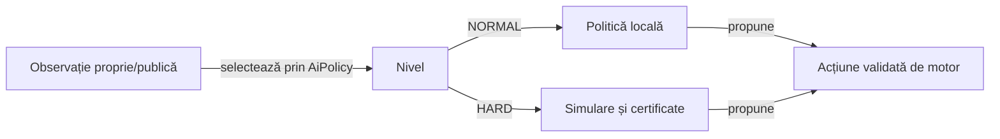

# Normal și Hard

[AiDifficulty](../whist-lab-app/game-core/src/main/java/ro/whistlab/core/AiDifficulty.java) definește nivelurile de joc, iar [AiPolicy](../whist-lab-app/game-core/src/main/java/ro/whistlab/core/AiPolicy.java) selectează implementarea. Dificultatea schimbă decizia AI în același contract de reguli.

## Responsabilități

Legendă: dificultatea nu modifică legalitatea

Ambele politici folosesc aceeași variantă și observație permisă. Motorul verifică acțiunea înainte de a schimba starea; nicio dificultate nu primește mâinile reale ale adversarilor.

## Obiective

| Politică | Comportament |
|---|---|
| Normal la licitare | Estimează puterea mâinii proprii și alege o licitație permisă. |
| Normal înaintea contractului | Caută levatele încă necesare și păstrează șanse viitoare când levata curentă nu poate fi luată. |
| Normal după contract | Evită levatele suplimentare și descarcă riscul viitor în limitele legale. |
| Hard cu contract recuperabil | Prioritizează șansa estimată a exactului, punctele proprii și scorul rivalului principal. |
| Hard cu imposibilitate publică | Protejează mai întâi punctele proprii estimate, apoi urmărește ratările adverse estimate. |

Bugetele, departajările și domeniile certificate sunt definite în [manifestul obiectivelor](../config/whist-play-objectives.yaml) și implementarea sa. Un certificat se aplică numai universului complet și continuărilor din domeniul permis; depășirea bugetului păstrează fallback-ul.

## Informație și adaptare

- Necesarul fiecărui loc se recalculează după levatele încheiate.
- Cărțile proprii, cele jucate, masa și cartea întoarsă sunt excluse din pool-ul ipotetic necorespunzător.
- Lipsurile de culoare demonstrate restrâng mâinile fezabile.
- Licitațiile cunoscute sunt ținte de contract în continuările simulate.
- Ponderarea generală a mâinilor prin probabilitatea licitației observate rămâne cercetare izolată.
- O estimare Monte Carlo și un certificat finit au niveluri diferite de certitudine.

## Compatibilitate

Parserul de dificultate convertește numele vechi EXPERT în HARD fără o a treia opțiune de meniu. Numele necunoscute și checkpoint-urile invalide sunt tratate prin validările explicite ale persistenței.

[Testele de contract](../whist-lab-app/game-core/src/test/java/ro/whistlab/core/DifficultyContractTest.java) verifică enum-ul, dispatch-ul și migrarea. [Colecțiile](testing/collections/README.md) disting regresiile de domeniu de compararea politicilor și integrarea Android.

[Modelul deciziei](AI_DECISION_MODEL.md) formalizează observația, estimarea și ordinea obiectivelor.
