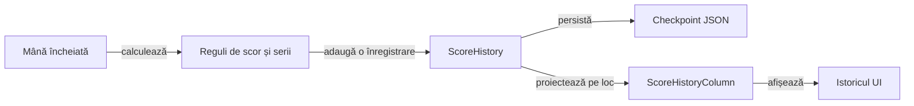

# Modelul istoricului de scor

Istoricul păstrează licitația, punctele mâinii și totalul fiecărui loc după o mână încheiată. Prezentarea și persistența consumă același registru, iar datele necunoscute dintr-o salvare veche rămân marcate ca necunoscute.

## Fluxul datelor

Legendă: scor și prezentare

Scorul este calculat o singură dată la închiderea mâinii. Registrul păstrează totalurile și contractele în ordinea locurilor; proiecția UI poate afișa mâinile în ordine inversă fără schimbarea proprietății valorilor.

## Invariante

| Contract | Regulă |
|---|---|
| Punctele mâinii | Diferența dintre totalul nou și soldul anterior, incluzând seria. |
| Licitația | Asociată explicit locului, chiar dacă acțiunile au fost capturate în altă ordine. |
| Înregistrare | O singură avansare pentru fiecare mână încheiată. |
| Reîncărcare | Ultimul sold trebuie să corespundă stării jucătorilor și fazei sesiunii. |
| Date vechi | Soldul cunoscut se păstrează; cărțile, licitațiile și mâinile neînregistrate nu sunt reconstruite prin presupunere. |
| Partidă nouă | Registru propriu și sold inițial validat. |

## Compatibilitate și UI

[GameSessionStore](../whist-lab-app/app/src/main/java/ro/whistlab/app/GameSessionStore.java) definește migrarea fiecărei scheme și validarea checkpoint-ului. [ScoreHistory](../whist-lab-app/game-core/src/main/java/ro/whistlab/core/ScoreHistory.java) definește integritatea registrului.

- Selectorul de jucător și antetele rămân separate de rândurile derulabile.
- Contractul zero se afișează ca valoare, iar contractul necunoscut are marcaj și text accesibil distinct.
- Istoricul rămâne disponibil după terminarea partidei.
- Proiecția furnizează aceeași ordine și aceleași valori afișării și citirii asistate.

## Verificarea mecanismului

Componentele verifică închiderea mâinii, migrarea, coruperea checkpoint-ului și proiecția pe loc. Replay-ul unui trace extern este opt-in și verifică asocierea contract–puncte–total după reîncărcare, cu identitatea și hash-ul intrării controlate.

[Motorul](../whist-lab-app/game-core/README.md) · [Persistența și interfața](../whist-lab-app/app/src/main/java/ro/whistlab/app/README.md)
