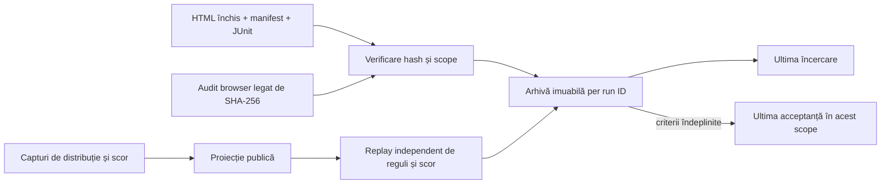

# Whist Lab · handoff offline al rapoartelor UI

[Ultima acceptanță și ultima încercare](<file:///C:/work/whist_back/ui-reports/whist-lab/LATEST.md>) · [Indexul din feedback](feedback/whist-extent/README.md)

Publicatorul Android actualizează linkul de execuție după auditul structural.
După închiderea JUnit, ownerul UI arhivează raportul pentru consumatorii de
componente, reguli și AI. Arhiva se află în afara checkout-ului și a TMP.
Pentru altă stație se configurează `atf.android.handoffRoot` sau `ATF_J4_UI_REPORTS`
și se folosește aceeași rădăcină la publicarea offline.



## Ce deschide un consumator

| Fișier în `whist-lab` | Întrebare |
|---|---|
| `LATEST.md` | Care sunt ultimul raport acceptat și ultima încercare înregistrată? |
| `scopes/<scope>/latest-accepted.json` | Există acceptanță pentru acest scop precis? JSON `null` înseamnă că nu există. O partidă completă cere o acceptanță proprie. |
| `scopes/<scope>/latest-attempt.json` | Cum s-a încheiat ultima încercare? Un eșec sau un refuz al rulării are verdict propriu. |
| `runs/<id>/metadata.json` | Cine a publicat, ce s-a executat, de unde provin timpul, binarul, bibliotecile și numărătorile? |
| `runs/<id>/report.html` | Raportul Extent original, păstrat octet cu octet. Pozele sunt în HTML. |
| `runs/<id>/comparisons.properties` | Comparațiile capturate, grupate după checkpoint. Fișierul poate conține informații privilegiate ale oracolului. |
| `runs/<id>/public-trace.json` | Intrările observatorului la licitare și rezultatele publice ale mâinilor încheiate, pentru replay offline. Disponibil pentru piloții de reguli. |

## Replay verificat pentru 0.1.3

```powershell
$run = 'C:\work\whist_back\ui-reports\whist-lab\runs\20261104-pilot-052110z'
python -B scripts/whist_ui_replay.py "$run/public-trace.json"
Get-FileHash -Algorithm SHA256 -LiteralPath "$run/report.html"
```

Rezultatul este de șase mâini, nouă levate și 36 de mutări. O singură invocare
JUnit a produs 31 de checkpoint-uri, 1.679 de comparații și 31 de referințe
către 25 de PNG-uri distincte. SHA-256 al HTML-ului este
`21ec9a7ba29fc6e738c1151f281863553bb6d724f040b31d265668d2e2671493`.
Totalurile după mâna a șasea sunt 25, 19, 26 și 18. Pilotul acoperă șase
dintre cele 24 de mâini ale unei partide românești la patru jucători.

Verificatorul reconstituie culorile disponibile din mutările publice ale mâinii
încheiate. Controlează ordinea jucătorilor, licitația finală, obligația de a
răspunde la culoare sau cu atu, câștigătorul, seriile și punctajele. Ordinea
licitațiilor este reconstruită din dealer și valorile capturate. Pentru levatele
intermediare, primul jucător al levatei următoare este martorul câștigătorului.
Ultimul câștigător apare în starea finală. Identitatea cărților adversarilor
înainte de joc rămâne probă privilegiată. Pentru AI, la decizie se folosește
numai `observerAtBid` și starea publică anterioară. Câmpul `exPost` conține
rezultatele observate.

## Publicarea următoarei rulări

```powershell
python -B scripts/whist_ui_handoff.py descriptor.json --root C:\work\whist_back\ui-reports
python -B scripts/test_whist_ui_handoff.py
```

Descriptorul selectează explicit fișierele. Câmpurile obligatorii pentru un
raport sunt `runId`, `sourceRunId`, `scope`, `requestedScope`, `effectiveScope`,
`profile`, `endedAt` cu fus orar, `timingBasis`, `limits`, `method`,
`html`, `manifest`, `junit`, `browser`, `apk` și `sources`. `startedAt` poate
lipsi dacă momentul nu a fost capturat. Un raport de display declară
`expectedCheckpoints`. Pilotul declară `result`, `expectedHands`, dificultatea,
locurile și bonusul. `visualReview=REVIEWED` se acordă numai după inspecție.
Fișierul `browser` consemnează verdictul auditului și `htmlSha256`, măsurat
înainte și după deschiderea acelorași bytes. Pentru o admitere refuzată se
declară `attemptStatus=NOT_RUN`, pachetul, scenariul, etapa și motivul.
Un SKIP/ERROR/FAIL fără HTML necesită și verdictul JUnit corespunzător.

Run ID-ul este imuabil. Reimportul identic este permis. O modificare a dovezilor
pentru același ID este respinsă. Pointerele se înlocuiesc atomic sub un singur
lock și sunt ordonate după sfârșitul declarat al execuției. O republicare veche
nu devine „ultima” prin data copierii. Scope-ul și pachetul separă pilotul Lab,
fluxurile de display și munca pe aplicația originală. O întrerupere brutală a
procesului poate lăsa `.publish.lock`; se verifică proprietarul înainte de o
nouă publicare.

## Ce rămâne deschis din J4-UI-HANDOFF-01/02

- Pentru rulările arhivate, JUnit identifică JAR-urile Core C3 și Reporting J18.
  Hash-urile lor s-au citit ulterior. `sha256AtExecution` rămâne `null`.
  Captura la pornirea JVM este un TODO pentru următoarea execuție planificată.
- Începutul execuțiilor istorice este aproximat din durata nativă și ora de
  închidere a manifestului. Proveniența temporală rămâne vizibilă în metadate.
- Cele șapte arhive păstrează șase fluxuri cu PASS și pilotul eșuat anterior.
  Replay-ul verifică mâinile încheiate. O distribuție întreruptă rămâne parțială.
  Namespace-ul aplicației originale și acceptanța unei partide complete rămân
  responsabilități distincte.

[Acceptanța UI 0.1.3](WHIST_UI_013_ACCEPTANCE.md) · [Feedback UX](feedback/WHIST_LAB_User_Experience_Feedback.md)
