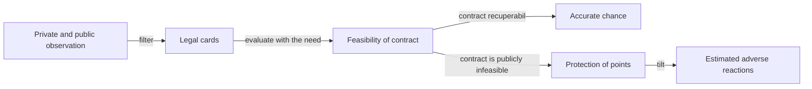

# Contextual decisions and contract safety

## Overview

The value of a card depends on the remaining objective and public information. [Manifestul contextual](../../config/whist-contextual-discard.yaml) links the general conditions for implementation and independent regressions.

## Order of assessment

Legend: priority of objectives

Legality precedes any intention. Feasibility uses public and certified limits in their field; an estimate of rollout is not a demonstration that a contract is impossible or a move is universally safe.

## Conditional rules

| Condition | Implication |
|---|---|
| The contract is made | Reduce the risk of additional levatates within the limits of legality. |
| There are still no achievable tricks | Keep or use cards that offer the necessary opportunities. |
| Missing the required color, but there is trump | Compulsory cutting takes precedence over the intention to avoid. |
| Missing color and no trump | A side honor can become a legal exit. |
| There's a higher hand still on the table | A playable asset can be consumed without a trick of its own. |
| The upper atum is returned or in a completed trick | He can't win his current trick anymore. |
| Total imbalance suggests avoidance | Further assess the needs of each place; the total does not replace the individual target. |

## State dimensions

[Modelul deciziei](ATF_DecisionModel.md#state-that-influences-the-decision) has the definitions of the need to be signed, opportunities, imbalance and progress. The conditions in this guide use the same units and include the unfinished trick once.

The positive demand amounts to `max(0, necesar)` per place: a contract already exceeded does not cancel the need of another player. The aggregate imbalance describes mass without replacing individual target or the legality of a card.

## Guarantees and estimates

The runtime order and the certificate quantifiers are defined in [modelul deciziei](ATF_DecisionModel.md#priority-objectives). [Rules and configuration](ATF_RulesConfiguration.md) Distinguishing these active branches of experimental clues and weights.

- [ContextualHonorDiscardTest](../../whist-lab-app/game-core/src/test/java/ro/whistlab/core/ai/engine/ContextualHonorDiscardTest.java) checks the borders of the rules through legal witnesses and controlled changes of the need.
- [Design of components](../testing/ATF_AiComponents.md) delimits the actor's observation and oracle.
- [Independent Player](../../whist-lab-app/ai-lab/README.md) has separate implementation and utility.

A contextual recommendation becomes a guarantee only if it is demonstrated in the stated field. The budget exhausted, incomplete listing or simple favourable average shall retain the estimation status.
