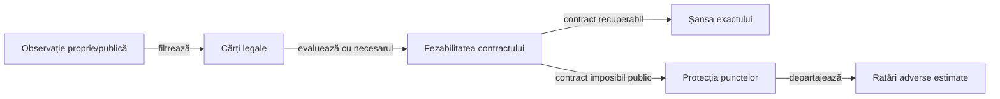

# Decizii contextuale și siguranța contractului

Valoarea unei cărți depinde de obiectivul rămas și de informația publică. [Manifestul contextual](../../config/whist-contextual-discard.yaml) leagă condițiile generale de implementare și de regresiile independente.

## Ordinea evaluării

Legendă: prioritatea obiectivelor

Legalitatea precedă orice intenție. Fezabilitatea folosește limite publice și certificate în domeniul lor; o estimare de rollout nu este o demonstrație că un contract este imposibil sau o mutare este universal sigură.

## Reguli condiționale

| Condiție | Implicație |
|---|---|
| Contractul este realizat | Reduceți riscul levatelor suplimentare în limitele legalității. |
| Mai lipsesc levate realizabile | Păstrați sau folosiți cărțile care oferă oportunitățile necesare. |
| Lipsește culoarea cerută, dar există atu | Tăierea obligatorie prevalează asupra intenției de evitare. |
| Lipsește culoarea și nu există atu | Un onor lateral poate deveni o ieșire legală. |
| Există un atu superior încă pe masă | Un atu propriu jucabil poate fi consumat fără o levată proprie. |
| Atuul superior este întors sau într-o levată încheiată | El nu mai poate câștiga levata curentă. |
| Dezechilibrul total sugerează evitare | Evaluați în continuare necesarul fiecărui loc; totalul nu înlocuiește obiectivul individual. |

## Mărimi de stare

[Modelul deciziei](ATF_DecisionModel.md#starea-care-schimbă-decizia) deține definițiile necesarului semnat, oportunităților, dezechilibrului și progresului. Condițiile din acest ghid folosesc aceleași unități și includ levata neterminată o singură dată.

Cererea pozitivă însumează `max(0, necesar)` pentru fiecare loc: un contract deja depășit nu anulează nevoia altui jucător. Dezechilibrul agregat descrie masa, fără a înlocui ținta individuală sau legalitatea unei cărți.

## Garanții și estimări

Ordinea runtime și cuantificatorii certificatelor sunt definiți în [modelul deciziei](ATF_DecisionModel.md#prioritatea-obiectivelor). [Regulile și configurarea](ATF_RulesConfiguration.md) disting aceste ramuri active de indicii și ponderi experimentale.

- [ContextualHonorDiscardTest](../../whist-lab-app/game-core/src/test/java/ro/whistlab/core/ai/engine/ContextualHonorDiscardTest.java) verifică frontierele regulilor prin martori legali și schimbări controlate ale necesarului.
- [Proiectarea componentelor](../testing/ATF_AiComponents.md) delimitează observația actorului și oracolul.
- [Jucătorul independent](../../whist-lab-app/ai-lab/README.md) are implementare și utilitate separate.

O recomandare contextuală devine garanție numai dacă este demonstrată în domeniul declarat. Bugetul epuizat, o enumerare incompletă sau o simplă medie favorabilă păstrează statutul de estimare.
