# Cost of AI qualification

## Overview

The cost of the decision qualifies separately from the strategic force and latency of the Android application. [Collection `cost`](../testing/ATF_Collections.md) exercises Normal, Hard and independent player on public observations resulting from the legally generated game, at 2–8 cards and four players. The preparation uses actual session and legal orders; full distribution remains in the test support, and the algorithm receives its own hand and public deeds.

[Profile](../../config/whist-ai-cost-profile.json) declares before execution the initializations, repetitions, heating JVM and working limits, CPU and total time. [CostProfile](../../whist-lab-app/game-core/src/test/java/ro/whistlab/core/ai/cost/CostProfile.java) validates it once and retains the identity of bytes; refuses incomplete domains, default conversions, numerical overruns and negative limits. The collection is explicit and does not add to the implicit regression or learning tournaments.

| Verification officer | Limit |
|---|---|
| `CostProfile` | Validated profile and independent copies of the document; [profile components](../../whist-lab-app/game-core/src/test/java/ro/whistlab/core/ai/cost/CostProfileTest.java) checks refusals. |
| `CostPlayer` | Adapters printed for the two APIs and measurement controls, with the maintenance of the diagnosis at abandonment. |
| `CostChecks` | Legality and structural limits, separated from the clock and serialization. |
| `AiCostQualificationTest` | Orchestrame, measured range and external result; the error in publication is attached to the original cause when the calculation has already failed. |

## Measurement flow

```mermaid
flowchart LR
    PROFILE[Copied profile] -->|set boundaries| FIXTURE[Legal position generated]
    FIXTURE -->|design| PUBLIC[Own and public observation]
    PUBLIC -->|warms up the JVM| WARMUP[Reference decision]
    WARMUP -->|Repeat with measurement| MEASURE[Measured decision]
    MEASURE -->|checks| CHECK[Legal, identity and limits]
    CHECK -->|keep external| RESULT[Result and environment]
```

Legend: coming into measurement

The game preparation, heating and publication of files are outside the measured range. The range includes the projection of the observation, the call for the decision and the reading of the meters. The identity of the action shall be compared to the undocumented appeal; the legality shall be verified separately by the contract of rules. The result retains the permitted observation without the actual hands of the opponents.

The positions cover the beginning and end of the bidding, the driving, the levitate response and the end of the hand. In two cards, the beginning and the end are the same state and do not double. The producer uses legal deterministic game for preparation without running the AIU and without reading the external body.

## Units and limits

| Measure | Meaning and limit |
|---|---|
| `workUnits` | Cooperative boundaries of actual calculation crossed; the unit depends on implementation and is not CPU instruction. |
| `SAMPLE` / `WORLD` | Sampling calls / feasible worlds assessed. A failed attempt does not become a world; listing can produce worlds without sampling. |
| `MATCHING` | Expansions of the feasible allocation from the engine, limited by the number of slots and unknown cards. |
| `REJECTION` / `FEASIBILITY` | Rejection tests and feasibility checks in independent implementation. |
| `ENUMERATION` | Expansions of the finished listing, including the preparation of evidence. |
| `ROLLOUT` | Books covered by the follow-up model; the limit derives from worlds, alternatives and remaining cards. |
| `ENDGAME` | Nodes search a hypothetical world. Solving that world is not universal. |
| `PROOF` | Expanded nodes of universal verification in the allowed finite domain. The expanded number shall not exceed the declared budget. |
| Wire CPU | The time taken by the decision thread, measured by `ThreadMXBean`; the clock shall be available. |
| Time total | The observed duration, including the expectation of planning by the system; has a separate protection limit. |

[Qualification test](../../whist-lab-app/game-core/src/test/java/ro/whistlab/core/ai/cost/AiCostQualificationTest.java) separately checks the structural boundaries and the measured profile. The meters are insulated by wire by [SearchWork](../../whist-lab-app/game-core/src/main/java/ro/whistlab/core/ai/simulation/SearchWork.java) and [PlannerControl](../../whist-lab-app/ai-lab/src/main/java/ro/whistlab/coach/PlannerControl.java); none changes random initialization or utility function. Without explicit context, the global limit is not activated.

## Cancellation, exhaustion and reserve

| Situation | Required behaviour |
|---|---|
| The budget of the exhausted proof | Keeps the basic legal proposal with `certified=false`; partial search does not become certainty. |
| Overall working limit reached | Discard `LimitExceeded`, with reason `WORK_LIMIT`; do not return partial decision. |
| Wire cut off | Drop `CancellationException`, keep the cut-off mark and reason `INTERRUPTED`. |
| Closed context | Freeze the measures and remove the limit from the line; the next call does not inherit the budget. |

The reason `NONE` only says that this control did not stop the calculation. The verdict also requires termination of appeal, legality, identity of decision and respect for all limits. The context of the ingot or otherwise closed is denied.

## Interpretation and governance

The results keep profile, Java version, VM, system, architecture, available processors, heap and each measurement. The inventory of sources links the observations to the code executed. A interrupted or failed execution retains its condition and diagnosis; limits do not relax retrospectively to produce success.

- **Domain: ** JVM qualification identifies a cost in declared positions and environment.
- **Device: ** distribution of latency, battery consumption and acceptance of Android wire require profile and measurement on target environment.
- **Strategy:** progress requires separate [reserved assessment](../learning/README.md), with frozen sources and criteria on the role, opponent and place; the speed and number of worlds do not demonstrate superiority.

[Components AI](../testing/ATF_AiComponents.md) · [Collections](../testing/ATF_Collections.md) · [Criteria open](../feedback/ATF_Ai.md)
