# Calificarea costului AI

## Responsabilitate și domeniu

Costul deciziei se califică separat de forța strategică și de latența aplicației Android. [Colecția `cost`](../testing/ATF_Collections.md) exercită Normal, Hard și jucătorul independent pe observații publice rezultate din joc legal generat, la 2–8 cărți și patru jucători. Pregătirea folosește sesiunea reală și comenzi legale; distribuția completă rămâne în suportul testului, iar algoritmul primește mâna proprie și faptele publice.

[Profilul](../../config/whist-ai-cost-profile.json) declară înaintea execuției inițializările, repetările, încălzirea JVM și limitele de lucru, CPU și timp total. [CostProfile](../../whist-lab-app/game-core/src/test/java/ro/whistlab/core/ai/cost/CostProfile.java) îl validează o singură dată și păstrează identitatea octeților; refuză domenii incomplete, conversii implicite, depășiri numerice și limite nepozitive. Colecția este explicită și nu se adaugă regresiei implicite sau turneelor de învățare.

| Responsabil al verificării | Limită |
|---|---|
| `CostProfile` | Profil validat și copii independente ale documentului; [componentele profilului](../../whist-lab-app/game-core/src/test/java/ro/whistlab/core/ai/cost/CostProfileTest.java) verifică refuzurile. |
| `CostPlayer` | Adaptoare tipizate pentru cele două API-uri și controale de măsurare, cu păstrarea diagnosticului la abandon. |
| `CostChecks` | Legalitatea și limitele structurale, separate de ceas și serializare. |
| `AiCostQualificationTest` | Orchestrare, interval măsurat și rezultat extern; eroarea publicării se atașează cauzei inițiale când calculul a eșuat deja. |

## Fluxul măsurării

```mermaid
flowchart LR
    PROFILE[Profil copiat] -->|fixează limite| FIXTURE[Poziție legală generată]
    FIXTURE -->|proiectează| PUBLIC[Observație proprie și publică]
    PUBLIC -->|încălzește JVM| WARMUP[Decizie de referință]
    WARMUP -->|repetă cu măsurare| MEASURE[Decizie instrumentată]
    MEASURE -->|verifică| CHECK[Legalitate, identitate și limite]
    CHECK -->|păstrează extern| RESULT[Rezultat și mediu]
```

Legendă: ce intră în măsurare

Pregătirea jocului, încălzirea și publicarea fișierelor sunt în afara intervalului măsurat. Intervalul include proiecția observației, apelul deciziei și citirea contoarelor. Identitatea acțiunii se compară cu apelul fără instrumentare; legalitatea se verifică separat prin contractul regulilor. Rezultatul reține observația permisă, fără mâinile reale ale adversarilor.

Pozițiile acoperă începutul și sfârșitul licitării, conducerea, răspunsul în levată și finalul mâinii. La două cărți, începutul și finalul sunt aceeași stare și nu se dublează. Constructorul folosește joc legal determinist pentru pregătire, fără rularea AI-ului și fără citirea corpusului extern.

## Unități și limite

| Măsură | Semnificație și limită |
|---|---|
| `workUnits` | Frontiere cooperative de calcul efectiv traversate; unitatea depinde de implementare și nu este instrucțiune CPU. |
| `SAMPLE` / `WORLD` | Apeluri ale eșantionării / lumi fezabile evaluate. O încercare nereușită nu devine lume; enumerarea poate produce lumi fără eșantionare. |
| `MATCHING` | Expansii ale alocării fezabile din motor, limitate de numărul sloturilor și cărților necunoscute. |
| `REJECTION` / `FEASIBILITY` | Încercări de respingere și verificări ale fezabilității în implementarea independentă. |
| `ENUMERATION` | Expansii ale enumerării finite, inclusiv pregătirea dovezilor. |
| `ROLLOUT` | Cărți parcurse de modelul de continuare; limita derivă din lumi, alternative și cărți rămase. |
| `ENDGAME` | Noduri de căutare într-o lume ipotetică. Rezolvarea acelei lumi nu este certificat universal. |
| `PROOF` | Noduri expandate ale verificării universale din domeniul finit admis. Numărul expandat nu depășește bugetul declarat. |
| CPU al firului | Timp consumat de firul deciziei, măsurat prin `ThreadMXBean`; ceasul trebuie să fie disponibil. |
| Timp total | Durata observată, inclusiv așteptarea planificării de către sistem; are o limită de protecție separată. |

[Testul de calificare](../../whist-lab-app/game-core/src/test/java/ro/whistlab/core/ai/cost/AiCostQualificationTest.java) verifică separat limitele structurale și profilul măsurat. Contoarele sunt izolate pe fir prin [SearchWork](../../whist-lab-app/game-core/src/main/java/ro/whistlab/core/ai/simulation/SearchWork.java) și [PlannerControl](../../whist-lab-app/ai-lab/src/main/java/ro/whistlab/coach/PlannerControl.java); niciunul nu schimbă inițializarea aleatoare sau funcția de utilitate. Fără context explicit, limita globală nu este activată.

## Anulare, epuizare și rezervă

| Situație | Comportament obligatoriu |
|---|---|
| Bugetul dovezii epuizat | Păstrează propunerea legală de bază, cu `certified=false`; o căutare parțială nu devine certitudine. |
| Limita globală de lucru atinsă | Aruncă `LimitExceeded`, cu motivul `WORK_LIMIT`; nu returnează decizie parțială. |
| Fir întrerupt | Aruncă `CancellationException`, păstrează marcajul întreruperii și motivul `INTERRUPTED`. |
| Context închis | Îngheață măsurile și elimină limita de pe fir; apelul următor nu moștenește bugetul. |

Motivul `NONE` spune numai că acest control nu a oprit calculul. Verdictul cere și terminarea apelului, legalitate, identitatea deciziei și respectarea tuturor limitelor. Contextele imbricate sau închise de alt fir sunt refuzate.

## Interpretare și guvernanță

Rezultatele păstrează profilul, versiunea Java, VM-ul, sistemul, arhitectura, procesoarele disponibile, heap-ul și fiecare măsurare. Inventarul surselor leagă observațiile de codul executat. O execuție întreruptă sau eșuată își păstrează starea și diagnosticul; limitele nu se relaxează retrospectiv pentru a produce succes.

- **Domeniu:** calificarea JVM identifică un cost pe pozițiile și mediul declarate.
- **Dispozitiv:** distribuția latenței, consumul bateriei și acceptanța firului Android cer profil și măsurare pe mediul țintă.
- **Strategie:** progresul cere separat [evaluarea rezervată](../learning/README.md), cu surse înghețate și criterii pe rol, adversar și loc; viteza și numărul lumilor nu demonstrează superioritate.

[Componente AI](../testing/ATF_AiComponents.md) · [Colecții](../testing/ATF_Collections.md) · [Criterii deschise](../feedback/ATF_Ai.md)
