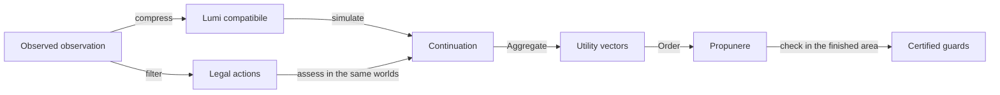
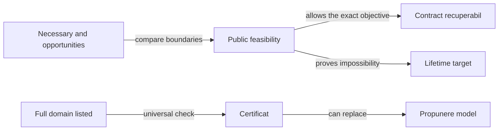

# Model decision with partial information

## Overview

The model shall convert the permitted observation into legal action, assessed against the active objective. The separation of observation, hypothetical worlds, continuation and the criterion of choice allows a mechanism to be changed without confusing it with the others.

## Contract of a decision



<details>
<summary>Legend: separation of responsibilities</summary>

Politics sees its own hand and public prefix. The simulator can build hypothetical hands and a guard can list a finite field; these operations do not introduce actual adverse hands into the observation.

</details>

## The status changing the decision

| Variable | Definition | Rol |
|---|---|---|
| Individual need null | contract-trick wins | Show if the actor is still looking for tricks, is at target or has exceeded contract. |
| R opportunities | (cards left in hands + cards on the table) / players | Count the unfinished trick once. |
| Dezechilibru Δ | sum of the requirements − R | After bidding, it stays constant in the same hand. |
| Density nthe / R for R > 0 | Required for opportunities | Expose individual urgency; it is not a probability and does not apply to a completed hand. |
| Progres | 1 − R / initial size | It measures the consumption of the hand, separated from the number of hand in the match. |
| Public memory | Playing cards, table and card | Tear down the unknown pole and compatible color gaps. |
| Score and series | Public totals and meters | Change the utility of the result by the set-up score rules. |

The same value of the product can coexist with very different individual requirements. As the game progresses, R, uncertainty and legal possibilities change, even if it remains fixed.

## When the Aion plays at 0

With the active option in Romanian Whist 1–8–1 or 8–1–8, Normal and Hard check the target at each bid and card choice.

- **Activation.** The engine seeks public proof of exclusion from the first two places and a sequence of results that can result in exactly 0. A possible equality for the second place retains the contract strategy.
- **Ranking at Hard.** After the bidding, Hard checks whether the opponents he must reach can split the remaining tricks. Compare each of his own results with the group of opponents that can be reached using the least levitated. If no allocation is in the budget, the first two seats shall be excluded.
- **Keeping a route to Hard.** Before the last hand, with two to four tricks remaining and several legal cards, Hard can compare all the sequels in the distributions consistent with the table. In any distribution where the top 2 remains possible, the two comparative choices must produce the same conventional result at each place. In the top 2 distributions excluded, the alternative keeps existing routes and, at four tricks, can transform a response-dependent route into a guaranteed one.
- **The budget of the checking.** Proof examines no more than 64 complete distributions. In three tricks it has a limit of 16.384 positions in continuations, and in four it has 16.384 positions in enumeration and 32.768 for sequels. Hard maintains the conventional choice when the evidence cannot be concluded within these limits.
- **Information.** Conservative limits combine every possible result of the current hand with the maximum and minimum remaining program. The number of serial payments shall be based on the meter that the result leaves to each place.
- **Evaluation.** The model goes back to the remaining program and combines possible delta according to the serial counter. Equal weights of individual results describe a score heuristic for future hands.
- **Hand of a cart.** The last bidder is obliged to declare 0 if the previous amount is 0 and 1 if the amount is 1. From an amount of 2, both bids are legal. The mandatory bid is directly applicable and says nothing about the force of the card. The model calibrated to four players can use the last player's bid as a clue only if he had a choice.
- **Last Hand ** Simulator compares on the same distributions both ways of loss when possible. At bidding, opening trick or missing tricks for target, an equal support shall be decided on the estimated final balance, including series. When the player responds to a color and has already the number of tricks that extinguish his balance, conventional points divide the cards with the same support for zero.
- **Penultimate hand ** At equal support for zero, the engine compares the bid-levated pairs that can close the balance in the last hand. If the actor bids last, count how many results adjacent to a trick remain legal misconduct as number of tricks. Thus, a maximum loss has few options and a one-point failure can become a contract at exactly a deviation from a trick.
- **Election .** The highest estimated support for zero exactly remains the first criterion. Conventional points are departmental according to the hand-specific criterion.
- **Limit.** The last hand pairs measure arithmetic freedom before splitting and bidding. If the available simulations do not support any action towards zero, the engine returns to the chosen level strategy. [Formal rule](../../config/whist-play-objectives.yaml)

The laboratory observation distinguishes the first choice for zero from an eligible decision that has returned to normal policy. A single legal action does not fall into the number of strategy changes. [Pair Collection](../../whist-lab-app/game-core/src/test/README.md#game-evaluation-at-0)

## Estimate of alternatives

| Owner | Contract |
|---|---|
| [MonteCarloAi](../../whist-lab-app/game-core/src/main/java/ro/whistlab/core/ai/engine/MonteCarloAi.java) | Observing API, generating and aggregation of comparisons, then the finished guards. |
| [DecisionEvaluation](../../whist-lab-app/game-core/src/main/java/ro/whistlab/core/ai/engine/DecisionEvaluation.java) | It turns hypothetical sequels into utility using the same targets and score rules; it does not select worlds or actions. |
| [DecisionOrdering](../../whist-lab-app/game-core/src/main/java/ro/whistlab/core/ai/engine/DecisionOrdering.java) | Ordering alternatives already assessed by profile and established tolerances; not consuming random numbers. |

The way of evaluation depends on the field. [MonteCarloAi](../../whist-lab-app/game-core/src/main/java/ro/whistlab/core/ai/engine/MonteCarloAi.java) coordinates selection; [PossibleDeals](../../whist-lab-app/game-core/src/main/java/ro/whistlab/core/ai/simulation/PossibleDeals.java) builds worlds, and [RolloutPolicy](../../whist-lab-app/game-core/src/main/java/ro/whistlab/core/ai/simulation/RolloutPolicy.java) continues a hypothetical world.

| Domeniu | Assessment and limit |
|---|---|
| Bidding of a card | `OneCardBidBelief` makes the enumeration conditional on the bids already observed in the Romanian domain of four places with a card turned over; outside the domain or without eligible evidence, the basic estimate is used. |
| Bidding of 2–8 cards | Legal alternatives use the same worlds; public contracts are maintained and offers still unknown are estimated below. |
| Play the card | A single legal action or rule of dominance can avoid simulation; otherwise the candidate cards are compared on common worlds. |
| Small endings | The enumeration of worlds and the search for continuances have distinct areas; full listing does not make the model of continuation a universal certificate. |

The model of a card has [implementation in engine](../../whist-lab-app/game-core/src/main/java/ro/whistlab/core/ai/engine/OneCardBidBelief.java) and [independent implementation](../../whist-lab-app/ai-lab/src/main/java/ro/whistlab/coach/OneCardBidBelief.java). The enumeration is accurate for the fixed plausible model; calibration of it against any actual opponent does not result automatically.

For simulated alternatives, the terminal vector shall contain its own points, the main rival score, the exact contract indicator and the number of adverse failures:

```text
estimare(acțiune) = suma ponderată a utilităților / suma ponderilor
utilitate_mixtă = (1 − α) × utilitate_rollout + α × utilitate_MaxN
```

- The aggregation of general simulations uses equal weights of the worlds generated; the sampler is not proven uniformly over all feasible distributions.
- The mixture with MaxN is only applied in the small field defined by `DecisionEvaluation.evaluate`; otherwise the rollout is used.
- Searching a hypothetical world can use that world for consequences without demonstrating the optimal of the hidden information strategy.
- The exact frequency depends on the model of worlds and on the continuation; general conditioning after bids at 2–8 cards is [separate research](ATF_RulesConfiguration.md#behavior-inference).

## Priority objectives

The order below concerns the Romanian profile; the other variants use their declared usefulness and rules.

| Policy and phase | Choice orders |
|---|---|
| Normal, licitare | Estimating his own hand, projected on legal bids. |
| Normal, joc | Tracking the need through rank and current situation; avoiding tricks by target. |
| Romanian Hard, Bidding | The estimated contract opportunity, the exact points, then the smaller bid at equal. |
| Hard, recoverable contract | Estimated chance of exact, points of the individual, then reduction of the main rival score. |
| Hard, publicly proven impossibility | Estimated own points, estimated adverse failures, then the score of the main rival. |
| Independent Player | His own points; by the card, the score of his main rival departs equality. |

The table describes the runtime profile `CURRENT`; experimental profiles can change order and be explicitly selected. The criteria apply to lexicographic, numeric tolerances in the comparator: a subsequent criterion departs values considered equal to the previous level.

## Feasibility and certificates

In [PublicSalvage.quota](../../whist-lab-app/game-core/src/main/java/ro/whistlab/core/ai/engine/PublicSalvage.java), The need is compared with the opportunities and public limit of inevitable assets. A higher asset still on the table can allow the legal consumption of an asset without gain; a turned card or a completed trick has another role.



<details>
<summary>Legend: limits of the guarantee</summary>

The lack of a certificate keeps the fallback and does not prove that the alternative is wrong. An incomplete listing or an exhausted budget may not certify a decision.

</details>

[ContractGuarantee](../../whist-lab-app/game-core/src/main/java/ro/whistlab/core/ai/engine/ContractGuarantee.java) requires the performance of the contract for each feasible world and all legal follow-up in the allowed field, including subsequent own choices. This is a conservative universal property of initial action.

[PublicSalvage](../../whist-lab-app/game-core/src/main/java/ro/whistlab/core/ai/engine/PublicSalvage.java) compares the candidate's limits with those of the basic proposal. In each world, the minimum of the candidate's own points and adverse failures must be at least the appropriate maximum of the base; at least one inequality is strict in any world.

## Reproducibility and limits

- The same full observation and implementation shall produce the same decision.
- For Hard, the initialization of the estimate uses the differences in score to actor, calculated on 64 bits. A common translation of totals keeps the same worlds and estimates; changing the score differences remains part of the context. The independent player has his own random stream and does not automatically take over this invariant.
- The set-up bonuses and penalties change the usefulness of the result without changing the distribution of the cards on their own. In eligible hands, the difference in the value of a series shall be weighted with the exact or failure frequency; a hand of a card shall not pay the series.
- Unknown tenders in the simulation are estimates and those already public remain binding targets.
- A card forced by legality does not prove the actor's intention.
- The simulation budget controls the cost and uncertainty of the estimate; its increase does not demonstrate only strategic progress.

[Configuration of rules and weights](ATF_RulesConfiguration.md) · [Projection of tests](../testing/ATF_AiComponents.md) · [Learning architecture](README.md)
