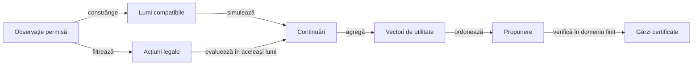
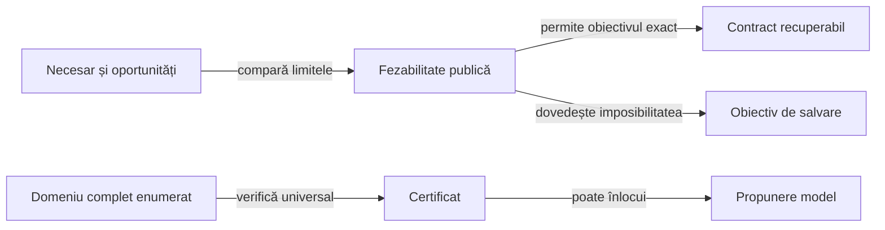

# Modelul deciziei cu informație parțială

Modelul transformă observația permisă într-o acțiune legală, evaluată față de obiectivul contractului. Separarea observației, lumilor ipotetice, continuării și criteriului de alegere permite schimbarea unui mecanism fără confundarea lui cu celelalte.

## Contractul unei decizii



<details>
<summary>Legendă: separarea responsabilităților</summary>

Politica vede mâna proprie și prefixul public. Simulatorul poate construi mâini ipotetice, iar o gardă poate enumera un domeniu finit; aceste operații nu introduc mâinile adverse reale în observație.

</details>

## Starea care schimbă decizia

| Variabilă | Definiție | Rol |
|---|---|---|
| Necesar individual nᵢ | contractᵢ − levate câștigateᵢ | Arată dacă actorul mai caută levate, este la țintă sau a depășit contractul. |
| Oportunități R | (cărți rămase în mâini + cărți pe masa curentă) / jucători | Numără o singură dată levata neterminată. |
| Dezechilibru Δ | suma necesarelor − R | După licitare rămâne constant în aceeași mână. |
| Densitate nᵢ/R, pentru R > 0 | Necesar raportat la oportunități | Exprimă urgența individuală; nu este o probabilitate și nu se aplică unei mâini încheiate. |
| Progres | 1 − R / mărimea inițială | Măsoară consumarea mâinii, separat de numărul mâinii în partidă. |
| Memorie publică | Cărți jucate, masă curentă și carte întoarsă | Restrânge pool-ul necunoscut și lipsele de culoare compatibile. |
| Scor și serie | Totaluri și contoare publice | Schimbă utilitatea rezultatului prin regulile de scor configurate. |

Aceeași valoare Δ poate coexista cu necesare individuale foarte diferite. Pe măsură ce jocul avansează, R, incertitudinea și posibilitățile legale se schimbă, chiar dacă Δ rămâne fix.

## Estimarea alternativelor

| Responsabil | Contract |
|---|---|
| [MonteCarloAi](../../whist-lab-app/game-core/src/main/java/ro/whistlab/core/ai/engine/MonteCarloAi.java) | API-ul observației, generarea și agregarea comparațiilor, apoi gărzile finite. |
| [DecisionEvaluation](../../whist-lab-app/game-core/src/main/java/ro/whistlab/core/ai/engine/DecisionEvaluation.java) | Transformă continuările ipotetice în utilitate, folosind aceleași ținte și reguli de scor; nu selectează lumi sau acțiuni. |
| [DecisionOrdering](../../whist-lab-app/game-core/src/main/java/ro/whistlab/core/ai/engine/DecisionOrdering.java) | Ordonează alternativele deja evaluate după profil și toleranțele consacrate; nu consumă numere aleatoare. |

Calea de evaluare depinde de domeniu. [MonteCarloAi](../../whist-lab-app/game-core/src/main/java/ro/whistlab/core/ai/engine/MonteCarloAi.java) coordonează selecția; [PossibleDeals](../../whist-lab-app/game-core/src/main/java/ro/whistlab/core/ai/simulation/PossibleDeals.java) construiește lumile, iar [RolloutPolicy](../../whist-lab-app/game-core/src/main/java/ro/whistlab/core/ai/simulation/RolloutPolicy.java) continuă o lume ipotetică.

| Domeniu | Evaluare și limită |
|---|---|
| Licitare de o carte | `OneCardBidBelief` condiționează enumerarea pe licitațiile deja observate în domeniul românesc de patru locuri cu carte întoarsă; în afara domeniului sau fără evidență eligibilă se folosește estimarea de bază. |
| Licitare de 2–8 cărți | Alternativele legale folosesc aceleași lumi; contractele publice sunt păstrate, iar ofertele încă necunoscute sunt estimate în continuare. |
| Jocul cărții | O singură acțiune legală sau o regulă de dominanță poate evita simularea; altfel cărțile candidate sunt comparate pe lumi comune. |
| Finaluri mici | Enumerarea lumilor și căutarea continuărilor au domenii distincte; enumerarea completă nu transformă modelul continuării într-un certificat universal. |

Modelul de o carte are [implementare în motor](../../whist-lab-app/game-core/src/main/java/ro/whistlab/core/ai/engine/OneCardBidBelief.java) și [implementare independentă](../../whist-lab-app/ai-lab/src/main/java/ro/whistlab/coach/OneCardBidBelief.java). Enumerarea este exactă pentru modelul de plauzibilitate fixat; calibrarea lui față de orice adversar real nu rezultă automat.

Pentru alternativele simulate, vectorul terminal conține punctele proprii, scorul rivalului principal, indicatorul contractului exact și numărul ratărilor adverse:

```text
estimare(acțiune) = suma ponderată a utilităților / suma ponderilor
utilitate_mixtă = (1 − α) × utilitate_rollout + α × utilitate_MaxN
```

- Agregarea simulărilor generale folosește ponderi egale ale lumilor generate; samplerul nu este dovedit uniform peste toate distribuirile fezabile.
- Amestecul cu MaxN se aplică numai în domeniul mic definit de `DecisionEvaluation.evaluate`; în rest se folosește rollout-ul.
- Căutarea pe o lume ipotetică poate folosi acea lume pentru consecințe, fără a demonstra optimalitatea strategiei cu informație ascunsă.
- Frecvența exactului depinde de modelul lumilor și al continuării; condiționarea generală după licitații la 2–8 cărți este [cercetare separată](ATF_RulesConfiguration.md#inferența-comportamentului).

## Prioritatea obiectivelor

Ordinea de mai jos privește profilul românesc; celelalte variante folosesc utilitatea și regulile lor declarate.

| Politică și fază | Ordine de alegere |
|---|---|
| Normal, licitare | Estimarea mâinii proprii, proiectată pe licitațiile legale. |
| Normal, joc | Urmărirea necesarului prin rang și situația curentă; evitarea levatelor după țintă. |
| Hard românesc, licitare | Șansa estimată a contractului exact, punctele proprii, apoi licitația mai mică la egalitate. |
| Hard, contract recuperabil | Șansa estimată a exactului, punctele proprii, apoi reducerea scorului rivalului principal. |
| Hard, imposibilitate dovedită public | Punctele proprii estimate, ratările adverse estimate, apoi scorul rivalului principal. |
| Jucător independent | Punctele proprii; la carte, scorul rivalului principal departajează egalitatea. |

Tabelul descrie profilul runtime `CURRENT`; profilurile experimentale pot schimba ordinea și se selectează explicit. Criteriile se aplică lexicografic, cu toleranțele numerice din comparator: un criteriu ulterior departajează valori considerate egale la nivelul anterior.

## Fezabilitate și certificate

În [PublicSalvage.quota](../../whist-lab-app/game-core/src/main/java/ro/whistlab/core/ai/engine/PublicSalvage.java), necesarul se compară cu oportunitățile și cu limita publică a atuurilor inevitabile. Un atu superior încă pe masă poate permite consumarea legală a unui atu propriu fără câștig; o carte întoarsă sau dintr-o levată încheiată are alt rol.



<details>
<summary>Legendă: limitele garanției</summary>

Lipsa unui certificat păstrează fallback-ul și nu dovedește că alternativa este greșită. O enumerare incompletă sau un buget epuizat nu poate certifica o decizie.

</details>

[ContractGuarantee](../../whist-lab-app/game-core/src/main/java/ro/whistlab/core/ai/engine/ContractGuarantee.java) cere realizarea contractului pentru fiecare lume fezabilă și toate continuările legale din domeniul permis, inclusiv alegerile proprii ulterioare. Aceasta este o proprietate universală conservatoare a acțiunii inițiale.

[PublicSalvage](../../whist-lab-app/game-core/src/main/java/ro/whistlab/core/ai/engine/PublicSalvage.java) compară limitele candidatului cu cele ale propunerii de bază. În fiecare lume, minimul punctelor proprii și al ratărilor adverse ale candidatului trebuie să fie cel puțin maximul corespunzător al bazei; cel puțin o inegalitate este strictă într-o lume.

## Reproductibilitate și limite

- Aceeași observație completă și aceeași implementare produc aceeași decizie.
- Seed-ul intern depinde și de scorurile publice absolute; invarianta la translația comună a scorurilor nu este un contract al implementării curente.
- Licitațiile necunoscute din simulare sunt estimări, iar cele deja publice rămân ținte obligatorii.
- O carte forțată de legalitate nu dovedește intenția actorului.
- Bugetul de simulare controlează costul și incertitudinea estimatorului; mărirea lui nu demonstrează singură progres strategic.

[Configurarea regulilor și ponderilor](ATF_RulesConfiguration.md) · [Proiectarea testelor](../testing/ATF_AiComponents.md) · [Arhitectura învățării](README.md)
