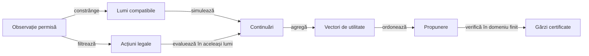
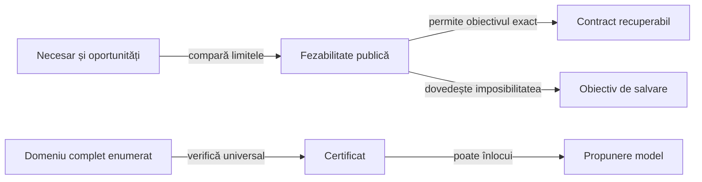

# Modelul deciziei cu informație parțială

## Pe scurt

Modelul transformă observația permisă într-o acțiune legală, evaluată față de obiectivul activ. Separarea observației, lumilor ipotetice, continuării și criteriului de alegere permite schimbarea unui mecanism fără confundarea lui cu celelalte.

## Contractul unei decizii



<details>
<summary>Legendă: separarea responsabilităților</summary>

Politica vede mâna proprie și prefixul public. Simulatorul poate construi mâini ipotetice, iar o gardă poate enumera un domeniu finit; aceste operații nu introduc mâinile adverse reale în observație.

</details>

## Starea care schimbă decizia

| Variabilă | Definiție | Rol |
|---|---|---|
| Necesar individual nᵢ | contractᵢ − levate câștigateᵢ | Arată dacă actorul mai caută levate, este la țintă sau a depășit contractul. |
| Oportunități R | (cărți rămase în mâini + cărți pe masa curentă) / jucători | Numără o singură dată levata neterminată. |
| Dezechilibru Δ | suma necesarelor − R | După licitare rămâne constant în aceeași mână. |
| Densitate nᵢ/R, pentru R > 0 | Necesar raportat la oportunități | Exprimă urgența individuală; nu este o probabilitate și nu se aplică unei mâini încheiate. |
| Progres | 1 − R / mărimea inițială | Măsoară consumarea mâinii, separat de numărul mâinii în partidă. |
| Memorie publică | Cărți jucate, masă curentă și carte întoarsă | Restrânge pool-ul necunoscut și lipsele de culoare compatibile. |
| Scor și serie | Totaluri și contoare publice | Schimbă utilitatea rezultatului prin regulile de scor configurate. |

Aceeași valoare Δ poate coexista cu necesare individuale foarte diferite. Pe măsură ce jocul avansează, R, incertitudinea și posibilitățile legale se schimbă, chiar dacă Δ rămâne fix.

## Când AI-ul joacă la 0

Cu opțiunea activă în Whist românesc 1–8–1 sau 8–1–8, Normal și Hard verifică obiectivul la fiecare licitație și alegere de carte.

- **Activare.** Motorul caută o dovadă publică a excluderii din primele două locuri și o secvență de rezultate care poate duce la exact 0. O egalitate posibilă pentru locul al doilea păstrează strategia de contract.
- **Clasament la Hard.** După licitare, Hard verifică dacă adversarii pe care trebuie să-i ajungă își pot împărți levatele rămase. Compară fiecare rezultat propriu cu grupul de adversari care poate fi ajuns folosind cele mai puține levate. Dacă nicio repartizare nu încape în buget, primele două locuri sunt excluse.
- **Păstrarea unei rute la Hard.** Înaintea ultimei mâini, cu două până la patru levate rămase și mai multe cărți legale, Hard poate compara toate continuările din distribuțiile compatibile cu masa. În orice distribuție în care top 2 rămâne posibil, cele două alegeri comparate trebuie să producă același rezultat convențional la fiecare loc. În distribuțiile cu top 2 exclus, alternativa păstrează rutele existente și, la patru levate, poate transforma o rută dependentă de răspunsuri într-una garantată.
- **Bugetul verificării.** Dovada examinează cel mult 64 de distribuții complete. La trei levate are o limită de 16.384 de poziții din continuări, iar la patru are 16.384 de poziții pentru enumerare și 32.768 pentru continuări. Hard păstrează alegerea convențională când dovada nu se poate încheia în aceste limite.
- **Informație.** Limitele conservatoare combină fiecare rezultat posibil al mâinii curente cu maximul și minimul programului rămas. Numărul plăților de serie pornește de la contorul pe care acel rezultat îl lasă fiecărui loc.
- **Evaluare.** Modelul parcurge înapoi programul rămas și combină deltele posibile în funcție de contorul de serie. Ponderile egale ale rezultatelor individuale descriu o euristică de scor pentru mâinile viitoare.
- **Mâna de o carte.** Ultimul licitant e obligat să declare 0 dacă suma anterioară e 0 și 1 dacă suma e 1. De la o sumă de 2, ambele licitații sunt legale. Licitația obligatorie se aplică direct și nu spune nimic despre forța cărții. Modelul calibrat la patru jucători poate folosi licitația ultimului jucător ca indiciu doar dacă acesta a avut de ales.
- **Ultima mână.** Simulatorul compară pe aceleași distribuții ambele sensuri ale pierderii, când sunt posibile. La licitare, la deschiderea levatei sau când mai lipsesc levate pentru țintă, o egalitate de sprijin se decide după soldul final estimat, incluzând seriile. Când jucătorul răspunde la o culoare și are deja numărul de levate care îi stinge soldul, punctele convenționale departajează cărțile cu același sprijin pentru zero.
- **Penultima mână.** La egalitate de sprijin pentru zero, motorul compară perechile licitație–levate care pot închide soldul în ultima mână. Dacă actorul va licita ultimul, numără câte rezultate adiacente cu o levată rămân ratări legale ca număr de levate. Astfel, o pierdere maximă are puține variante, iar o ratare de un punct poate deveni contract exact la o abatere de o levată.
- **Alegere.** Cel mai mare sprijin estimat pentru zero exact rămâne primul criteriu. Punctele convenționale departajează după criteriul specific mâinii.
- **Limită.** Perechile pentru ultima mână măsoară libertatea aritmetică înainte de împărțire și licitare. Dacă simulările disponibile nu susțin nicio acțiune spre zero, motorul revine la strategia nivelului ales. [Regula formalizată](../../config/whist-play-objectives.yaml)

Observarea în laborator distinge prima alegere pentru zero de o decizie eligibilă care a revenit la politica obișnuită. O singură acțiune legală nu intră în numărul schimbărilor de strategie. [Colecția pereche](../../whist-lab-app/game-core/src/test/README.md#evaluarea-jocului-la-0)

## Estimarea alternativelor

| Responsabil | Contract |
|---|---|
| [MonteCarloAi](../../whist-lab-app/game-core/src/main/java/ro/whistlab/core/ai/engine/MonteCarloAi.java) | API-ul observației, generarea și agregarea comparațiilor, apoi gărzile finite. |
| [BidConditioning](../../whist-lab-app/game-core/src/main/java/ro/whistlab/core/ai/engine/BidConditioning.java) | Reponderează mâinile inițiale ipotetice folosind dovezi limitate din licitații al căror prefix legal este cunoscut. |
| [HandTrickPotential](../../whist-lab-app/game-core/src/main/java/ro/whistlab/core/ai/policy/HandTrickPotential.java) | Scor de potențial pentru onoruri, acoperirea în aceeași culoare și scurtime cu sprijin de atu, consumat doar de condiționarea licitațiilor; estimarea licitației pentru Normal rămâne neschimbată. |
| [DecisionEvaluation](../../whist-lab-app/game-core/src/main/java/ro/whistlab/core/ai/engine/DecisionEvaluation.java) | Transformă continuările ipotetice în utilitate, folosind aceleași ținte și reguli de scor; nu selectează lumi sau acțiuni. |
| [DecisionOrdering](../../whist-lab-app/game-core/src/main/java/ro/whistlab/core/ai/engine/DecisionOrdering.java) | Ordonează alternativele deja evaluate după profil și toleranțele consacrate; nu consumă numere aleatoare. |

Calea de evaluare depinde de domeniu. [MonteCarloAi](../../whist-lab-app/game-core/src/main/java/ro/whistlab/core/ai/engine/MonteCarloAi.java) coordonează selecția; [PossibleDeals](../../whist-lab-app/game-core/src/main/java/ro/whistlab/core/ai/simulation/PossibleDeals.java) construiește lumile, iar [RolloutPolicy](../../whist-lab-app/game-core/src/main/java/ro/whistlab/core/ai/simulation/RolloutPolicy.java) continuă o lume ipotetică.

| Domeniu | Evaluare și limită |
|---|---|
| Licitare de o carte | `OneCardBidBelief` condiționează enumerarea pe licitațiile deja observate în domeniul românesc de patru locuri cu carte întoarsă; în afara domeniului sau fără evidență eligibilă se folosește estimarea de bază. |
| Licitare de 2–8 cărți | Alternativele legale folosesc aceleași distribuiri posibile. Licitațiile publice anterioare reponderează moderat mâinile inițiale ipotetice ale adversarilor; licitațiile cu prefix lipsă și propria licitație a actorului nu sunt dovezi. |
| Jocul cărții | O singură acțiune legală sau o regulă de dominanță poate evita simularea; altfel cărțile candidate sunt comparate pe lumi comune. |
| Finaluri mici | Enumerarea lumilor și căutarea continuărilor au domenii distincte; enumerarea completă nu transformă modelul continuării într-un certificat universal. |

Modelul de o carte are [implementare în motor](../../whist-lab-app/game-core/src/main/java/ro/whistlab/core/ai/engine/OneCardBidBelief.java) și [implementare independentă](../../whist-lab-app/ai-lab/src/main/java/ro/whistlab/coach/OneCardBidBelief.java). Enumerarea este exactă pentru modelul de plauzibilitate fixat; calibrarea lui față de orice adversar real nu rezultă automat.

Pentru alternativele simulate, vectorul terminal conține punctele proprii, scorul rivalului principal, indicatorul contractului exact și numărul ratărilor adverse:

```text
world_weight(D) = tempered_product(public_bid_likelihoods(D))
estimate(action) = sum(world_weight(D) × utility(action, D)) / sum(world_weight(D))
mixed_utility = (1 − α) × rollout_utility + α × MaxN_utility
effective_sample_size = sum(world_weights)² / sum(world_weights²)
```

- La 2–8 cărți, în Whist românesc 1–8–1 cu patru locuri, plauzibilitatea licitației păstrează 65% sprijin uniform și 35% plauzibilitate normalizată după forța estimată, pentru fiecare ofertă eligibilă; produsul este temperat cu 0,25 la două cărți și 0,50 la trei–opt. Estimarea comună a forței acordă regelui acoperit un potențial limitat în aceeași culoare și o flexibilitate modestă la tăiere pentru culori fără atu scurte, dacă actorul are atu; niciuna nu reprezintă o levată sigură. Whistul românesc lung rămâne neutru până când o validare separată pe date nefolosite susține transferul.
- Poziția la licitație schimbă setul de oferte legale și informația disponibilă înaintea deciziei. Calibrați și validați jocul condiționat de licitații separat pentru primul, mijlocul și ultimul ofertant, precum și pentru mese cu politici uniforme și mixte; un câștig agregat pe semințele de ajustare nu este dovadă de validare independentă.
- Cărțile jucate sunt scoase din pachetul necunoscut, culorile demonstrate ca lipsă restrâng repartizările, iar cărțile publice jucate distinct se adaugă la reconstrucția mâinii inițiale a ofertantului. Atuul întors este exclus din pachet.
- O licitație impusă de reguli, una făcută după un prefix incomplet și oferta proprie a observatorului nu adaugă plauzibilitate. Licitația de o carte își păstrează separat domeniul calibrat din `OneCardBidBelief`.
- Ponderile sunt plauzibilități relative regularizate peste samplerul existent cu restricții; nici distribuția propusă de acesta, nici valorile rezultate nu sunt prezentate drept posterior calibrat. Mărimea efectivă a eșantionului arată concentrarea, iar planificatorul de cărți își păstrează bugetul limitat de lumi.
- Amestecul cu MaxN se aplică numai în domeniul mic definit de `DecisionEvaluation.evaluate`; în rest se folosește rollout-ul.
- Căutarea pe o lume ipotetică poate folosi acea lume pentru consecințe, fără a demonstra optimalitatea strategiei cu informație ascunsă.
- Frecvența exactului depinde de modelul lumilor și de continuare; alegerea adversarilor de a juca anumite cărți nu este încă folosită drept dovadă de plauzibilitate.

## Prioritatea obiectivelor

Ordinea de mai jos privește profilul românesc; celelalte variante folosesc utilitatea și regulile lor declarate.

| Politică și fază | Ordine de alegere |
|---|---|
| Normal, licitare | Estimarea mâinii proprii, proiectată pe licitațiile legale. |
| Normal, joc | Urmărirea necesarului prin rang și situația curentă; evitarea levatelor după țintă. |
| Hard românesc, licitare | Șansa estimată a contractului exact, punctele proprii, apoi licitația mai mică la egalitate. |
| Hard, contract recuperabil | Șansa estimată a exactului, punctele proprii, apoi reducerea scorului rivalului principal. |
| Hard, imposibilitate dovedită public, cu peste două levate rămase | Punctele proprii estimate, ratările adverse estimate, apoi scorul rivalului principal. |
| Hard, imposibilitate dovedită public, ultimele două levate | Mai întâi ratările adverse estimate, apoi punctele proprii estimate și scorul rivalului principal. Un certificat universal poate înlocui propunerea doar dacă nu înrăutățește punctele proprii sau ratările rivalilor. |
| Jucător independent | Punctele proprii; la carte, scorul rivalului principal departajează egalitatea. |

Tabelul descrie profilul de producție `Hard`:

- Tactica de ardere târzie se activează numai după ce imposibilitatea este dovedită public și au rămas cel mult două levate.
- Normal păstrează prioritatea contractului și nu intră în profilul de ardere.
- Profilurile experimentale rămân selectabile explicit.
- Comparatorul aplică toleranțe numerice lexicografice: fiecare criteriu ulterior departajează valorile considerate egale la nivelul precedent.

## Fezabilitate și certificate

În [PublicSalvage.quota](../../whist-lab-app/game-core/src/main/java/ro/whistlab/core/ai/engine/PublicSalvage.java), necesarul se compară cu oportunitățile și cu limita publică a atuurilor inevitabile. Un atu superior încă pe masă poate permite consumarea legală a unui atu propriu fără câștig; o carte întoarsă sau dintr-o levată încheiată are alt rol.



<details>
<summary>Legendă: limitele garanției</summary>

Lipsa unui certificat păstrează fallback-ul și nu dovedește că alternativa este greșită. O enumerare incompletă sau un buget epuizat nu poate certifica o decizie.

</details>

[ContractGuarantee](../../whist-lab-app/game-core/src/main/java/ro/whistlab/core/ai/engine/ContractGuarantee.java) cere realizarea contractului pentru fiecare lume fezabilă și toate continuările legale din domeniul permis, inclusiv alegerile proprii ulterioare. Aceasta este o proprietate universală conservatoare a acțiunii inițiale.

[PublicSalvage](../../whist-lab-app/game-core/src/main/java/ro/whistlab/core/ai/engine/PublicSalvage.java) compară limitele candidatului cu cele ale propunerii de bază. În fiecare lume, minimul punctelor proprii și al ratărilor adverse ale candidatului trebuie să fie cel puțin maximul corespunzător al bazei; cel puțin o inegalitate este strictă într-o lume.

## Reproductibilitate și limite

- Aceeași observație completă și aceeași implementare produc aceeași decizie.
- Pentru Hard, inițializarea estimatorului folosește diferențele de scor față de actor, calculate pe 64 de biți. O translație comună a totalurilor păstrează aceleași lumi și estimări; schimbarea diferențelor de scor rămâne parte a contextului. Jucătorul independent are propriul flux aleator și nu preia automat această invariantă.
- Bonusurile și penalizările configurate schimbă utilitatea rezultatului, fără să schimbe singure distribuirea cărților. La mâinile eligibile, diferența valorii unei serii se ponderează cu frecvența exactului sau a ratării; o mână de o carte nu plătește seria.
- Licitațiile necunoscute din simulare sunt estimări, iar cele deja publice rămân ținte obligatorii.
- O carte forțată de legalitate nu dovedește intenția actorului.
- Bugetul de simulare controlează costul și incertitudinea estimatorului; mărirea lui nu demonstrează singură progres strategic.

[Configurarea regulilor și ponderilor](ATF_RulesConfiguration.md) · [Proiectarea testelor](../testing/ATF_AiComponents.md) · [Arhitectura învățării](README.md)
