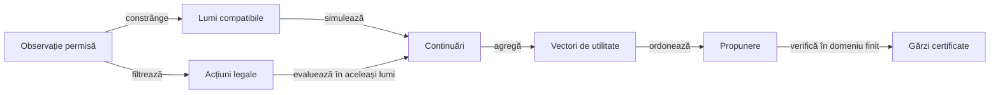
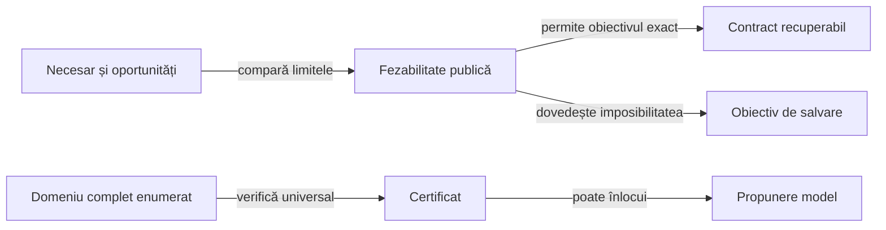

# Modelul deciziei cu informație parțială

Modelul transformă observația permisă într-o acțiune legală, evaluată față de obiectivul contractului. Separarea observației, lumilor ipotetice, continuării și criteriului de alegere permite schimbarea unui mecanism fără confundarea lui cu celelalte.

## Contractul unei decizii



<details>
<summary>Legendă: separarea responsabilităților</summary>

Politica vede mâna proprie și prefixul public. Simulatorul poate construi mâini ipotetice, iar o gardă poate enumera un domeniu finit; aceste operații nu introduc mâinile adverse reale în observație.

</details>

## Starea care schimbă decizia

| Variabilă | Definiție | Rol |
|---|---|---|
| Necesar individual nᵢ | contractᵢ − levate câștigateᵢ | Arată dacă actorul mai caută levate, este la țintă sau a depășit contractul. |
| Oportunități R | (cărți rămase în mâini + cărți pe masa curentă) / jucători | Numără o singură dată levata neterminată. |
| Dezechilibru Δ | suma necesarelor − R | După licitare rămâne constant în aceeași mână. |
| Densitate nᵢ/R | Necesar raportat la oportunități | Exprimă urgența individuală; nu este o probabilitate. |
| Progres | 1 − R / mărimea inițială | Măsoară consumarea mâinii, separat de numărul mâinii în partidă. |
| Memorie publică | Cărți jucate, masă curentă și carte întoarsă | Restrânge pool-ul necunoscut și lipsele de culoare compatibile. |
| Scor și serie | Totaluri și contoare publice | Schimbă utilitatea rezultatului prin regulile de scor configurate. |

Aceeași valoare Δ poate coexista cu necesare individuale foarte diferite. Pe măsură ce jocul avansează, R, incertitudinea și posibilitățile legale se schimbă, chiar dacă Δ rămâne fix.

## Estimarea alternativelor

Pentru fiecare acțiune, motorul compară continuările pe aceleași lumi generate. Vectorul terminal conține punctele proprii, scorul rivalului principal, indicatorul contractului exact și numărul contractelor adverse ratate.

```text
estimare(acțiune) =
  suma_lumilor pondere(lume) × utilitate(continuare)
  / suma_lumilor pondere(lume)

utilitate_mixtă =
  (1 − α) × utilitate_rollout
  + α × utilitate_căutare_pe_lume
```

- În politica Hard acceptată, lumile generate au aceeași pondere de agregare; samplerul nu este dovedit uniform peste toate distribuirile fezabile.
- În finalurile eligibile, estimarea combină rollout-ul cu rezultatul căutării MaxN în lumea ipotetică; în afara domeniului mic se folosește rollout-ul.
- α este un parametru al estimatorului, cu valoarea și condiția de aplicare definite în [MonteCarloAi.evaluate](../../whist-lab-app/game-core/src/main/java/ro/whistlab/core/ai/engine/MonteCarloAi.java).
- Căutarea completă într-o lume ipotetică nu dovedește optimalitate pentru jucătorul care nu cunoaște acea lume.
- Media indicatorului exact este o estimare dependentă de sampler și de continuare, fără garanție de calibrare față de adversarii reali.

## Prioritatea obiectivelor

Ordinea de mai jos privește profilul românesc; celelalte variante folosesc utilitatea și regulile lor declarate.

| Politică și fază | Ordine de alegere |
|---|---|
| Normal, licitare | Estimarea mâinii proprii, proiectată pe licitațiile legale. |
| Normal, joc | Urmărirea necesarului prin rang și situația curentă; evitarea levatelor după țintă. |
| Hard românesc, licitare | Șansa estimată a contractului exact, punctele proprii, apoi licitația mai mică la egalitate. |
| Hard, contract recuperabil | Șansa estimată a exactului, punctele proprii, apoi reducerea scorului rivalului principal. |
| Hard, imposibilitate dovedită public | Punctele proprii estimate, ratările adverse estimate, apoi scorul rivalului principal. |
| Jucător independent | Punctele proprii; la carte, scorul rivalului principal departajează egalitatea. |

Ordinea lexicografică înseamnă că un criteriu ulterior nu compensează o pierdere în criteriul anterior. Schimbarea priorității la imposibilitatea contractului este o regulă de stare, cu gărzi publice explicite.

## Fezabilitate și certificate



<details>
<summary>Legendă: limitele garanției</summary>

Lipsa unui certificat păstrează fallback-ul și nu dovedește că alternativa este greșită. O enumerare incompletă sau un buget epuizat nu poate certifica o decizie.

</details>

[ContractGuarantee](../../whist-lab-app/game-core/src/main/java/ro/whistlab/core/ai/engine/ContractGuarantee.java) cere realizarea contractului pentru fiecare lume fezabilă și toate continuările legale din domeniul permis, inclusiv alegerile proprii ulterioare. Aceasta este o proprietate universală conservatoare a acțiunii inițiale.

[PublicSalvage](../../whist-lab-app/game-core/src/main/java/ro/whistlab/core/ai/engine/PublicSalvage.java) compară limitele candidatului cu cele ale propunerii de bază. În fiecare lume, minimul punctelor proprii și al ratărilor adverse ale candidatului trebuie să fie cel puțin maximul corespunzător al bazei; cel puțin o inegalitate este strictă într-o lume.

## Reproductibilitate și limite

- Aceeași observație completă și aceeași implementare produc aceeași decizie.
- Seed-ul intern depinde și de scorurile publice absolute; invarianta la translația comună a scorurilor nu este un contract al implementării curente.
- Licitațiile necunoscute din simulare sunt estimări, iar cele deja publice rămân ținte obligatorii.
- O carte forțată de legalitate nu dovedește intenția actorului.
- Bugetul de simulare controlează costul și incertitudinea estimatorului; mărirea lui nu demonstrează singură progres strategic.

[Configurarea regulilor și ponderilor](ATF_RulesConfiguration.md) · [Proiectarea testelor](../testing/ATF_AiComponents.md) · [Arhitectura învățării](README.md)
