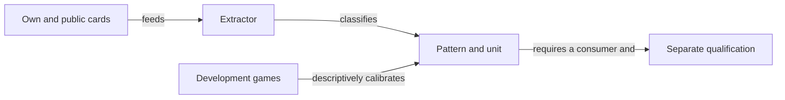

# Honors, covers and contract safety

A holding provides hints conditioned on legality, remaining need and public information. [Game rules](../game/ATF_RulesEn.md) define legal actions; the catalog describes holdings with no direct runtime influence.

## From observation to hint



<details>
<summary>Legend: description, measurement and activation</summary>

The [extractor](../../whist-lab-app/ai-lab/tools/patterns/whist-hand-patterns.mjs) identifies ranks, covers and higher cards still unseen. The [calibrator](../../whist-lab-app/ai-lab/tools/patterns/whist-heuristic-calibrate.mjs) measures outcomes from games already played by particular policies; neither operation activates a Hard rule.

</details>

## Hint units

`hint_scope` defines what `trick_hint` describes. Values with different units are neither additive nor interchangeable probabilities.

| Field or scope | Meaning and limitation |
|---|---|
| `HIGHEST_CARD_CAPTURE` | Indicator that the seat played its highest card of the suit in a trick it won. This does not count all tricks won through that suit. |
| `SUIT_TRICKS` | Number of tricks won by the seat through cards of that suit, separate from capture of its highest card. |
| Exact-contract rate | The whole-hand result for that seat; repeating it across categories does not create independent outcomes. |
| Support and weighting | Describe grouped observations and shrinkage towards the initial hint. They are neither calibrated win probabilities nor runtime coefficients. |

The [YAML catalog](../../config/whist-hand-patterns.yaml) remains `RESEARCH_CATALOG_NOT_RUNTIME_CONFIGURATION`. Overlapping patterns cannot give repeated credit to the same card.

## Interpretation rules

- **Honor promotion:** low covers may help consume higher ranks; lead, entries and ruffing can prevent a trick.
- **Sequences and length:** assess honors jointly; rank, card count and attainable suit tricks are different quantities.
- **Legal exit:** a side honor can be discarded when both the led suit and trump are absent; mandatory trump can force an unwanted trick.
- **Public memory:** turned cards, completed-trick cards and cards still on the table have different effects.
- **Objective:** individual remaining need and opportunities follow the [decision model](ATF_DecisionModel.md#starea-care-schimbă-decizia); aggregate auction imbalance does not replace them.

## Extractor input

| JSON field for `describe` | Contract |
|---|---|
| `hand` | Distinct own cards: rank `A`, `K`, `Q`, `J`, `10` or `2`–`9`, followed by `S`, `H`, `C` or `D`; within the reduced deck. |
| `trump` | `S`, `H`, `C`, `D` or `NT`. |
| `players` | Integer from 3 to 6; defaults to 4. |
| `handSize` | Declared initial size from 1 to 8; omission uses the supplied hand length. |
| `publicOut` | Public cards excluded from the unknown pool; defaults to an empty list and cannot intersect the own hand. |

The extractor checks these local card and parameter constraints. The caller owns observation consistency and the legal prefix; describing a holding does not validate an entire match.

From the repository root, with Node.js and an explicitly selected external input:

```powershell
$inputFile = Read-Host 'External JSON file containing the permitted observation'
node whist-lab-app/ai-lab/tools/patterns/whist-hand-patterns-cli.mjs describe $inputFile
```

## Descriptive calibration

The calibrator reads all JSON files under `games/development` in the supplied archive and validates rules and scoring first. It does not automatically resolve the active-corpus pointer; select the input and its cost explicitly.

1. Reject games from another partition and deduplicate repeated action traces.
2. Group observations by initial distribution, seat and suit; average policy variations within each unit first.
3. Aggregate the groups while retaining separate highest-card capture, suit tricks and exact-contract metrics; grouping does not prove statistical independence across categories.
4. Write the calibrated YAML, full context inventory, source hashes and comparison receipt into a new directory.

```powershell
$archive = Read-Host 'External archive for development calibration'
$output = Read-Host 'New external output directory; its parent must exist'
node whist-lab-app/ai-lab/tools/patterns/whist-heuristic-calibrate.mjs $archive $output
```

Observed frequencies depend on the generating policy and do not estimate an unplayed alternative action. Thresholds and support come from the catalog and implementation; generated files stay external with zero runtime influence.

## Verification and promotion

Components use constructed inputs for honors, distinct units, duplicates and cluster averaging:

```powershell
node --test whist-lab-app/ai-lab/tools/patterns/whist-hand-patterns.test.mjs whist-lab-app/ai-lab/tools/patterns/whist-heuristic-calibrate.test.mjs
```

The [configuration contract](ATF_RulesConfiguration.md) owns the consumer and activation domain; the [offline protocol](../learning/README.md) owns promotion. Hints, simulation estimates and finite certificates provide different levels of guarantee.

[Ghid în română](ATF_HandPatternsRo.md) · [Contextual play](ATF_ContextualPlay.md) · [Corpus integrity](../learning/ATF_Corpus.md)
